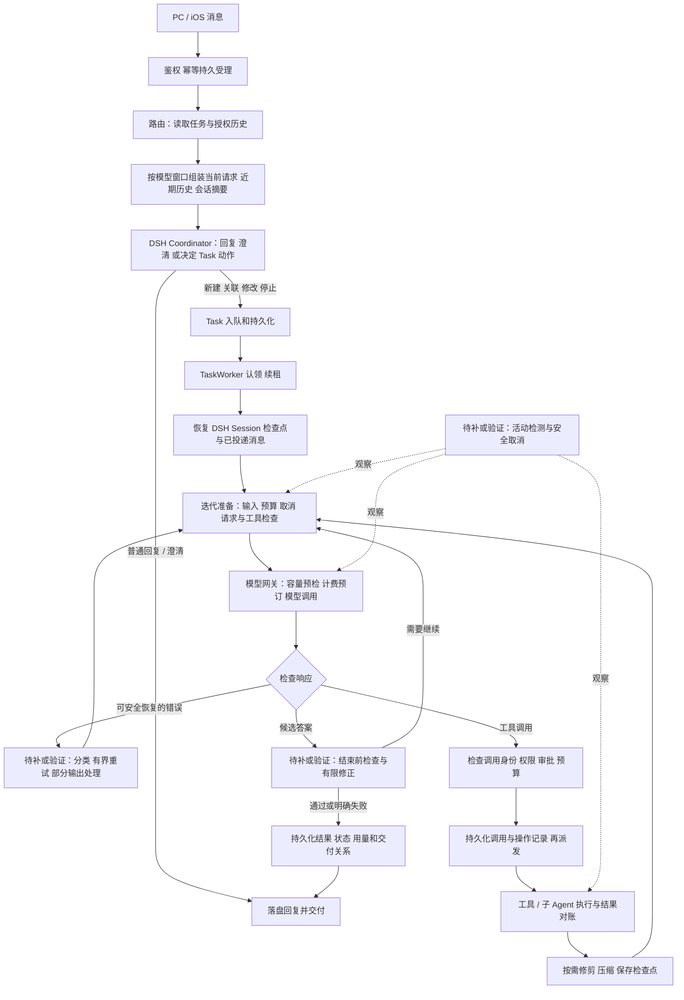

# Hermes 对话机制移植与 Morde Harness 设计

- 更新：2026-11-22
- 状态：对照评估与目标设计；各项当前状态见下表，未标“已有”的部分不能视为已实现
- 对照输入：用户提供的 2026-11-21 原设计稿，以及 Morde 当前工作区代码
- 范围：PC/iOS 对话、路由、Task、DSH 执行、长上下文、失败恢复与交付

## 1. 结论

**目前没有证据证明上一版方案是最优解。** 上一版把 Hermes 的迭代准备、错误恢复、卡死检测、结束前检查等内容概括得过于简单，也没有逐项证明 DSH 或 Morde 已覆盖；本版恢复逐环节对照，并将需要实现或验证的行为放回目标流程。

建议充分移植 Hermes 对话机制的**可观察行为和失败处理**：持久受理、会话冲突处理、上下文整理、迭代准备、受控重试、工具执行前记录、进度检测、压缩和结束前验证。Morde 的入口与多租户能力落在 Go/PostgreSQL，Agent 循环保留 DSH。具体代码可以适配和移植，但必须保留上游许可证，并先检查 DSH 插件与当前版本是否兼容。

这个设计是待验证的候选方案。“最优”需要在相同场景下比较成功率、误操作和重复执行、恢复能力、延迟与成本；当前尚缺真实 Provider、长时间运行和 PC/iOS 验收证据。

## 2. 目标流程

下图是**目标设计**：部分环节已有实现，带“待补/验证”的环节不能理解为已完成。

两层上下文分别负责不同范围：

- **跨 Task 会话摘要**：路由用摘要、近期历史和当前消息理解新请求；原文可按权限检索。
- **DSH Session 内压缩**：任务执行期间处理该 Session 的模型上下文、工具结果和检查点；不能替代跨 Task 的会话摘要。

## 3. Hermes 19 个环节逐项对照

状态含义：**已有**表示代码中找到对应基础，不代表完整等价或通过端到端验收；**部分**表示已有基础但尚缺行为对照；**待补/验证**表示不能从本次核对证明已经覆盖；**形态适配**表示按 Morde 的 PC/iOS 与服务端形态实现。

| # | Hermes 环节 | Morde 当前证据与差距 | 目标决定 |
|---|---|---|---|
| 1 | 入口和消息分流 | Portal 与会话路由已有消息、Task 和权限处理 | **已有基础**。继续先鉴权、幂等保存，再路由；客户端断线不撤销受理。 |
| 2 | Slash 命令分流 | Hermes 的 CLI 命令不对应 PC/iOS 的普通聊天入口 | **形态适配**。保留状态、停止和修改等用户意图，不为复制 CLI 新增命令体系。 |
| 3 | Skill 注入 | DSH 有 system prompt 和插件机制；本次未证明与 Hermes 注入顺序等价 | **待验证**。对照授权 Skill 的发现、选择和注入；写入 Skill 仍遵循用户授权。 |
| 4 | Turn 入口与中断 | Task/Runtime 有取消和检查点机制 | **部分**。定义消息受理、执行中取消、状态落盘和客户端重连的可观察结果，覆盖边界时刻。 |
| 5 | Agent 创建与恢复 | Runtime 创建或恢复 DSH Agent 和 Session；绑定会话、代次、授权身份 | **已有基础**。保留 DSH 创建/恢复；测试身份变化、授权撤销和检查点损坏。 |
| 6 | 线程与运行方式 | Hermes 使用其进程/线程模型；Morde 使用 Worker 和独立 DSH 执行上下文 | **形态适配**。保留可取消和可恢复语义，不复制 Python 线程结构。 |
| 7 | 会话租约与 early result | Morde 已持久化消息、Task 租约和摘要操作租约；不能推断它们等价于 Hermes 的 turn lease | **部分**。同一可变 DSH Session 的冲突必须有跨进程保护；冲突时已受理消息保持可见并显示排队/处理中，不伪称执行完成。先验证现有 session 写入栅栏，缺哪层补哪层。 |
| 8 | 活动检测与看门狗 | TaskWorker 续租只说明持有者仍在续租；Runtime 的 idle/running 状态也不等于工具或模型确实有进展 | **待补/验证**。按第 4 节设计活动信号、等待状态和安全取消；不能仅凭固定 600 秒杀任务。 |
| 9 | Turn 外层包装 | Morde 有消息路由、Task 和模型网关；与 Hermes 外层重试/结算顺序尚未逐项对照 | **部分**。明确执行边界、取消传播、结果及失败落盘；跨重试对账用已有消息/调用 ID。 |
| 10 | Turn setup | DSH 创建/恢复 Session，Morde 保存检查点和用户消息 | **部分**。验证恢复身份→装配授权工具与上下文→处理待投递消息→检查容量的顺序和失败回滚。不要机械照搬 Hermes 的 SQLite 建行顺序。 |
| 11 | System prompt 构建 | DSH 有 SystemPrompt 和 Session request header | **部分**。对照稳定指令、项目上下文、Skill/日期的更新和恢复；测模型/授权/工具变化后的正确性及缓存，而不是承诺永不变化。 |
| 12 | 主循环 phase | Morde 注册 DSH AgentLoop；已安装的 DSH 提供 pre-step、request-error、turn-stopping 等扩展点 | **已有基础，等价待验证**。保留 DSH 循环，通过兼容插件/扩展点补 Hermes 行为，不再建第二个循环。 |
| 13 | 迭代准备 | 当前 Runtime 已接通受限 `steer()`、`followup()` 和检查点；其余准备动作未证明覆盖 | **部分**。逐项核对新消息领取、取消、预算提醒、工具参数和消息序列修复；不能把 8 项清单直接写成已完成。 |
| 14 | API 请求组装与预检 | 路由按模型容量裁剪历史；DSH 有请求组装 | **部分**。覆盖当前输入、系统提示、工具 schema、输出预留、角色/工具配对及 Provider 上下文溢出；保留原文和来源。 |
| 15 | 模型调用 | 模型经 Morde 网关；已有调用预订、结算及 unknown 状态，当前单次调用上限 45 秒 | **部分**。按模型测量 45 秒是否过短；设计总时限、空闲时限和取消传播，修改前验证账本与流式恢复。 |
| 16 | 响应检查、错误和空响应 | 网关有响应校验；无效路由输出仍进入 `routing_action_unavailable`。DSH 有 `agent/request-error` 钩子，但 Morde 当前插件清单未证明有完整 Hermes 恢复梯子 | **待补/验证**。实现受限结构化重试、错误分类、空/截断响应和部分输出处理；不把前一轮答案冒充当前结果。 |
| 17 | 工具轮 | DSH 有 `tools/pre-execute`；Morde Broker 校验工具并在派发前建立操作记录，支持对账与 unknown | **部分**。验证调用/结果配对、审批、并发顺序、崩溃恢复；按调用 ID 和操作账本处理重放，不按相同参数盲目去重。 |
| 18 | Stop gates | DSH 有 `agent/turn-stopping` 扩展点；Morde 已有独立 Task validation review Worker，但不能据此认定它同步阻止交付 | **待补/验证**。设计有预算的结束前检查；先确认 DSH 钩子的实际投递与阻断语义，以及现有验证 Worker 的时序。 |
| 19 | Turn finalizer | DSH 记录 `turn/end`，Morde 有检查点、结果事件和模型账本 | **部分**。验证状态、回复、用量、检查点及交付关联的提交顺序；失败和结果未知不得显示成功，重连不能重复交付。 |

主要代码依据：[路由 Worker](../server/internal/worker/conversation_route_worker.go#L143)、[无效输出处理](../server/internal/worker/conversation_route_worker.go#L243)、[DSH 插件注册](../runtime/morde-cloud-runtime/src/engine.mjs#L1286)、[消息投递](../runtime/morde-cloud-runtime/src/engine.mjs#L1696)、[Broker 操作记录](../server/internal/app/cloud_dsh_tool_broker.go#L1095)、[结果验证 Worker](../server/internal/worker/task_validation_review_worker.go#L40)、[模型调用超时](../server/internal/app/model_client.go#L12)。

## 4. 需要补回的具体机制

### 4.1 安全的失败恢复

- **路由无效输出**：先验证结构；可在预算内进行有限次结构化修正请求，修正结果重新走原有动作与授权校验。仍无法确定时返回具体澄清或明确失败，不按关键词擅自新建、修改或停止任务。
- **模型错误**：区分可重试的限流/暂时错误、上下文溢出、认证/授权失败、用户取消和账本状态未知。仅在请求状态及计费可安全对账时重试，并设置次数、退避和总预算；模型切换只能使用用户已授权的配置。
- **已有流式输出**：保留用户已看到的内容及其状态。恢复时显式衔接，不静默重放已展示内容；空响应或截断不能借用上一轮答案伪装成功。
- **工具重试**：有副作用的调用先查 operation ledger；结果未知时暂停并说明，不能自动重复执行。相同参数的两次不同调用可能都是用户需要的，不能直接“first wins”。

### 4.2 活动与安全取消

1. 定义模型流、工具派发与完成、子 Agent 状态、检查点等有效进展，以及等待审批、等待外部任务等非异常等待。
2. 对各阶段设置可调整的等待上限；Hermes 的 600 秒可以作为实验参考，不直接当作通用判死条件。
3. 疑似卡死先记录等待阶段和证据；取消前重新核对 Task/Session 身份、租约代次与最后活动时间，防止旧观察误杀已恢复工作。
4. 协作取消后等待执行器结束；工具结果仍未知时进入对账或等待状态，不声称失败前操作一定没有发生。

### 4.3 结束前检查与预算

- 针对需要交付或执行工具的 Task，在可用预算内检查用户要求、工具结果和必要的产物证据；需要修正时可有界地继续执行，预算耗尽则如实交付已知部分与未完成事项。
- 先核对 DSH `agent/turn-stopping` 能否承载所需继续/阻断，及现有独立 Task review Worker 发生在交付之前还是之后；无法证明时不得宣称已实现 stop gate。
- Morde 已有工具次数与模型使用预算。需对照 Hermes 迭代预算、预警和收尾行为，避免反复调用或无进展循环；不以任意超时替代预算。

### 4.4 跨任务交互与上下文

- 受限、低风险的补充走已接入的 `steer`；较大的计划、授权或目标变更走现有受控修改路径。消息先持久化，只有 Agent 实际领取并确认后才显示对应状态。
- 跨 Task 摘要维护版本、来源证明和不完整标记；DSH Session 内由 TokenMeter、工具结果修剪和 compaction 处理。摘要失败保留原始记录，模型需要精确旧事实时检索授权原文。
- 单条当前输入超过模型预算时需明确限制。受理之前超过接口上限的输入应拒绝；已经受理的内容应保留，不能悄悄截断并声称完整处理。

## 5. 原设计中的横切功能

| 原设计内容 | 决定与依据 |
|---|---|
| 审批与成本 | 保留现有授权、审批、模型调用账本和预算预订；补审批时展示/对账需求须核对数据来源。Hermes smart guardian 可研究为辅助解释，不能自动绕开 Morde 的人类审批与授权。 |
| Prompt cache 与固定工具 | 按 Provider 能力测量和验证重放一致性；权限或工具集合变化时安全更新，不能为了缓存冻结已撤销的权限。 |
| 流式与事件 | 测试单写者、部分输出、中断后重连和结果绑定；复用现有事件与账本，是否需要新字段先核对契约。 |
| Skill 与记忆 | 研究 Hermes 的发现、注入和整理策略；写入或跨会话读取仍受现有用户/项目授权，不默认开放可写。 |
| 可观测与评测 | 先复用 Zap、Prometheus、事件和模型账本，覆盖阶段、失败类型、耗时、摘要和重试次数，避免日志泄露内容。服务器约定要求引入 OpenTelemetry SDK 前先完成架构决策。原稿中的 Phoenix/44 条套件数量不是当前已接通的证明。 |

## 6. DSH 插件候选

当前 `runtime/morde-cloud-runtime/package.json` 固定 DSH `0.2.2-rc.1`；本次核对的本地上游 DSH 源码为提交 `fcc0ad462172522aaf5c93a7b2e01f6b9f0b0159`。

- `dsh-repeat-tool-reminder`：本地上游包版本同为 `0.2.2-rc.1`，MIT；用于对连续相同工具调用做**提醒**，只匹配完全相同参数，不会阻止调用，恢复后计数从头开始。Morde 当前插件列表未注册，不能当作已经接通；先验证依赖、授权/检查点和多 Agent 隔离，再决定引入。
- `dsh-tool-call-timeout-policy`：本地上游包版本同为 `0.2.2-rc.1`，MIT；按工具声明的时限发出协作取消，忽略取消的工具仍可能继续运行，不能当成强制终止或活动看门狗。Morde 当前插件列表未注册；需先验证 Provider/工具取消和副作用对账。
- DSH `agent/request-error` 与 `agent/turn-stopping` 是扩展点，不等于已经有 Hermes 的重试梯子和 stop gate。新增插件前须确认包依赖与当前实际安装版本兼容，并通过任务隔离、审批、取消和恢复测试。

## 7. 推进与验收

| 顺序 | 先处理什么 | 最低验收 |
|---|---|---|
| P0 | 固定对照样本，先重现无效路由、长输入/历史、超时和空响应；补安全的路由恢复 | 无效输出不能触发错误 Task；消息不丢；仍不确定时明确澄清或失败。 |
| P0 | 任务活动、租约和副作用边界 | 有进展的长任务不误杀；真正卡死后可取消；旧代次不能停止新执行；结果未知不自动重放。 |
| P1 | 迭代准备、请求规范、模型错误/流式恢复 | 同一输入比较 Hermes 与 Morde 的用户消息、工具配对和终态；部分输出不重复，重试与账本一致。 |
| P1 | 结束前检查与工具轮 | 有界验证；审批不绕过；工具调用先记录再派发，崩溃后安全对账，独立 Task 不互相取消。 |
| P1 | 跨 Task 摘要与 DSH Session 内压缩 | 多次压缩后可查早期约束和原文；摘要失败不覆盖旧状态；权限与会话不串线。 |
| P2 | Prompt cache、Skill/记忆和可观测扩展 | 按授权与 Provider 差异逐项对照；用量、延迟与失败原因可定位，不能以缓存命中牺牲权限正确性。 |

每项验收需记录：输入与模型/窗口、Hermes 基线版本、Morde 版本、预期行为、实际状态、消息/Task/操作 ID、恢复及副作用结果。数小时长跑需记录进度、资源、取消和中断恢复，不以短时间单测替代。

已有可执行长上下文用例见[长会话测试方案](design/Morde-AI对话长会话测试方案.md)。PC 交互须在实际 `morde-pc` 验收，跨端场景再用 iOS 验证。

## 8. 本次核对与验证记录

- 当前工作区代码中，服务端可将合适的低风险补充标记为 `steer`，Runtime 调用 `agent.steer()`；这纠正了旧设计中“当前仅用 followup”的表述。实际 PC/iOS 端到端仍需验收。
- 本次运行服务端 steer 路由与安全校验定向测试通过；Runtime 三项定向测试（丢失确认后重放 steer、领取后重启不重复领取、工具中断后对账）通过。
- 2026-11-21 记录：Runtime 152/152、Go app/worker、隔离 PostgreSQL 长历史及重启 E2E、40 轮多次压缩用例通过。上述历史记录不等于本次重新运行。
- 尚未完成 Hermes 与 Morde 的同样例逐项差分，也未完成真实 Provider、数小时任务和实际 PC/iOS 的验收，不能宣布最优或全量移植完成。

Hermes 参考：[迭代准备](https://github.com/NousResearch/hermes-agent/blob/0d49d6d9d20e461155d49ba9d188687079c811af/agent/turn_iteration_prep.py)、[活动看门狗](https://github.com/NousResearch/hermes-agent/blob/0d49d6d9d20e461155d49ba9d188687079c811af/agent/turn_liveness.py)、[结束前检查](https://github.com/NousResearch/hermes-agent/blob/0d49d6d9d20e461155d49ba9d188687079c811af/agent/turn_stop_gates.py)。本地 Hermes 源码副本没有独立 Git 元数据，不能把它等同于上述固定提交；精确搬运前应核对源码版本与许可证。
