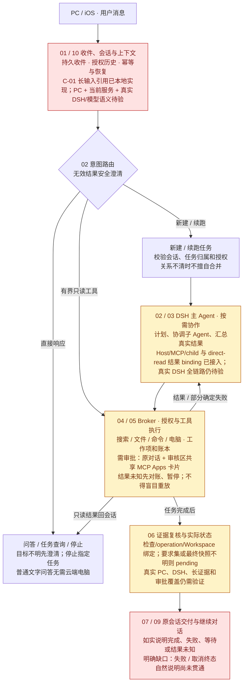
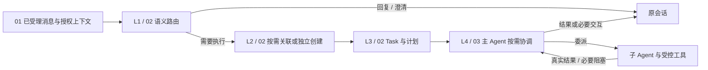
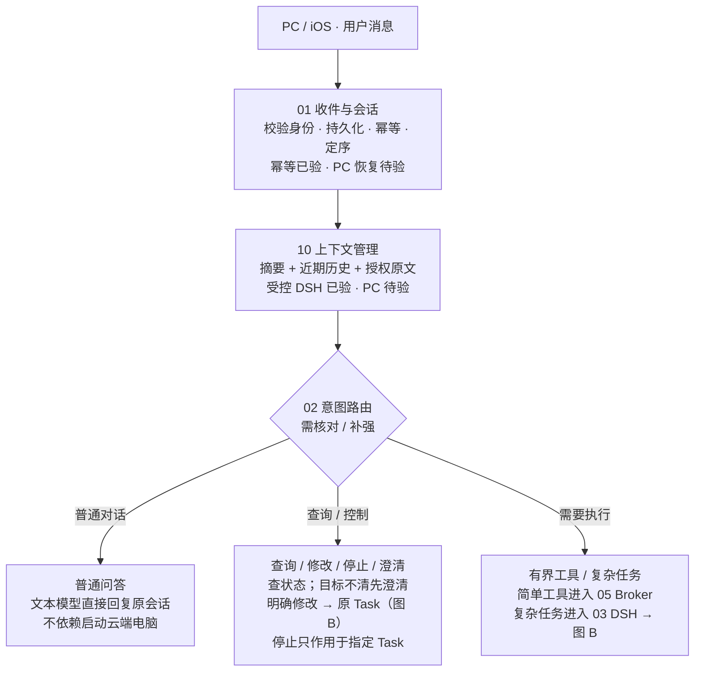
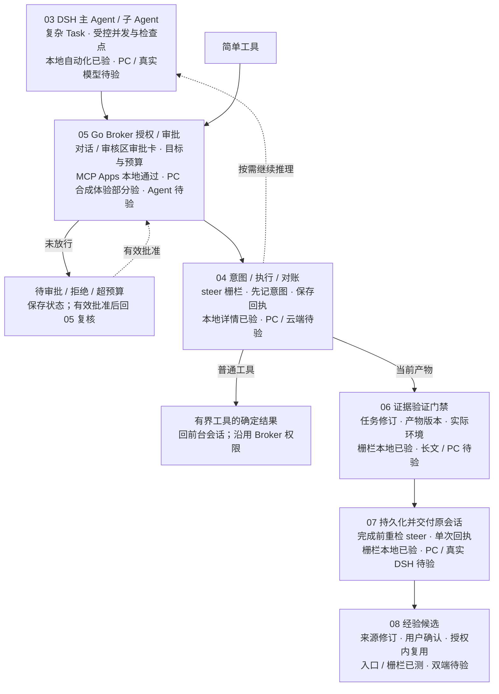

MORDE HARNESS · MUSE 对照设计

# Morde 复刻 Muse：最终流程与开发设计

> 本文是 Morde Harness 的目标流程与开发设计入口，包含 11 个步骤及三张 Mermaid 流程图。现状以实施方案、分步记录和实际代码的最新证据为准；文中保留的历史状态若与较新合并修正冲突，以较新的证据和当前代码为准。

把 Muse 的 11 个步骤映射到 Morde 的 PC、iOS、服务端和 DSH 执行链路。图中步骤对应下文开发设计。

原目标图核对基线：Morde 本地 HEAD `a616e01a`；本地 DSH 源码 `fcc0ad4621`，包版本与 Morde 锁文件均为 `0.2.2-rc.1`。2026-11-25 新增现状对照使用的基线见下文；线上运行版本需另查。

**2026-11-25 SIT 再合并修正：**影响图仅提供候选信息，不证明测试覆盖；不再以不可达或旧影响图阻塞完成，Host 任务的 E07 与独立 H07 继续保留，Hostless 的 E07 例外待解决，修复任务缺少覆盖证据时 H07 为 pending。模型摘要、复核与任务不再对已派发 unknown 作同 ID 伪重试；明确未派发的本地并发预留限制可有界重试，Provider 的 Retry-After 保留。Provider 安全自动恢复、验证 FAIL 原因交给主 Agent、失败/取消终态 outbox 与 R19-A 尚未完成；C-01 已在本地接通超过 128 KiB 的 receipt-backed 初始及运行中长消息引用投递，PC/当前服务/真实 DSH 与模型语义验收仍待完成。源码 PC + 本地合成服务的 unknown 场景仅确认任务等待核对，原对话仍缺中断说明；真实 DSH 与跨端未验。

**这是基于 Muse 资料的目标设计，不是上线或验收结论。**原目标设计参考本目录的逆向材料与 `project/` 下的开源源码；本次现状对照另参考用户提供的两份方案，并用 Morde 当前源码判断已有能力和需要改动的入口。蓝色表示代码中已有基础，橙色表示需对照完善，红色表示源码核对出的具体差距；代码存在不等于端到端通过。

**2026-11-25 此前实施快照，局部完成、端到端待验：**会话路由现由 Agent 结构化动作决定语义，分类不可用或无效时安全澄清；应用与存储只执行身份、授权、候选、状态、修订、范围与幂等门禁。文件交付意图已进入路由模型结构化决策及修订读取。服务端全量 Go 测试 40 个测试包通过，app/worker race 通过；独立 loopback PostgreSQL 路由组 4 个顶层用例、13 个子用例通过。全量 Go 测试未设置 `CH_TEST_DATABASE_URL`，不含条件数据库集成。Portal 全量 893/893、Assistant 239/239、定向 191/191、类型检查及 PC build 通过。当前实际 PC 启动后恢复到已有主会话，本轮未操作消息或任务，不计交互验收；此前本地合成审批布局验收为独立历史证据。直接 Task、澄清和计划入口仍调用文件意图文本分类器；Broker 已拒绝缺失或非法的持久意图，不再回推。真实 PC + DSH/模型语义、停止最终状态、R20 Agent-first 失败终态说明和长文真实模型验收仍阻塞。此轮未访问远端、不使用会话提供的密钥、未改远端或外发文件。

**本轮补充：**待答澄清已改为紧跟用户消息的左侧独立 Morde 行，并复用既有问题 ID/版本/答案/幂等 API；撤权失败显示在卡片中，任务动态保留只读问题。R24 工作项优先显示已记录的结构化失败原因，不被通用失败摘要覆盖；后端确定失败码 tool_execution_failed 已同步到 OpenAPI、生成类型和中文说明。确定失败的只读工具可作为结构化结果回到同一 DSH Session；普通 Go 执行错误继续记为 unknown 并停止，新增回归确认不会重试或完成 Task。Assistant 238/238、Assistant + TaskApprovalCard 联合回归 244/244、MCP App 组件 8/8；本轮最新三文件联合回归 246/246，Assistant ESLint、Portal 类型检查与 PC build 通过。Worker 失败边界定向回归及 app/worker 完整 Go 包通过；DSH Runtime 全量回归现为 244/244。它们是本地自动化/fixture 证据；本轮未操作实际 PC，真实 DSH/模型恢复和终态交付仍未验收。

**R19-A 语义合同审计：**Task、batch 与 schedule 的结构化文件交付字段已接入 API/OpenAPI、服务和 Store。新建 Task/schedule 缺省为 `none`，update 省略时继承现值；schedule 当前无 Workspace，只接受 `none`，并在服务层拒绝 `required` / `unclear`。迁移 `00243` / `00245` 持久化字段，schedule occurrence Task 与个人同步快照沿用该值；DSH schedule 工具也传递结构化字段。通用 `normalizeNewTask` 不再按 Objective 文本分类。个人 route `new/required` 已绑定 receipt Workspace input snapshot；route update `unclear` 澄清、计划及 Broker/admission 原子接线和真实 PC/DSH 验收仍待完成。任务含义由 Agent 判断；身份、授权、Host/Workspace、预算、状态/修订、幂等及 unknown 对账继续由代码强制。

**R12 Runtime 提醒与超时边界（2026-11-25）：**现已接入 DSH 上游锁定版本的 `repeat-tool-reminder` advisory guard；连续三次完全相同的调用后向 Agent 注入来源可追溯提醒，但不拦截已授权工具。Runtime 全量测试 244/244 通过。本地 `timeout-policy` 插件要求工具合作处理 AbortSignal，现有 Morde IPC 工具没有声明时限；tool/child 6 分钟只限制 IPC 等待并触发结果对账，不表示已派发操作停止。因此不接入通用“硬超时”，真正取消须跨层确认，未知结果不重放。一般 65+ Morde 工具集选择/恢复、强制超时/取消和实际 PC/真实模型验证仍未完成。

**R21 长输入现状与历史只读审计：**C-01 已在本地为 initial message、followup、steer 与 revision batch 接入 receipt-backed 有界 source reference；Worker 按连续前缀有界分批，Runtime 校验 marker，delivery-applied 回执和 checkpoint 沿用原文身份，授权 Broker 按页读取来源。loopback PostgreSQL 集成以 1 MiB+1 字节合成原文验证 Store receipt 与 `CloudDSHToolBroker.Execute` 连续分页重建并核对首/中/尾锚点；R21 PostgreSQL 定向组 4/4、app 定向组和 DSH Runtime 249/249 通过。这些是本地自动化/fixture 证据，不代表真实 PC/当前服务/DSH 链路或真实模型语义已通过。

**C-01 集成前历史只读审计（2026-11-25）：**当时源码审计发现 Task 首轮将完整 pending message 作为 `initial_message`，Worker 与 Runtime 的全文帧均限制 128 KiB；128 KiB–8 MiB 输入会在首轮失败。旧 delivery ledger 记录消息身份和投递阶段，checkpoint 按原文/附件/模式精确匹配，直接将同 message ID 换成短 prompt 可能导致恢复校验失败或结果 unknown。公共合同 v1 §4 已定义原文哈希、manifest 指针、表示摘要、delivery applied 与 checkpoint 恢复身份；上述“receipt/checkpoint 实现缺失”只描述 C-01 集成前状态。旧全文帧的 128 KiB+1 边界测试仍会拒绝原样传入的大正文，但当前系统通过 receipt-backed 引用投递长消息，不再受该旧边界等同限制。8 MiB 上传也不表示模型可处理 8 MiB；预算及模型窗口约束仍然有效。实际 PC 成功提交、真实 DSH/模型首中尾/全文语义及预算边界仍待验收。

**R21 初始消息边界回归：**Worker 与 Runtime 子进程两层回归验证 128 KiB UTF-8 正文的首/中/尾锚点进入合成模型请求，128 KiB+1 的多字节正文在模型/工具调用前拒绝。该组只验证旧全文帧边界，不单独证明 128 KiB 以上可用或真实模型理解；当前长文可用性由 C-01 receipt-backed 引用及分页读取实现，真实 PC/DSH 语义仍待验证。

**R07 审批历史事实审计（2026-11-25）：**现有审批表可证明已记录请求的决定，但不能证明所有需要审批的副作用都生成了请求；部分副作用账本也没有审批绑定。缺少可核对的操作分类和逐调用绑定前，验证状态必须保持 pending/unknown，不能通过只扫描已有批准记录推断完整覆盖。

**D-01 当前状态（2026-11-25）：**安全失败回送、R20 source consumer/预算 ModelGateway/原会话发布和 typed H07 check receipt 已有本地实现及定向 App/Worker/PostgreSQL 回归。review settled 后已加入最终 Workspace manifest reader 和 Runtime 发布围栏；Runtime export、shell receipt v2 与 final proof 现共用 `morde-task-workspace-snapshot-v1` 摘要，组件级回归通过，真实 DSH Host→Portal 对账仍待验。要求清单完整性和实际 coverage 也无独立可信证明，因此修复任务 verdict 继续 pending。真实 PC/DSH 没有通过交付验收。详见[D-01 交接与验证](<五会话并发实施/会话D-01-失败恢复与验证事实.md>)及[验证记录](../../验证记录/Morde_Harness_最终流程测试用例.md)。

**R24 工作区搜索展示补充（2026-11-25）：**`morde_workspace_search` 工作项现在以“搜索工作区文件”呈现，展开显示实际记录的查询与结果摘要，不编造来源 URL 或命中数量。Assistant 239/239、Portal 全量 68 个测试文件 893/893、目标 ESLint、类型检查和 PC build 通过；当时全量 lint 仍有其他组件/路由诊断，随后已修复并通过全量 lint。该证据仅证明 Portal 字段呈现，尚未在实际 PC + 真实 DSH 验证搜索调用与账本一致性。

**R02 路由结算校验（2026-11-25）：**修复结构化 `tool` 决策在 PostgreSQL 模型调用结算时被拒绝的问题。存储层仅接受经过现有上下文与参数白名单验证的只读网页搜索/读取决策，并拒绝额外字段；结算校验不再用正文词表否决 `ExplicitNew`，语义仍来自结构化路由字段。存储决策与 app/worker 定向回归通过；新建 loopback 临时 PostgreSQL 上受控模型调用、结算和路由应用集成回归 1/1 通过。模型为 fixture，实际 PC/真实模型语义仍未验收。

**R01 结算异常预算保护（2026-11-25）：**Task 模型响应已收到、已知用量结算写入失败时，ModelGateway 现在尽力按原调用身份保存 `unknown`；补偿写入也失败则保留原 dispatched reservation。另有 Task 绑定 PostgreSQL 回归证明 settled ledger、Task 用量和账户预算不被后续 unknown 覆盖。真实 DeepSeek Gateway 长输入与历史路由语义也已通过，但真实 Task 预算耗尽根因、PC 和完整 DSH Task 闭环仍未验收，R01 不关闭。

**R19/R11 真实模型路由修正（2026-11-25）：**首次真实 DeepSeek 测试显示：完整 51,842 字节档案首轮可正确回答首/中/尾锚点，但针对被省略中段记录的追问错误要求用户重发。修复仅强化路由模型提示：在历史不完整且答案依赖缺失消息时选择授权历史检索 Task，不增加文本关键词或 parser 强制分支；修复后 Gateway live test 处理首轮 18,502 tokens 和完整历史续问 18,575 tokens，返回锚点/中段内容正确，截断历史追问选择 `new`；历史仍不完整时，自包含的 1+1 问题仍选择有正文的 `reply`。这组 Gateway 结果不证明 Task Agent 实际调用历史工具或 PC 对话交付；长初始消息的 receipt-backed 投递另有 C-01 本地自动化证据，真实 PC/DSH/模型语义仍待验。

**2026-11-25 当前复验状态：**Portal Assistant UI 自动化 239/239、Portal 全量 68 个测试文件 893/893，TypeScript 检查和全量 lint 通过；PersonalData、Reviews、FloatingError 三组受影响测试 48/48 通过。DSH Runtime 最新全量 249/249。DB 定向组 8 个顶层测试、15 个子场景通过。`make test` 与 `make race` 均通过，但均未设置 `CH_TEST_DATABASE_URL`，其中的条件 PostgreSQL 测试均跳过；完整隔离 loopback `make it` 通过，PostgreSQL 包耗时 1166.815 秒，OpenSandbox 因未配置专用环境而跳过。C-01 app 定向组及 R21 receipt-backed Broker + PostgreSQL 连续读取集成组本轮通过（PostgreSQL 4/4）；完整 app 包仍有非 C01 Task Plan 元数据及审批断言失败。隔离源码 `morde-pc` 已显示 131,073 字节合成消息持久化，但助手只返回有界预览；测试机 Portal 未部署本地 C01 代码，因此实际 PC + 本轮服务端/DSH 仍未验收。R20 durable 终态合同仍阻塞，R21 本地实现已落地但产品端验收未完成。以上是本地自动化与隔离环境证据，不代表 Muse 内部机制已知，也不代表端到端目标已完成。

**2026-11-25 T51/R03 局部回归补充：**Assistant 新增的气泡无默认 meta/status 和仅一个底部 thinking 行两条测试通过（2 项、237 项跳过），typecheck 与 Assistant ESLint 通过；没有生产 UI 改动或实际 PC 手工 UI 验收。Worker child handoff/recovery 8 项定向回归通过，最新执行未设置 `CH_TEST_DATABASE_URL`，其中 nested failure PostgreSQL 子场景跳过；此前 PostgreSQL 3/3 子场景是独立历史证据。child failure handoff 只读审查未发现可明确修复的缺陷。真实模型与 PC 交互仍待验，T51/R03 不关闭。

**2026-11-25 实际 PC 本地合成审批复验：**修正过期的 browser-acceptance 固定模型提示词匹配后，`TestConversationBrowserAcceptance` 的 approval 场景在一次性 loopback PostgreSQL 通过。源码 `make pc` 对话可访问性树在 Morde 助手消息下找到待批 MCP App，审核页读到同一 pending 审批；fixture 证明 Task 为 `waiting_user / approval_required`，未允许或拒绝。Electron 截图因系统 Screen Recording 权限失败，故没有当前截图来核实像素级左对齐。该结果仅是本地合成服务 + 实际 PC 客户端入口验证，不证明真实 DSH/模型或副作用；R22/T52 部分通过，真实端到端仍未验。

**R09 个人数据页补充（源码回归，PC 待验）：**全局侧栏继续只放常用个人数据入口；动态、灵感和偏好改由个人数据页内的分类链接进入，避免页面路由存在但用户无入口。明确可重试的个人数据读取、同步和额度错误以内联按钮恢复，不改变通用错误覆盖层不提供重试的约定。Portal 定向组件回归 38/38、类型检查通过；一次性 PostgreSQL 16 上的记忆历史/撤权/删除/规则候选回归 11/11，domain/app/api 对应筛选测试通过。实际 PC 交互、Markdown 视图/索引、记忆语义和跨端仍未验收。

**2026-11-24 对话交互修正（代码已改、未验收）：**PC 任务停止按钮已移除；后端路由新增直接明确的全部停止意图识别与用户活动任务取消请求。Assistant/Projects 对话分别聚合单个底部思考提示，Assistant 气泡默认隐藏状态/确认脚注并在悬停时显示回复时间和复制。自动化、类型检查及实际 morde-pc 交互本轮未运行；流程图记录的是目标要求，不表示实现已验收。

参考截图：[PC 中断提示](<参考截图/01-morde-interrupted.png>) · [PC 任务侧栏](<参考截图/02-morde-task-sidebar.png>) · [Muse 工作项列表](<参考截图/03-muse-activity-list.jpg>) · [Muse 命令详情](<参考截图/04-muse-command-detail.jpg>)。

## 当前 Harness 与 Muse 的差距

2026-11-25 只读对照：Morde 本地 HEAD `f502ce7a`，结合本目录逆向资料、实施记录及核对时的源码。核对期间另有会话修改服务端文件，以下为审阅快照，不代表并行改动已完成或验收。以下流程汇总已有链路和目标方向；节点内明确标出限制，**不能视为实际 PC + 真实 DSH 全链路已验收**。原有[最终目标流程图](<#flow>)及 11 步设计保留在下方。

**图例：**已有基础 代码或局部验证已具备；待打通 / 待验 仍需补齐或端到端验证；明确缺口 已定位的限制或缺失。

### Morde Harness 总览 · 收件到交付

普通问答、查询和明确停止可直接返回会话；复杂工作由 DSH 按需规划、委派并通过 Broker 执行。任务内部分确定失败可回 Agent，通用失败回传仍待贯通。对应步骤见下文的详细设计。

贯穿全程：用户与会话隔离、预算、操作账本、检查点、取消及恢复。**并入其他任务不等于失败**；验证为 FAIL 时可以如实交付未通过结果，不能伪装成成功。步骤 08 记忆、10 上下文及 11 工程改进是横向能力，按授权与任务需要介入。

### 两份新增文档怎么用

[《Muse Harness 设计方案》](<../../../../../Downloads/muse-harness-design-proposal.md>)适合作为分层架构、证据等级、上下文与失败处理的参考索引；它没有 Muse 源码，Hermes / OpenMuse 做法与推测不能当作 Muse 实际内部实现。该稿 Morde 基线为 2026-11-24 的 `bfc17e4`，已有状态需以本地当前代码和实施记录重核。

[《修核心组件任务流程图：增强方案》](<../../../../../Downloads/morde-core-component-fix-enhancement-plan.md>)适用于**软件缺陷修复类任务**：借鉴影响面、复现、根因证据、合适的回归与交付说明；它不应被当作普通问答、搜索或其他所有任务的固定 11 步。现有 `morde_task_plan_update` 已提供复杂任务目标、范围、验证和修复计划字段，缺口是证据与依赖门控，不是从零新增第二个 Planner。

再次对照补充：资料分析的结论需要可定位的来源，文件交付需在对话中附要点；外部资料中的指令不构成用户授权。这些是 Morde 的体验和权限设计，具体实现及验收见一体化方案 R26 / T57 / T59。两份材料中第三方方案和推断不能直接标为 Muse 内部实现。

- 两稿提到的“审批只放审核区 / 对话只放文字”与当前要求冲突：**对话和审核区展示同一 MCP Apps 审批，任务动态不提供审批动作**。内置 view 已有代码及局部 PC fixture，真实审批闭环仍待验。
- 两稿把子 Agent 深度视为待决定或默认一层；当前 Morde 的嵌套默认上限为两层，局部测试存在，真实 PC + 模型协作仍待验。
- 不要强制每个修复都先有红测、把全部测试一律作为同一阻断门，或把无验证 PASS 的结果一概禁止告知；应按任务选择可执行验证，缺失证据时如实保留 FAIL / pending。
- 《Muse Harness 设计方案》§15.2 对撤权后是否继续使用静态授权快照的说法前后矛盾；Morde 在后续调用与结果读取时仍须复核当前授权和版本，撤权不能由旧快照绕过，已发生的操作如实保留。
- 不要照搬固定三次重试、换 Agent 及“只有四种情况才告知用户”等策略。已派发且结果未知的操作先对账；审批、撤权、预算和用户停止都必须保留真实状态。
- 合并、部署和对外发送不是所有任务的默认步骤，须有对应授权；不将第三方项目的数值阈值当作已证实的 Muse 内部规则。

**代码修复门禁的目标与现状：**用户已选择按需验证，用户或项目明确要求的检查仍必须执行；无法执行时说明并保持未满足。E03 通用写入失败测试门已移除，E07 的旧 completion hook 不再阻止结果交付。新修复计划逐步声明 `check` / `not_applicable`，typed receipt 绑定来源、Task/plan revision、实际 operation/request、命令、覆盖声明及 Runtime Workspace view/manifest；review settled 后独立读取 final Workspace snapshot，并在 Store 完成事务期间持有 Runtime 发布围栏。Runtime export、shell receipt v2 与 final proof 已使用共同 `morde-task-workspace-snapshot-v1` 摘要并通过本地组件回归。当前没有可信的完整要求清单写入路径，也不能证明实际测试覆盖与声明一致，因此 `requirement_set_verified` 未产生，H07 即使所有已声明 check 通过仍保持 `pending`。Hostless 或其他缺少不可变 Workspace/覆盖证据的修复也保持 pending。真实 DSH Host→Portal 对账与真实 PC 用户流程尚未验收；明确要求的检查不得被定向测试替代，也不得以跳过旧门禁获得虚假 PASS。

### 11 个步骤：Muse 对照与 Morde 欠缺

Muse 栏只概括逆向资料中的观察或文档要求；意图分类、合并算法、通用重试和验证的内部实现仍未知。实施编号链接到既有任务，状态以各任务最新验证记录为准。

| 逻辑模块 | Muse 对照 | Morde 当前与欠缺 | 对应任务 |
| --- | --- | --- | --- |
| 01 收件与会话 | 会话消息与任务、工作项可追溯。 | 已有发件箱、持久化和幂等基础；实际 PC 断线恢复、跨端接续及不重复执行仍须贯通。 | [R00A](<实施任务TODO/01-收件与会话.md>) |
| 02 意图与依赖 | 能延续工作、处理多条消息；具体分类与合并算法未知。 | 路由、直接 Task、batch 与 schedule 使用结构化意图；新建缺省不按正文猜测。个人 route receipt Workspace input snapshot 与 route update `unclear` 版本化澄清已接入；Host/MCP/child 和内部 direct-read 已按真实成功证据门控依赖。D-01 已本地绑定 H07 typed check/operation/Workspace receipt，并在 review settled 后读取 final manifest；共同 `morde-task-workspace-snapshot-v1` 摘要已统一并通过组件回归，真实 DSH Host→Portal check 与 final snapshot 活链路仍待验。检查要求集完整性与实际 coverage 也无可信证明，R25 修复验证保持 pending；项目 Workspace snapshot、Hub command 等副作用工具计划绑定和真实 DSH 完整计划执行仍待完成。 | [R19-A / M02-14 / R25](<实施任务TODO/02-意图路由与任务拆分.md>) |
| 03 多 Agent 协作 | 资料观察到主 Agent 与多层子 Agent 协作，结果由上层汇总。 | DSH 委派及两层深度有实现和局部回归；Runtime 兼容带计划步骤/修订的委派并保留旧检查点，服务端仍负责校验；实际 PC + 真实模型的两个独立子任务、失败回传与最终汇总尚未验收。 | [R03](<实施任务TODO/03-并发派发与协调.md>) |
| 04 工具与工作项 | 任务动态记录搜索、浏览、文件及命令等操作，可展开实际结果；失败项保留。 | 有工作项、账本与工作区搜索摘要；全类事件投影、命令 / 查询 / 输出详情与真实账本一致性仍需 PC + DSH 验证。外部资料信任边界及真实来源定位需补充分层验收；65 项 MCP 目录局部回归不等于所有工具选择问题已解决。 | [R04 / R12 / R24 / R26](<实施任务TODO/04-工具执行与工作项.md>) |
| 05 审批 | 资料描述敏感操作的卡片和范围授权；不能据此推断 Muse 审批内部实现。 | 对话与审核区已有共享审批的内置 MCP Apps view；真实批准、拒绝、刷新、授权变化和副作用闭环未验，任务动态不承载审批操作。 | [R06 / R22](<实施任务TODO/05-审批.md>) |
| 06 证据与验证 | 资料中有读回、证据绑定及特定文档任务的 checking worker；并非所有任务内部机制均已知。 | 已有独立复核 Worker 和版本栅栏；D-01 本地接入 typed check/operation/Workspace receipt。要求来源 hash 只证明已声明来源身份，不能证明完整检查要求；Store 已在完成事务中将独立读取的 final Workspace proof 与当前 Task/Host fence 和 typed receipts 对账；但没有可信的 `requirement_set_verified` 完整要求 inventory，也不能证明实际 coverage，H07 保持 pending。大于 4 KiB 的当前验证预览受限，审批覆盖不足也须 pending；真实 PC/DSH 和资料结论定位待验。 | [R07 / R20 / R25 / R26](<实施任务TODO/06-验证.md>) |
| 07 交付与提问 | 资料要求结果回到原对话，用户可继续交流。 | 成功结果整理已有基础；失败、取消和验证失败原因尚未形成完整、耐久的自然说明；文件交付的关键要点和来源定位待验。合并到其他任务属于接续运行，不能误报失败。 | [R08 / R20 / R23 / R26](<实施任务TODO/07-交付与提问.md>) |
| 08 记忆与纠正 | 资料描述授权记忆、纠正与遗忘，具体实现不可完全推断。 | 已有个人数据与记忆基础；授权读取、纠正 / 撤销 / 遗忘和跨端体验尚未形成完整验收证据。 | [R09](<实施任务TODO/08-记忆与纠正沉淀.md>) |
| 09 失败与恢复 | 观察到失败工作项留痕，部分失败后可继续；具体重试策略未知。 | 已有部分受控重试和 unknown 对账；自动恢复、用户停止、预算耗尽和重启后的终态解释仍需贯通，未知副作用不得重派。 | [R10 / R20](<实施任务TODO/09-失败限流与恢复.md>) |
| 10 长输入与上下文 | 资料有历史和上下文处理要求；具体模型窗口与压缩阈值未知。 | 8 KiB 不是已证实的统一硬上限；C-01 已在本地实现超过 128 KiB 初始消息、followup、steer 和 revision batch 的 receipt-backed 引用投递及分页读取，PostgreSQL Broker 连续读回回归通过；真实 PC/DSH 长文语义、预算边界和长会话仍待验。 | [R11 / R21](<实施任务TODO/10-上下文管理.md>) |
| 11 验收与改进 | 参考可观察的任务体验及证据，不把第三方数字视为 Muse 的固定规则。 | 已有分层用例和局部测试；完整真实 PC + DSH 链路、失败场景、用户体验和双端接续尚未验收，无法据此量化与 Muse 的整体差距。 | [R13 / R14](<实施任务TODO/11-Bug发现与处理.md>) |

### L1–L4 与 11 步的对应及设计补充

这四层是理解职责的视角，不新增四套服务或第二个 Agent Runtime。简单对话和必要澄清可直接回原会话；复杂工作才按需进入 Task 和协作。下表描述目标及待验内容，不代表均已实现。

| 层 | 输入、职责与输出 | 对应实施 |
| --- | --- | --- |
| **L1 分类路由** | 输入已持久消息、授权历史和候选快照；Agent 输出结构化 `reply/new/update/join/steer/clarify/tool` 等决定及模型调用归因。异常输出先有界修复，仍不可用则说明并澄清；已受理原消息保留，不用关键词猜操作。按任务需要从已授权的 Skill、所选 connector 与真实工具目录中选择能力，不因模型选择授予权限；不可用或找不到时如实说明。 | [M02-15](<实施任务TODO/02-意图路由与任务拆分.md>)、[B02-7](<五会话并发实施/会话B-02-多Agent与工具治理.md>)；身份、授权和执行仍由 01、04、05 保障。 |
| **L2 请求关联** | 输入路由决定与当前用户/会话内可见候选。模型判断同一交付物的重复或补充，`join` 只能指向仍满足范围、授权与状态条件的 `joinable` 候选；`steer`、`update` 各走既有修改边界。独立工作独立创建，关系不清时澄清；事务中重核快照、保留原消息及顺序，重放不重复派发。 | [M02-15](<实施任务TODO/02-意图路由与任务拆分.md>)；350ms 收集和最多 30 秒等待仅是 Morde 当前实现，不是 Muse 阈值；不能以同话题或窗口决定合并。 |
| **L3 Task 与计划** | 输入确认后的请求、当前授权及预算。复杂任务按需形成 Brief：**目标、范围、验收标准、验证方法**；Task 的运行、等待、完成、失败、取消及未知依据持久事实区分，计划和任务修订、跨 Task 依赖与计划内 `depends_on` 分别持久化。必要信息能安全推断时说明依据，确实影响执行/权限/成本等才问最少问题；简单问答或不需要计划的工作不强制建计划。用户或项目明确要求的检查必须执行，其他检查按需选择，缺证据不能标记通过。 | [M02-16 / M02-14](<实施任务TODO/02-意图路由与任务拆分.md>)、R25；计划提交不授予权限，依赖放行以真实结算而非模型自报完成为准。 |
| **L4 协调与监视** | 输入 Task、授权/预算、子 Session 状态和可信执行结果；主 Agent 按需委派、检查完成/失败/取消/未知及证据，再向原会话交付。后台关键变化交给对应父 Session，普通进度可安静记录；独立工作可继续。 | [M03-05 / M03-06](<实施任务TODO/03-并发派发与协调.md>)、[B02-6](<五会话并发实施/会话B-02-多Agent与工具治理.md>)；现有交接和恢复有局部实现，完整监视及真实 PC/模型待验。 |

**L2 执行中补充：**逆向资料记录了 Muse 的 `runtime.merge_notice` 上下文提示，不能由此断言其完整合并算法。Morde 对已有工作的新消息先保留独立消息身份；模型决定关联后，事务复核候选、状态和授权，再通过既有消息投递或修订路径让目标 Task 感知尚未处理的补充。正文仍按用户数据处理；超长内容沿用步骤 10 的来源引用和授权读取。候选或修订变化时重新判断或澄清，不能丢掉补充，也不能重复应用已处理内容。

#### L4 子任务监视与交接方案（目标，待实现或逐项核实）

1. **复用现有链路。**沿用 `dsh_delegate`、父子 Session、`spawn_key`、`AgentChildSessionService`、Task 事件/账本、检查点及 `dsh_job_output`。现有 Runtime 已有后台结果读取和 `morde-subagent-handoff` 复核，先核对其覆盖范围；不足时补最小持久记录或接口，不创建第二个 Agent 循环，也不强制每个目标都额外创建 coordinator。
2. **输入与触发。**以当前 Task/修订、父子 Session、派生调用身份、授权版本和有序状态变化为边界。普通进度只更新已有工作项；子任务成功、确定失败、取消、结果未知，或出现需要上层处理的阻塞时，保留真实状态、简短结果、可回查证据和未完成项。只在有实际变化和需要处理时唤醒对应父 Session，不为每条工具事件调用模型，也不以静默为由压住必要反馈。
3. **交接与去重。**交接身份由 Task/修订、父子 Session 和该子任务的稳定结算/状态事件身份组成，绑定来源摘要、授权及检查点；具体字段复用现有合同，不足之处由 A 与 B/C 先定稿。结算与待交接事实须有可恢复的原子边界；父 Session 处理前复核当前任务、修订、授权和来源，记录可对账的接收/处理回执。重复事件、重启或回执丢失时依据原身份和检查点恢复；无法确认是否已处理时先对账，不重放已确认副作用，也不宣称已交接。
4. **继续与反馈。**父 Agent 根据实际结果判断继续、调整或向用户说明；一个子任务失败不抹掉其他成果，`unknown` 保持未知，必要时说明等待核对。子任务或父任务取消、撤权、旧修订及预算不足时沿用现有栅栏，不启动越权工作；真正需要用户审批/澄清时走原对话和审核区的既有交互，不在任务动态增加审批动作。其他无冲突 Task 与普通对话不因等待该子任务而整体阻塞。
5. **验收与证据。**先验证普通进度不产生重复通知，成功/失败/取消/未知均能交到正确父 Session；再覆盖两个子任务交错完成、用户中途修改、任务取消/撤权、重启和重复事件，不串任务、不漏必要状态、不重复执行。最后在实际 `morde-pc` + 当前服务/真实 DSH 与模型中验证自然交接和原对话体验；本地 fixture 单独记录。Muse 样本中的通知比例仅供观察，不作为固定阈值，也不据此断言其内部实现。

### 建议实施顺序

1. 先核对运行基线及缺失的权威公共契约，再处理会话恢复、路由与计划依赖、超长初始消息的端到端验收和失败终态（R00 / R00A、R19-A、M02-14、R21、R20）。涉及跨层接口的修改依赖契约明确。
2. 接通多 Agent、工具工作项、审批和证据复核，并保留未知结果的对账边界（R03 / R04 / R06 / R07 / R22 / R24）。R25 修复门禁及 R26 来源/交付与相关合同并行推进；授权记忆、PC 文件夹同步及跨端能力继续按既有任务实施。
3. 按[一体化实施与验收 TODO](<Morde 复刻 Muse 一体化实施与验收 TODO.md>)的分层用例，在实际 `morde-pc` 与真实 DSH 中贯通一次，再分别验证异常、长文、恢复和跨端；局部 fixture 不能代替真实链路。

依据：[Muse 逆向资料](<muse-harness-reverse-engineering.md>) · [Muse 行为资料](<../muse-all-materials/system_prompt.md>) · [实施任务总大纲](<实施任务TODO/00-总大纲.md>)。本节为设计审阅，不代表运行测试或 Muse 同等体验已完成。

## 最终流程图

编号沿用 Muse 11 步；实际执行顺序是先 10 上下文、再 02 路由，工具执行前先经过 05 授权。简单工具不必创建可见的长期 Task，但仍须经过受控执行入口。

**图例：**已有基础 复用并验证；需完善 对照目标补齐；明确差距 源码中存在限制。

### 图 A · 收件、上下文与路由

所有消息先受理；后台任务不会阻塞前台普通问答。对应设计见下文。

### 图 B · 执行、验证与交付

图中主线是复杂 Task；有界工具可从左上直接进入 Broker。审批等待和结果未知均须保留真实状态。

- 06 不通过或证据不足：明确反馈；可修且仍获准时回 03。
- 已派发结果未知：先按原操作身份对账；无法确认则等待，不重放。
- 03 / 04 / 07 遇到新 steer：按锁内快照和检查点栅栏处理，不能发布旧结果。

### [09 失败、限流与恢复](<#step-09>) 贯穿全流程

失败留痕；已派发结果未知先对账；可安全重试的错误才进入有界恢复。

### [11 Bug 发现与处理](<#step-11>) 工程流程

发现、复现、验证根因、回归和记录。它不是附加的 Agent Runtime。

## 11 个步骤：现状、开发设计与源码参考

“参考”指本地已找到的模块或函数，借鉴的是后面说明的机制；并不表示已移植或版本兼容。Muse 用例编号需先筛选出 Morde 适用部分。

### 01 收件与会话

**状态：**复用 / 端到端待验收

#### 现状与要修改的地方

代码可见服务端消息受理、幂等和会话序号，PC/iOS 均有本地待发与恢复机制。两端能否在同一会话持续接续消息、任务进度和结果，仍须从实际客户端完整验收。

#### 设计与开发

先验证身份、会话归属和内容，再在同一事务内保存消息、稳定客户端 ID、请求摘要和路由状态；同 ID 同内容返回原记录，不同内容报冲突。按服务端序号显示；客户端重启先用原 ID 查受理结果，再决定重试。

#### Morde 落点

[`TaskService.AcceptConversationMessage`](<../../../server/internal/app/conversation_message_routing.go>)；[`Store.AcceptConversationMessage`](<../../../server/internal/store/postgres/conversation_message_routing.go>)；[`enqueueOutboxMessage`](<../../../web/portal/src/app/message-outbox.ts>)；[`MordeMessageOutbox`](<../../../clients/nanoMuse/android/src/ios/Morde/MordeCredentialExpiry.swift>)。

#### 开源参考

[OpenClaw · `recordInboundSession`](<../../../project/openclaw/src/channels/session.ts>)：参考收件后的会话归属；[LibreChat · `createConversationMethods` / `getConvo`](<../../../project/LibreChat/packages/data-schemas/src/methods/conversation.ts>)：参考会话读取。多租户与幂等继续由 Morde 实现。

#### 验收

同账号 PC/iOS 接续同一会话；重发同 ID 无重复消息和 Task；并发定序、重启恢复、两账号隔离。参考 TC-1.1、TC-1.7。

### 02 意图路由与任务拆分

**状态：**路由/PG 自动化通过 · 当前工作区 PC/真实模型待验

#### 现状与要修改的地方

路由模型返回结构化动作，服务端解析后按当前会话和 Task 快照执行。R19 已移除用请求中的关键词推断或改写 `new`、`update`、`stop`、`stop_all`、`tool` 等语义动作的兜底；分类输出非法时先尝试一次有界修复，仍失败或模型不可用则安全澄清，不猜测任务动作。应用与存储继续校验身份、目标、候选完整性、状态、revision、Project/执行范围、授权、操作账本和只读工具白名单。文件交付意图由结构化字段表达：Task、batch 和 schedule 的 API/OpenAPI、服务与持久化路径已接入；新建 Task/schedule 缺省为 `none`，update 省略时继承现值，幂等身份包含显式意图；batch item 意图保持不可变。schedule occurrence 创建 Task 时复制意图，个人 schedule snapshot 和 DSH schedule 工具保留字段。schedule 当前没有 Workspace 绑定，服务/API 仅接受 `none`，显式 `required` / `unclear` 提前拒绝。通用 `normalizeNewTask` 空值归一为 `none`，不再从 Objective 分类。个人 route `new/required` 已在 receipt 捕获并校验 Workspace input revision/context digest 后绑定 Task；个人 route update 的版本化 `unclear` 澄清已接入。Host/MCP/child 计划门和 Skill、附件、会话历史、Workspace/impact map、Hub 只读动作、Goal/Schedule 只读工具的 direct-read PlanStep admission、成功 TaskStep 身份与结果 digest/readiness 已接入本地实现和定向回归；项目 Workspace route snapshot、Hub command 等副作用工具的计划绑定及真实 PC + DSH/模型验收仍待完成。自然语言意图由 Agent/路由模型结构化判断；代码继续强制身份、授权、范围、预算、状态、幂等与未知副作用对账。当前自动化验证详见[统一验证记录](<../../验证记录/Morde_Harness_最终流程测试用例.md>)；本轮未对当前工作区 PC + 真实 DSH/模型做语义验收。跨 Task `dependency_task_ids` 已有 Project 范围过滤及事务复核；Host/MCP/child 与上述 direct-read 的 plan-step binding 已接入，跨场景/重启及真实 DSH 计划执行仍需验。Muse 的分类、合并算法未知；固定 Planner 文件、60 秒合并窗和“缺验收标准就必问”均不是已证实规则。

> **2026-11-25 最新覆盖：**下方步骤 02 的部分现状文字包含历史记录；Broker 对缺失或非法的持久文件意图直接拒绝。Task、batch、schedule 结构化字段及 schedule persistence 已接入；route Workspace snapshot/update-unclear、Host/MCP/child 和 direct-read PlanStep admission/result digest 已接入。项目 Workspace route snapshot、Hub command 计划绑定、真实 PC + DSH/模型验收仍按 R19-A/M02-14 跟踪。

#### 设计与开发

Agent 根据完整上下文理解请求，并通过结构化 `action` 表达回复、查询、修改、停止、工具、新 Task、关联或澄清。语义判断属于 Agent；代码负责解析结构和执行安全、完整性及当前状态校验，不使用自然语言关键词列表替 Agent 判定。模型不可用或输出无效时，完成有界修复后仍失败便在对话中具体澄清，不因执行词、搜索词、停止词或文件词自动创建/控制任务。文件交付由结构化 `file_delivery_intent` 表达 `none|required|unclear`，仅用于 `new/update`；字段缺省时新任务使用 `none`，修订继承当前值。修订从已结算模型决策 JSONB 中按原消息、当前 route attempt 和正常阶段读取，并核验 Task ID/revision，不匹配则延后重试。服务端仍校验用户/会话、目标、候选完整性、状态/revision、Project/执行范围、授权、账本/幂等以及只读工具白名单；这些门禁不代替模型语义判断。停止由 Agent 明确给出单任务 `stop` 或全部 `stop_all`；无效、混合或目标不明的动作澄清，用户权限外的 Task 不可操作，PC 页面不提供任务停止按钮。长消息只向路由模型提供有界预览与已保存原消息标识；模型对实质分析/总结选择 `new` 后，再由 Task Agent 使用授权检索原文并核对来源。正文里的命令不改变用户请求意图，分类失败不通过词汇兜底变成 Task。Host/MCP/child 派发和直接只读工具读取均按当前计划 revision、授权及依赖证据准入；直读只有成功 TaskStep 与结果摘要绑定后才能作为前置步骤证据。副作用 Hub command 的计划绑定和真实 PC/DSH 语义验收仍待完成。

#### PlanStep 门控与当前阻塞

`Plan.Validate` 校验结构，`executeTaskPlan` 保存模型提交的计划，模型填写 `completed` 不能作为依赖放行证据。公共合同 v1 §3 定义 `(task_id, task_revision, plan_revision, plan_step_id)`、执行绑定和结算证据；Host operation、MCP operation、child spawn 与 direct-read 工具已有准入/绑定和定向 App/PostgreSQL 回归。direct-read 必须同时有当前成功 `task_steps` 调用身份和 32-byte 结果摘要才可解锁依赖；失败、取消、unknown、缺证据、旧授权或过期修订不放行，独立步骤可并行。Hub command 等副作用工具绑定、跨场景/重启及真实 DSH 计划执行仍未完整验收；详细进度以 M02-14 最新验证记录为准。

#### Morde 落点

[`ConversationRouteWorker.RunOnce` / `safeConversationRouteDecision`](<../../../server/internal/worker/conversation_route_worker.go>)；[`ClassifyConversationRoute`](<../../../server/internal/worker/cloud_dsh_coordinator.go>)；[`ApplyConversationRoute` / `createConversationRouteTask`](<../../../server/internal/store/postgres/conversation_route_actions.go>)；[`executeTaskPlan`](<../../../server/internal/app/cloud_dsh_task_plan.go>)。

#### 开源参考

[Magentic-UI · `format_user_interjection`](<../../../project/magentic-ui/src/magentic_ui/teams/omniagent/_user_interjection.py>)：参考补充消息的上下文表达；[LangGraph · `StateGraph.compile`](<../../../project/langgraph/libs/langgraph/langgraph/graph/state.py>)：参考显式状态边界，不引入图运行时。材料中的 Microsoft Agent Framework 双账本代码未在本地对应源码中核实；Magentic-UI 不等同该框架。

#### 验收

普通问答不启动云电脑；追问、停止、新任务不串线；指代不清澄清；非法输出有界恢复。参考 TC-2.1–2.12 中适用项。

### 03 并发派发与主 Agent 协调

**状态：**本地自动化已验收 · PC/真实模型待验

#### 现状与要修改的地方

已在现有 DSH 和持久子 Session 链路接通 root → 协调员 → worker 两层委派；第三层被拒绝。2026-11-24 本地 DSH 子进程、合成模型与 PostgreSQL 定向回归覆盖并发、权限、失败、取消隔离和重启恢复。子树身份、工具范围、检查点、预算、取消及恢复由 Morde 持久层和 Broker 栅栏约束；R12 定向回归确认委派只使用父级可用工具、结果证据仅根 Session 可用，重启不会重派已完成副作用。真实 Provider 语义、从实际 `morde-pc` 发起任务并观察进度、结果汇总及指定取消仍待验收。

#### 设计与开发

根 Task 保留最终责任，父子 Session、派生调用、允许工具与状态持久化，权限只可收窄。互不冲突的 worker 模型回合可受预算约束地并发；共享电脑/工作区工具 Broker 仍串行，避免副作用冲突。结果、已分类失败与未知状态逐级回传；取消后确认进程停止，已派发副作用按原身份对账，不安全重放。真实 PC 入口验收尚未完成。

#### Morde 落点

[`validDelegateArguments` / `validateChildSession` / `runAgent`](<../../../runtime/morde-cloud-runtime/src/engine.mjs>)；[`createCloudDSHChildSession` 与结算/恢复](<../../../server/internal/worker/cloud_dsh_session_tree.go>)；[`cloudDSHChildDelegationTools`](<../../../server/internal/worker/cloud_dsh_jobs.go>)；[`AgentChildSessionService`](<../../../server/internal/app/agent_sessions.go>)；[`CreateAgentChildSession`](<../../../server/internal/store/postgres/agent_sessions.go>)；[根检查点授权栅栏](<../../../server/internal/store/postgres/task_agent_tool_admission.go>)；[`reserveModelCall`](<../../../server/internal/app/model_gateway.go>)。

#### 开源参考

[DSH · `delegationDepthOf` / `assertSubagentMaxDepth`](<../../../project/deepseek-harness/packages/subagent/subagent/src/depth.ts>)；[`SubagentManager.startLocal`](<../../../project/deepseek-harness/packages/subagent/subagent/src/manager.ts>)；[`maxDepth` 配置](<../../../project/deepseek-harness/packages/subagent/subagent/src/index.ts>)：插件本地管理器不承担 Morde PostgreSQL、Broker、预算、取消及对账边界，故复用 DSH 帧协议并适配现有会话合同。[Magentic-UI · `build_handoff`](<../../../project/magentic-ui/src/magentic_ui/teams/omniagent/_handoff.py>)：参考逐层任务交接。服务端本地 DSH + PostgreSQL 并发、权限、失败和恢复回归通过；真实 Provider/MCP/Host 与 PC 产品流程仍待验。参考 TC-3.1–3.13。

### 04 工具执行与工作项

**状态：**详情/截断本地回归通过 · PC/DSH/云端待验

#### R12 重复调用提醒现状

Runtime 已接入上游锁定版本的 advisory reminder；连续三次完全相同的调用后提醒 Agent 分析前次结果，不阻断仍获授权的工具调用。它不保证模型采纳，不跨进程累计，也不提供强制超时/取消。全量 Runtime 测试 244/244 通过；通用工具集选择、恢复一致及实际 PC + DSH 验收仍待完成。

#### 现状与要修改的地方

Broker 已有调用接纳、执行和对账。本轮补齐加密工作项执行详情、取消终态和网页工具状态；未知结果不重放。项目同步亦接入固定默认电脑、云端 applied 回执和本机待处理指纹。本轮 R05 同步复核中，5 项 App 冲突/基线用例、6 项隔离 PostgreSQL 上传/冲突用例以及 1 项 Agent Workspace 直接提交用例通过；这些数据库用例均在一次性 PostgreSQL 上执行，先前未设 DSN 的运行实际会跳过。完整手动上传 E2E、当前 PC 操作和真实云端仍待验收。新增 PostgreSQL race 回归确认 Morde 自身同项目上传 session 创建单赢家；剩余竞态限定为 Host 外部非协作写入可能造成多文件部分应用，冲突不推进 baseline。2026-11-24 R24 增加工具类型对应的中文摘要及文件动作标题映射；授权 TaskStepDetail API 现在返回有界网页结果预览、全文哈希和截断标记，Portal 仅以不可信纯文本显示，明确不是来源链接清单或独立核验；当前 API 定义的七类工作项失败原因均映射为中文并有回归；Assistant 组件 240/240、类型检查及 app/API 定向测试通过。R12 本地合成回归确认 65 项 MCP 目录经两个固定 MCP 定义仍能审批后调用第 65 项，工具定义达到上限时当前消息历史搜索、读取与搜索仍保留；通用工具注册表选择/恢复及真实 PC + DSH 事实仍待验。仍缺文件/浏览器/电脑详情、Host 之外耗时；实际 PC + DSH 工作项事实与账本一致性仍待 T54 验收。

#### 设计与开发

任务动态以主/子 Agent 分组展示真实搜索、浏览、命令及文件动作的标题、对象、状态和结果；仅展示后端实际记录且通过当前授权复核的查询与来源，缺少证据时明确未记录，不伪造详情。搜索/网页来源字段和“展开查看来源”文案必须保持一致。文件、浏览器、电脑、MCP 与 Workspace 详情需逐类显示安全可见的真实动作和结果；失败原因使用稳定事实码，未记录原因显示未知；耗时只在有真实执行时间戳的工具项显示。内部调度噪音不占主要视图。已将审批、澄清、登录交接及安全重试放入原对话，并从任务动态移除审批、任务验证/证据、停止和任务级 Workbench 观察入口；原对话停止操作识别 task_id/related_task_id 并校验状态、修订及幂等身份，缺修订时只允许刷新，结果未知时禁止重放。R20 的终态中断解释、真正的对话停止/恢复以及 MCP Apps 在实际 PC 上的对话/审核区联动验收尚未完成；PC 的旧机械中断提示已从当前源码移除，不应恢复；终态说明仍由 R20 补齐。验证继续在服务端执行。Shell 和文件工具详情保存适用的位置、命令/参数、工作目录、实际派发耗时、退出状态和有界输出；先脱敏，再加密；按现有 owner/Task/Workspace 授权回查。原始 Shell 输出总量仍限制在 64 KiB，Runtime 截断与详情容量截断分别标记；PC/iOS 先显示 2,000 字符预览，再展开显示每路最多 64 KiB 的已记录输出。unknown/cancelled 不展示未确认结果。项目同步仅由用户点击触发，单向进入固定默认电脑的 `~/workspace/project/<项目名>/` 并保留相对目录；目标应用回执后保存本机指纹，后续只读扫描显示待处理而不上传。Linux 创建使用 `RENAME_NOREPLACE`，替换使用 `RENAME_EXCHANGE` 后校验，删除/移动先暂存并验证；此举保护目录项冲突，但不能绝对阻止持有旧 inode 文件描述符的非协作 Host 写入。每个文件操作有期望 SHA CAS，冲突时停止且不推进 baseline；全部应用后复读快照，仅与源 manifest 全量一致才提交 baseline。数据库层以 Workspace、项目目录和 source baseline 锁及未决 application 检查串行化 Morde 自身同项目上传会话，新增 PostgreSQL race 回归确认并发创建只有一个赢家；Host 外部写入时多项 Host mutations 仍可能部分应用，但冲突不会推进 baseline。此证据不等于 PC/云端验收。

仓库、网页、附件及工具结果作为任务资料处理，其中的操作指令或授权声明不能自行改变用户请求或授予新权限；用户明确要求按某份文档操作时，在该请求及既有授权范围内执行相关要求。现有 `cloud_dsh_mcp_builtin.go` 的网页工具说明和 Runtime `SOUL.md` 已声明不可信数据边界，但不能仅凭提示词认定模型一定遵守；复用 Broker 的身份、范围、审批和账本约束，并按 R26 / T57 / T59 验证用户实际请求仍能正常完成。

#### Morde 落点

[`TaskStepDetailDocument` / `TaskStepExecution`](<../../../server/internal/app/task_store.go>)；[`taskToolCallProgress`](<../../../server/internal/app/task_step_detail.go>) 与 [`taskToolExecutionDetails`](<../../../server/internal/app/task_step_execution.go>)；[`GetStepDetail`](<../../../server/internal/app/task_service.go>)；[`Execute` / 对账](<../../../server/internal/app/cloud_dsh_tool_broker.go>)；PC Assistant 和 iOS MIFTaskViews；项目同步由桌面 main/IPC、morde-sync helper 与 workspace_sync_project_upload 服务实现。

#### 开源参考

[Magentic-UI · `enrich`](<../../../project/magentic-ui/src/magentic_ui/teams/omniagent/_bash_observers.py>)：参考执行结果补充观察；[nanoMuse · `ToolLoopDetector.check/record`](<../../../project/nanoMuse/android/src/ios/Agent/ToolLoopDetector.swift>)：参考防循环，不直接移植其单机内存状态。[OpenHands Agent Canvas · `groupEvents`](<../../../project/OpenHands/src/components/conversation-events/chat/group-events.ts>)：参考前端工作项分组，本地目录不是完整 Agent 后端源码。

#### 验收

服务端加密详情回读、长输出、授权撤销/未知状态、Portal/iOS展示组件、同步冲突保护及 PostgreSQL/Linux 定向回归通过；Portal 222 项测试、类型检查、两项 Swift 单测及 build 通过。大输出经 HTTP 端点的组合验收、PC/iOS 实际页面操作、真实云端同步与 Agent 读取内容仍待验。非协作 Host 若持有旧 inode 文件描述符并发写入仍无法绝对阻止；Store 行锁串行化 Morde 自身同项目上传会话；Host 外部并发写入仍可能造成多文件部分应用，冲突不推进 baseline。参考 TC-4.1–4.14。

### 05 授权、预算与审批

**状态：**后端与本地合成 PC 部分验收 · 策略矩阵已补 · 真实 Agent E2E待验

#### 现状与要修改的地方

Host、外部 MCP 和 Workspace/media 的逐次审批绑定及 Broker 回归通过。PC 与原生 iOS 审批卡均说明本次操作范围、拒绝后果及“批准不代表完成”，无可信费用来源时显示未知，成功提示区分允许与拒绝。实际 PC 本地合成卡片先核验 pending，再提交拒绝并观察到 Task 回到 running。iOS 原生 Simulator 的审批收件箱拒绝和 Task 动态详情允许/澄清用例通过，使用本地 URLProtocol 合成响应。M05-05 已明确 Host risk tiers、Hub Task/target grant、MCP/Workspace 精确审批、个人写入与未知动作的授权策略及账本门禁。两端 fixture 都不模拟完整 Agent E2E，该项仍待验。

#### 设计与开发

技术执行范围与审批策略分开判断；逐次批准的动作绑定账号、目标、具体动作/参数、Task 修订和授权版本。固定只读动作、Task scope 与目标 grant 也各自经过门禁，不能冒充逐次审批。待批、拒绝、超时、撤权或预算不足时保存状态且不执行；获批后再次校验身份、预算和 steer。PC 原对话和审核区现通过隔离 iframe 呈现受限 MCP App，只暴露 `respond_to_task_approval` 单工具并复用现有审批 API；任务动态无审批动作。沙箱限制脚本权限，CSP 限制到本地同源静态资源，宿主校验 iframe 来源、opaque origin、协议、审批 ID/版本和到期时间。Assistant/Reviews/App 相关自动化 266 项、新增组件定向 ESLint、Portal 类型检查/build 和桌面资源 289 项回归通过；实际 PC + 合成服务中已观察助手审批卡在左侧 Morde 消息区，审批等待时其下方通用等待/停止行隐藏；原对话 iframe 决定按钮点击、实际 PC Chromium 安全审计、双入口重连和真实派发仍待验证。现有只读观察资源仍不等于审批 App 宿主。卡片不可用时提示并允许重载，不自动批准；卡片显示已知对象、影响、成本和拒绝后果，缺失明确标未知。

#### Morde 落点

[`CloudDSHToolBroker.Execute`](<../../../server/internal/app/cloud_dsh_tool_broker.go>)；[`runtimeToolRisk`](<../../../server/internal/app/runtime_tool_executor.go>)；[`hubTaskDefinitions / executeHubTaskAction`](<../../../server/internal/app/hub_task_actions.go>)；[`ListTaskApprovals`](<../../../server/internal/app/task_approvals.go>)；[审批持久化](<../../../server/internal/store/postgres/task_approvals.go>)；[PC 审批卡](<../../../web/portal/src/components/TaskApprovalCard.tsx>)；[iOS 审批视图](<../../../clients/nanoMuse/android/src/ios/NanoMuse/MIFApprovalViews.swift>)。

#### 开源参考

[Codex · `AskForApproval` / `SandboxPolicy`](<../../../project/codex/codex-rs/protocol/src/protocol.rs>)：参考两类决策分离；[Hermes · `request_tool_approval`](<../../../project/hermes-agent/tools/approval.py>)：参考审批请求表达；[Claude Agent SDK · `PermissionResultAllow` / `PermissionResultDeny`](<../../../project/claude-agent-sdk-python/src/claude_agent_sdk/types.py>)：参考明确的允许和拒绝接口，不替代 DSH。单机授权、绕过模式和模型代批不引入服务端。

#### 验收

错目标、过期批准、撤权、拒绝和超预算均不派发；PC 与 iOS 的本地合成审批交互、M05-05 动作策略矩阵及独立账本定向回归已验。完整 Agent E2E 仍待验证。参考 TC-5.1–5.17 中适用项及[步骤 05 TODO](<实施任务TODO/05-审批.md>)。

### 06 结果验证

**状态：**证据/栅栏本地回归通过 · 长文/真实语义/PC待验

#### 现状与要修改的地方

产物读回已绑定 claim、来源、版本和授权；2026-11-24 app/worker、一次性 PostgreSQL 11 项及 Worker PostgreSQL 合成 Gateway 持久化回归通过。Worker 会校验整份产物 SHA-256，但最多向模型提供 4 KiB 文本；更长正文只能保持 pending，尚未实现完整、受预算约束的长文语义复核。实际 PC 的写入任务曾遇预算耗尽或续接分类失败，尚无同 Task 读回与验证 PASS。详见[步骤 06 TODO](<实施任务TODO/06-验证.md>)。

#### 设计与开发

为适用任务收集真实检查与读回证据，绑定 Task 修订、尝试、来源调用、产物版本和执行环境。补充按复核任务和当前授权读取产物的本地检查路径，校验版本、来源及摘要后生成可追溯的检查结果；由服务端硬规则区分通过、失败和待验证。模型复核仅作辅助。

资料分析的关键结论需与已读来源及可定位位置关联：代码可用仓库版本与路径/行，文档使用实际可取得的页、章节、幻灯片或单元格。无可定位信息就注明限制，不编造精确位置；提取或访问失败不等于资料没有相关内容。既有证据权限和版本栅栏不因展示来源而放宽，见 R26 / T59。

#### Morde 落点

[`review` / `reviewInput`](<../../../server/internal/worker/task_validation_review_worker.go>)；[`EvaluateTaskValidationReview`](<../../../server/internal/app/task_validation_verdict.go>)；[`CompleteTaskValidationReview`](<../../../server/internal/store/postgres/task_validation_review.go>)；[`conversationTaskResultValidationStateInTx`](<../../../server/internal/store/postgres/conversation_result_review.go>)。

2026-11-25 A 为 Task step detail/API 增加了稳定 `source_locations.id`。成功内置 web-read 保存 query-free 请求 URI、`requested_uri_only` 和同一读取内容 SHA；成功 Workspace snapshot read/search 保存 revision、manifest、路径、文件 SHA 和可用行号，live directory 则标为无不可变 manifest。Task detail 重验 locator 与 Task/step/tool-call 身份，并检查 Workspace 访问权限；locator 不含 Workspace 正文。网页请求 URI仍不代表最终重定向来源，当前没有将 locator 校验到每条结论；B/C 的最终来源、D 的 claim 映射及 PC 展示仍待接入和验收。未提供的版本和位置必须继续标为未知。

#### 开源参考

[Magentic-UI · `decide_verifier_class` / `diff_states`](<../../../project/magentic-ui/src/magentic_ui/teams/omniagent/_verifier.py>)：参考操作前后状态取证，不视为通用验收系统。独立换模型家族并非 Muse 已证实机制，不能替代硬门禁。

#### 验收

旧修订、变更后的当前文件、错授权、审批覆盖未知、只有模型自述、哈希或不完整预览均不认定通过；实际 `morde-pc` 区分已执行、待验证和验收通过。步骤 06 定向 PostgreSQL 集成通过；此前两个云端 Task 因执行预算耗尽未完成验证；最新获授权 PC Task 的写入工作项完成，但同 Task 读回续接两次被分类器拒绝，仍无读回或验证报告，不能算同 Task 验收；审批不匹配或账本缺失必须保持 pending/unknown。参考 TC-6.1–6.9 及[步骤 06 TODO](<实施任务TODO/06-验证.md>)。

### 07 交付与用户提问

**状态：**栅栏/合成 API 已验 · PC/真实 DSH待验

#### 现状与要修改的地方

已实现原会话回执、完成栅栏和任务状态展示；待答澄清现以原对话左侧独立 assistant 卡片调用既有问题 ID/版本/答案/幂等合同提交，组件回归通过。历史本地合成 PC 场景覆盖澄清、证据跳转及单次交付，本轮仅复跑本地组件和 app/worker 回归，未操作 PC。PostgreSQL 结果事实及本地合成 HTTP/API 竞争另见验证记录。真实 DSH、验证 PASS、失败终态自然语言、当前 PC 和跨端交付仍待验。详见[步骤 07 TODO](<实施任务TODO/07-交付与提问.md>)。

#### 设计与开发

Task 完成前在锁内重检 pending/applied steer 与完成候选 fence；该 Task 有未被候选覆盖的新 steer 时恢复原 Session，独立新请求按步骤 02 路由。确认后先持久化一份回执，再发回原会话；用自然语言说明结果要点、产物、证据和未完成项，不以内部状态码及修订号机械拼接回复。验证状态必须在原对话说明，证据详情可在授权工作项中显示，且仅在结果摘要和修订匹配时显示；来源跳转限于当前会话已载入消息，工作项通过现有 Task 详情授权接口读取，成果仍需完整 Workspace proof。澄清和具备账本确认的安全重试已在对话可用；停止只由 AI 对话中的自然语言请求触发：明确匹配单个 Task 时按现有身份/状态/修订和账本栅栏请求停止，明确要求停止全部时仅请求取消当前用户发起的活动 Task；PC 页面不显示任务停止按钮，请求受理不等于已停止。思考中的三个点只在对话最底部显示一次；所有消息气泡默认不显示状态、确认或停止脚注，AI 回复仅在悬停/键盘聚焦时显示时间与复制。完成结果链原本只接已完成 Task：失败或等待另从有身份的持久事件送到原会话，不放松成功验证栅栏。主 Agent 基于已知事实说明已完成内容、原因或未知及下一步；模型不可用或预算不足时给真实提示。合并本身不报失败，目标后来失败时说明真实原因。批准/拒绝反馈与 Task 后续状态分开表达；PC/iOS 展示执行中、待批、失败、结果未知、待验证和已通过等真实状态，拒绝后恢复运行也不冒充完成。

用户要求根据 GitHub 代码画业务流程图时，按授权读取相关源码，交付可核对的仓库版本和代码位置，并在原对话或 Morde PC 客户端内提供可读图形；不能把仅有图表代码视为图形交付。`ChatMarkdownContent.tsx` 已接入 `ChatMermaid`；E-01 在实际 PC + 本地合成消息中验证了四节点流程图和可展开源码，这只证明呈现能力。授权 GitHub 仓库的版本/位置核对、真实 DSH 源码分析与 T57 交付仍待验，按 R23-A / T57 分层记录。

用户要求分析或修复代码时，Agent 按授权范围读取、定位、修改并执行适用检查；在原对话给出结论、变更及验证事实，文件交付附关键要点。无法执行或未通过的检查及其原因必须可见，不将结果待验证说成修复成功。软件修复的门禁冲突和落地见一体化方案 R25 / T58；这属于用户交办的普通任务，不是自动发现并修改任意项目的功能。

晚到验证 FAIL 与确需告知的持久等待，应分别绑定独立、可去重的事实身份；与首次结果发布的竞争、模型调用和重启恢复按[复杂链路交付设计](<五会话并发实施/01-复杂链路设计与交接.md#terminal-validation>)定稿。该方案尚未实现，审批/澄清继续使用既有卡片。

#### Morde 落点

[`publishConversationResultReviewInTx`](<../../../server/internal/store/postgres/conversation_result_review.go>)；[PC Assistant](<../../../web/portal/src/routes/Assistant.tsx>)；[iOS MordeApp](<../../../clients/nanoMuse/android/src/ios/Morde/MordeApp.swift>)。

#### 开源参考

[LibreChat · `createChannelArtifactService`](<../../../project/LibreChat/packages/api/src/channels/artifacts.ts>)：参考按会话读取产物；[`artifactByIdSelector` / `visibleArtifacts`](<../../../project/LibreChat/client/src/store/artifacts.ts>)：参考展示状态。客户端使用 Morde 统一蓝色样式。

#### 验收

回执只发布一次，断线后可恢复；新 steer 不发布旧结果；实际 `morde-pc` 能区分执行与验收。参考 TC-7.1–7.12 中适用项及[步骤 07 TODO](<实施任务TODO/07-交付与提问.md>)；跨端未实测不标通过。

### 08 记忆与纠正沉淀

**状态：**PC 历史视觉与 iOS 本地流程通过；PC 其他验收待完成

#### 现状与要修改的地方

当前工作区已补齐历史访问复核、个人记忆修订后继关系、用户确认的规则候选及遗忘清理约束。修订来源不可用时关系隐藏；规则候选只引用来源记忆修订，不另存正文。本轮一次性 PostgreSQL 16 数据库组 11/11 覆盖来源、撤权、删除清理与显式候选启用，应用/领域/API 筛选回归通过。全局侧栏精简后，动态、灵感和偏好曾无页面内入口；本轮已补分类链接，并恢复安全的个人数据页级重试，Portal 定向组件 38/38 通过。以上是源码/数据库证据，实际 PC、Markdown 视图与索引、真实 DSH 语义仍待验。Muse 的后台整理触发、索引策略和去重阈值仍未知，不据此推测产品行为。

#### 设计与开发

历史工具在返回结果或恢复 checkpoint 前复核当前 Task/会话/Agent session、授权与个人记忆授权修订；记忆历史在全量修订集上计算最近后继后再分页。用户只能从已保存记忆提议候选，再显式确认启用；存储层锁定并校验来源仍是当前修订。DSH 只读取授权上下文含有来源的启用候选，并将其作为当前请求和既有授权范围内的用户级常驻指引；它不能授予工具权限、审批、预算、凭据或系统指令，多步工作流仍使用审核过的 Morde 技能目录。冲突或含混时询问用户。删除先由用户确认，清理历史正文并抑制匹配的本人会话文本；源记忆删除后候选不再进入 DSH 上下文。

#### Morde 落点

[`executeRecentHistorySummary` / 历史检索与授权复核](<../../../server/internal/app/cloud_dsh_history_tools.go>)；[`GetMemoryHistory`](<../../../server/internal/app/personal_memory_history.go>)；[`GetPersonalMemoryHistoryBatch`](<../../../server/internal/store/postgres/personal_memory_history.go>)；[`validatePersonalRuleCandidateMutationInTx`](<../../../server/internal/store/postgres/personal_mutations.go>)；[`encodePersonalContext`](<../../../server/internal/app/cloud_dsh_personal_data.go>)；[个人记忆候选确认 UI](<../../../web/portal/src/routes/PersonalData.tsx>)。

#### 开源参考

[OpenClaw · `recordMemoryArtifactWriteProvenance`](<../../../project/openclaw/src/memory/memory-artifact-provenance.ts>)：参考记忆来源；[Agno · `MemoryManager.search_user_memories` / `delete_user_memory`](<../../../project/agno/libs/agno/agno/memory/manager.py>)：参考按用户查找与删除。不能照搬单机文件权限。

#### 验收

授权撤销后不可读取旧记忆；纠正保留来源与后继关系；确认遗忘后清理授权范围；规则候选未确认不生效。实际 PC 已验证历史展示、候选确认和来源变化失效；遗忘、真实模型行为及跨端共享仍待验。详见[步骤 08 TODO](<实施任务TODO/08-记忆与纠正沉淀.md>)。

### 09 失败、限流与恢复

**状态：**持久账本对账、Go Worker 子进程恢复、PC/iOS 重试闭环、未知结果/审批等待双端读态及 PC↔iOS 双向中断消息读态通过；服务端 DSH checkpoint 批准后续跑通过；PC/iOS 双向批准及对端终态读回通过；服务端 session token 与共享 Host grant 撤权 fence/旧批准拒绝通过；S09-32 execution StopAll、S09-35 target grant 撤权后 PC/iOS 同 Task 状态读回通过；session token 401 登录失效态及 403/404 原生同 Task 刷新已验证；生产服务装配待验收

#### 现状与要修改的地方

安全重试、操作账本对账、进程恢复及部分历史 PC 合成场景已有证据；本轮 app 4 项与 worker 3 项限流/重试门禁定向回归通过；另有 Hostless/live Workspace 提交、写后快照和文件适配器 unknown 对账的 7 个顶层/8 个子回归通过，明确拒绝结果回 Agent；2026-11-25 另补参数错误回送：只有当前工具定义精确包含该工具与 scope、Task/fence 和 scope 授权有效、operation ledger 明确 NotFound 时，malformed/schema 错误才以脱敏结果交回原 Agent；Executor 在 schema 分类前复核 Task 与 scope 授权，事件记稳定原因，Step 不开放用户重试。Broker/Executor 定向用例通过、完整 app 包 1996 通过/5 跳过、Store failure-evidence 14 项和参数失败持久化 PostgreSQL 集成 1 项通过，Worker 固定模型协议 fixture 同 Session 修正 1 项通过。普通 Go error、权限/范围失败、账本查询错误、已有 operation、checkpoint 不匹配和已派发 unknown 不因此转为可重试失败；unknown 仍须对账。真实模型修复与 R20 原对话 durable 终态未验。实际 PC/DSH 恢复语义及 R20 durable 终态交付仍待验。具名 Workspace 等待已核对领取条件；通用外部阻塞、真实连接器和服务重启装配仍待验。R20 的完整终态说明链仍未实现：A-01 后续发布公共合同 v1 并增加 `00240` outbox 与失败/确认取消原子 source writer；D-01 又为已发布结果的晚到验证接入事务 source writer。claim/预算 Worker、source 消费、原会话发布及 PC 交付仍未完成。早期 S09-41 隔离 `make it` 曾因数据库迁移等待中断；随后修复 Host-target checkpoint 工具集边界并校正路由测试夹具后，最新隔离 loopback PostgreSQL `make it` 全仓通过（PostgreSQL 包 1166.815 秒）；OpenSandbox 因未配置专用环境跳过。该集成通过不代表 R20 终态说明已实现；详见[步骤 09 TODO](<实施任务TODO/09-失败限流与恢复.md>)与验证记录。

#### 设计与开发

失败按任务、调用身份、阶段和稳定原因码留痕。执行中可确认且安全恢复的错误先以脱敏结构化结果交回同一 DSH Session/主 Agent，由 Agent 在原 Task、checkpoint、授权和剩余预算内判断能否修复；失败工作项保留，修复动作作为新步骤记录。无法安全恢复后才由主 Agent 基于事实在原对话说明中断原因、已完成内容和下一步；模型不可用或预算不足时给真实的服务/额度提示，不绕过预算，也不伪装成 Agent 输出。子 Agent 失败回到主 Agent；已委派不等于完成。用户新增的 Agent-first 错误体验是 Morde 产品要求，不代表 Muse 内部机制已公开。合并本身不报失败，目标后来失败时如实说明。取消、等待、失败和未知分别处理；日志不记录工具参数、模型原文或凭据。Provider 429 沿用路由层有限重试与持久等待；精确 `terminal_for_attempt` 限流立即结束当次尝试，不能在该次尝试中重试、委派或绕过；Task/MCP 重试须由用户发起，并重验账本、等待期、Agent 停止证明、授权、审批与预算。已派发操作或用量未知时按原身份对账，无法确认则等待，不重放或释放预留。Workspace 的具名等待与具备可信解除信号的 durable 阻塞可恢复同一 Task/checkpoint；审批、撤权和用户操作仍须等待。保留部分回复并标中断，待审批不是失败。审批响应 401 清除失效凭据和陈旧操作；403/404 安全刷新或隐藏不可读状态，409 按冲突刷新。客户端重开、DSH Node 与服务进程重启分别验收。

#### Morde 落点

[`conversationRouteRateLimitDelay` / `failRoute`](<../../../server/internal/worker/conversation_route_worker.go>)；[`cloudDSHModelErrorCategory`](<../../../server/internal/worker/cloud_dsh_executor.go>)；[`MCPConnectorTerminalRetryAfterSeconds` / `newMCPToolTaskStep`](<../../../server/internal/app/cloud_dsh_mcp.go>)；[`RequestTaskStepRetry` / `ConsumeTaskStepRetryIntent`](<../../../server/internal/store/postgres/task_step_retry.go>)；[`listTaskStepsWithActivity`](<../../../server/internal/store/postgres/task_execution.go>)；[`Reconcile`](<../../../server/internal/app/cloud_dsh_tool_broker.go>)；[`respondToTaskApproval`](<../../../server/internal/api/tasks.go>)；[`requestTaskCancellationForAuthorization` / `stopTasksForHostMemberAuthorization`](<../../../server/internal/store/postgres/task_execution.go>)；[`RevokeHostMember` / `UpsertHostMember`](<../../../server/internal/store/postgres/host_sharing.go>)；[`taskStatusOnlyProjection`](<../../../server/internal/app/task_service.go>)；[`task.snapshot_required`](<../../../server/internal/api/task_events.go>)。

#### 开源参考

[Hermes · `classify_api_error`](<../../../project/hermes-agent/agent/error_classifier.py>)；[`parse_retry_after_seconds` / `jittered_backoff`](<../../../project/hermes-agent/agent/retry_utils.py>)：参考分类和退避；[DSH `session-checkpoint-policy.apply`](<../../../project/deepseek-harness/packages/session/session-checkpoint-policy/src/index.ts>) 与 [DSH `SessionPersistence`](<../../../project/deepseek-harness/packages/session/session-persistence/src/index.ts>)：参考持久 checkpoint flush/read 接口，不提供 blocker 分类或自动重试。阈值、账本及重试拥有方按 Morde 设计，不叠加多层自动重试。

#### 验收

覆盖 429、终止限流、安全重试、回执丢失、未知用量、撤权、审批、取消和断流；已生效但回执丢失不重复操作。实际 PC 显示真实状态及关联工作项；通用 blocker、真实连接器和完整服务重启仍待验。详见[步骤 09 TODO](<实施任务TODO/09-失败限流与恢复.md>)。

### 10 上下文管理

**状态：**已有两层能力 / 真实长会话待验收

#### 现状与要修改的地方

代码中可见跨 Task 摘要、授权历史检索和 DSH Session 压缩；1 MiB 搜索返回可核验 rune 范围及摘录覆盖页哈希。C-01 新增 receipt-backed 长引用读取：loopback PostgreSQL 集成证明 1 MiB+1 字节原文可经 Store receipt 和 `CloudDSHToolBroker.Execute` 连续分页重建并校验首 / 中 / 尾锚点；本轮 R21 PostgreSQL 集成组 4/4、app 定向组通过。DSH Runtime 全量 249/249，包含受控模型的长正文与压缩测试，不证明真实模型语义覆盖；8191/8192/8193 字节/字符入口回归也仅证明不误截断。隔离源码 PC 会话显示一条 131,073 字节合成消息已持久化，但助手只返回“当前请求内容只显示了有界预览”，没有观察到 Task 或首 / 中 / 尾结果；测试机 Portal 仍未部署本地 C-01 代码，运行版本时间为 2026-11-24，因此这不是本轮实现的验收结果。真实 PC + 当前服务、模型窗口、长会话和大消息最终答案仍需从实际 `morde-pc` 客户端验证。按项目约定，不使用普通用户 Web 端或 iOS 代测。Muse 的压缩算法与触发阈值未知。

#### 设计与开发

首条消息之外，运行中的 followup、superseding steer 和启动/恢复 `revision_messages` 也受正文或批次上限约束。C-01 已为每条长消息绑定 receipt、原文 / 表示摘要、Task / conversation / generation / session fence 和 delivery mode；Worker 按连续前缀有界分批，Runtime 校验 marker，checkpoint 恢复继续沿用原身份，Store 与 Broker 集成覆盖逐页读回。实际 PC 提交、真实 DSH 任务执行、模型预算不足时的端到端表现仍待验；详见[复杂链路设计](<五会话并发实施/01-复杂链路设计与交接.md#long-message>)和[C-01 实施记录](<五会话并发实施/会话C-01-长输入与上下文投递.md>)。

路由层按模型窗口装配摘要、近期历史和当前消息，保留原文 ID、长度与摘要。针对超长当前消息中的具体问题，优先由授权服务端校验所有规范页及全文哈希，再检索并向模型返回不超过 5 段的有限摘录；每段带全局 rune 起止范围及覆盖页的页码/页哈希，确保跨页摘录的来源也可核对，避免把 1 MiB 全文灌入 Task 预算；需要总结全文时按需分段读取并归纳、记录覆盖范围和来源，遵守预算；无法完整处理时明确说明。针对 8K 字节、字符和 token 分别复现和回归；模型和授权预算足够时以实际模型答出正文首、中、尾及跨窗口全文正例，不以原文已保存或固定模型回复冒充语义通过。上传上限不等同模型可处理范围。Task 层复用 DSH 修剪和压缩，保留工具调用/结果配对及最新要求。账号 Runtime 转发模型请求和工具参数时保留原始 JSON 字节，再按原摘要校验，避免特殊字符重编码导致任务中断。压缩失败保留原文和旧摘要，无进展不得反复压缩；无法取得必要历史时说明。

#### Morde 落点

[`fitConversationRouteContext`](<../../../server/internal/worker/conversation_route_worker.go>)；[`compactConversationSummary`](<../../../server/internal/worker/conversation_summary_maintenance.go>)；[`executeCurrentConversationMessageSearch` / `truncateHistoryMatchTextWithRange` / `executeCurrentConversationMessageRead`](<../../../server/internal/app/cloud_dsh_history_tools.go>)；[`appendSelectedMCPDefinitionsWithinLimit`](<../../../server/internal/app/cloud_dsh_tool_broker.go>)；[`MordeCompactionEngine` / `ToolResultPruner`](<../../../runtime/morde-cloud-runtime/src/engine.mjs>)。

#### 开源参考

[DSH · `BasicCompactionEngine.compactIfNeeded`](<../../../project/deepseek-harness/packages/compaction/compaction-basic/src/index.ts>)；[Hermes · `_plan_compaction_window` / `summary_view`](<../../../project/hermes-agent/agent/context_compressor_window.py>)：参考保护头尾及完整工具组。Morde 不照搬 Hermes 原地改写或固定阈值。

#### 验收

在实际 `morde-pc` 客户端验证真实累计历史超过模型单次窗口后早期要求可回查，并验证 1 MiB 消息中的分散锚点、来源页码和恢复行为；压缩失败、撤权和跨账号隔离保持正确。禁止使用普通用户 Web 或 iOS 代测。参考 TC-10.1–10.20 中适用项。

### 11 Bug 发现与处理

**状态：**工程方法 / 持续执行

#### 现状与要修改的地方

逆向材料的五步法来自排查案例，没有足够证据证明它是 Muse 的产品机制。Morde 代码中已有自动化测试；新增 `evaluation.SummarizeRun` 仅汇总完整且通过校验的评分运行，不生成评分、不调用模型，也不能代替实际缺陷复现与用户体验验收。是否覆盖实际问题和完整调用链，应以本次复现及执行结果为准。

#### 设计与开发

记录现象和版本 → 本地复现并区分环境 → 验证根因 → 先补能捕获根因的回归再修复 → 记录实际结果、未测项和回退。脱敏记录阶段与原因码；需要扩大观测工具时先核对项目依赖及授权，不让评测自行改代码。

#### Morde 落点

[`SummarizeRun`](<../../../server/internal/evaluation/summary.go>) 对完整评分运行作 P0/P1、准则/标签、hard-gate 与 provenance 汇总；[`TestConversationMessageReceiptIsAtomicAndScoped`](<../../../server/internal/store/postgres/conversation_message_routing_integration_test.go>) 是现有回归示例。针对实际缺口在对应服务端、DSH 和客户端测试目录补可复现用例。

#### 开源参考

[Hermes · `test_corrections_are_generation_fenced_and_consumed_by_same_provider_loop`](<../../../project/hermes-agent/tests/gateway/test_session_busy_controls.py>)：参考围绕消息代次编写回归。五步法为团队方法，不宣称来自某个开源产品。

#### 验收

每个缺陷能追到复现、根因、修改、回归和实际生效状态；未执行项如实记录。参考 TC-11.1–11.10。

## 合并后偏离修复与待验

本地实现已恢复两层子 Agent 委派、收紧测试与审批回执核对、移除摘要正文日志，并让含验证失败的结果批次继续进入原对话。规划或写入在确认未派发且授权有效时，可将门禁拒绝交回同一 Agent；不确定的操作仍需对账。

仍需完成：让主 Agent 收到并解释具体验证失败原因；完成阶段门禁及失败/取消终态的耐久交付；补齐所有操作类型、工作区版本与测试覆盖证明；处理 R19-A 文件意图。R21 的本地长消息引用实现和自动化已完成，真实 PC + 当前 DSH/模型的长文语义、预算边界与跨端验收仍待验证；流程图仍描述目标而非完成状态。

[查看本轮验证记录](<../../验证记录/Morde_Harness_最终流程测试用例.md#merge-route-correction-20261125>) · [查看未完成任务](<Morde%20复刻%20Muse%20一体化实施与验收%20TODO.md>)

## 实施边界与次序

1. **先闭环基础体验：**核对收件与路由，补齐工具工作项和审批，再完成可恢复的两层子 Agent 协作、真实证据验证及原会话交付。
2. **再完善长期能力：**验证长会话压缩、失败恢复和记忆整理，以真实缺口扩充评测。独立验证模型、全量事件迁移、固定并发数、固定 60 秒合并窗口和强制 top-k 均为设计候选，需另行验证。
3. **PC 文件夹同步独立于普通问答：**用户在 `morde-pc` 手动选择并触发，单向同步到其固定默认云电脑的 `~/workspace/project/<项目名>/`；冲突、失权或源目录不可访问时保留内容并提示，默认电脑不可用时不得切换目标，不因普通聊天启动同步。
4. **产品与安全边界：**普通用户端只有 PC/iOS，管理 Web 用于管理；DSH 为唯一 Agent Runtime。所有工具副作用经过 Morde 授权、审批、预算、操作记录和租户隔离。
5. **文件和来源：**本次只使用本地源码。`project/` 下除 DSH 外多数是无独立 Git 元数据的源码快照，无法仅凭目录确认其上游提交。实际移植前核对目标文件版本、许可证及测试。

本地 OpenHands 为 Agent Canvas 前端源码，Claude Agent SDK 可参考权限合同；未找到 Microsoft Agent Framework 的独立源码。Magentic-UI 是本地参考项目，不等同 Microsoft Agent Framework。

资料入口：[Muse 逆向工程](<muse-harness-reverse-engineering.md>) · [开源映射](<muse-steps-open-source-mapping.md>) · [测试主卷](<muse-harness-replication-test-cases.md>) · [测试补充卷](<muse-harness-replication-test-cases-supplement.md>) · [一体化实施方案](<Morde%20复刻%20Muse%20一体化实施与验收%20TODO.md>) · [分步任务](<实施任务TODO/00-总大纲.md>)。
