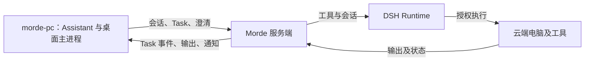

# Muse Desktop PC 交互移植设计方案

## 范围与原则

依据[移植需求文档](<Muse Desktop PC交互移植需求文档.md>)，按用户确认的 **6 项功能**设计：工具活动组、长输出、结构化追问、附件拖放与预览、语音波形、任务完成通知。需求文档验收段残留的审批卡片和排队/引导不作为新增功能；现有审批和消息路由仍纳入回归。

PC 入口使用 `morde-pc` 内打包的 Assistant；服务端继续使用 Morde Task、Broker 和 DSH。新增接口与数据采用可选字段或独立接口，旧客户端和已有任务按原协议运行。除需求中用户已确认的完整输出保存、必答问题可跳过和本机电平采集外，如实施需要改变现有功能、权限或数据处理方式，先说明影响并取得确认。

## 整体结构

- 活动组和追问卡片使用现有 Task 状态，长输出由服务端受控保存和读取；附件与语音交互留在 PC 输入区。
- 桌面主进程负责麦克风授权、前后台状态和系统通知；服务端继续负责账号、任务、授权、审计与恢复。
- 目前规范文件 `docs/design/ice-cream-blue/morde-icecream-blue-ui-spec.html` 在工作区缺失。界面先复用现有 Morde 样式和蓝色 M 标识，取得权威规范后再验收视觉一致性。

## 1. 折叠式工具活动组

在现有 Assistant 任务详情的主/子 Agent 分组内，以 Task、Agent、任务修订为边界，按步骤序号把连续工具步骤折叠成一组；非工具步骤或不同身份中断分组。摘要显示工具数和各状态，失败、等待和运行不能被“已完成”掩盖。

展开后保留每个步骤现有详情入口和授权查询，显示实际记录的输入、输出、耗时及失败原因；只汇总服务端提供的文件增删行数，缺失时显示未记录。按步骤 ID 合并事件更新，重连后以服务端快照恢复，避免重复步骤或跨任务串组。

**落点：**[Assistant 任务活动](../../../web/portal/src/routes/Assistant.tsx)的 `taskAgentActivityGroups`、工作项列表和 `TaskStepDetails`；继续使用现有 Task 事件及步骤详情接口。

## 2. 长工具输出

当前步骤详情是有界、脱敏、加密的记录；云端电脑 Shell 默认在源头对标准输出和错误输出合计截断到 64 KiB。只改 PC 展开控件无法取得截断后的内容。

设计新增独立的完整输出采集支路：在支持的工具源头、截断前按原操作身份采集，原工具返回、模型输入、执行状态及现有有界详情保持原样。采集、传输或保存失败及超过容量时停止该支路，继续排空原输出，不能阻塞、重跑或改变工具结果。源头本身未提供完整内容的工具标明截断或未记录。

服务端按账号、Task、修订、步骤、工具调用及输出流绑定记录；沿用现有敏感命令隐藏和脱敏规则，脱敏后分块加密保存，校验分块和完整性。分块处理须覆盖跨块敏感内容；无法安全处理时不保存该内容。新增只读分页接口在每次读取时复核 Task/Workspace 授权，撤权后停止返回；清理随 Task 数据生命周期执行，并设置可配置容量限制。

步骤详情保留摘要，按需读取输出。分别显示保存中、可读取、源头截断、容量截断、未记录和保存失败；仅在确认源头完整且保存完整时标为完整。历史缺失内容不可恢复，未知或取消的操作继续遵循现有结果展示规则。

**落点：**[Shell 输出](../../../runtime/morde-runtime/runtimeactions/shell.go)、[Task 步骤详情](../../../server/internal/app/task_step_detail.go)、[输出脱敏](../../../server/internal/app/task_step_execution.go)、[Task 详情授权](../../../server/internal/app/task_service.go)。

## 3. 结构化追问

### 兼容性验证结论

2026-11-26 使用 [`dsh-user-questions`](https://github.com/deepseek-ai/deepseek-harness/blob/dsh-v0.2.2-rc.1/packages/interaction/user-questions/README.md) 和 [`dsh-tool-ask-user`](https://github.com/deepseek-ai/deepseek-harness/blob/dsh-v0.2.2-rc.1/packages/interaction/tool-ask-user/README.md) 的官方 `0.2.2-rc.1` 包及 Morde 当前 DSH 依赖在本机验证。两包为 MIT，发布包的 DSH peer 依赖与 Morde 版本一致；**插件可加载，但目前不能直接接入，适配后的端到端兼容性尚未验证**。当前项目未安装这两个插件。

| 检查 | 结果与影响 |
| --- | --- |
| 任务隔离 | 插件实包测试中，并发根 Agent 的回答各自归属；取消一个请求不影响另一个，子 Agent 和失效 Agent 被拒绝。Morde 现有并发 Task、定向取消和跨 Session checkpoint 拒绝测试通过。插件本身不校验 Morde 的账号与 Task 授权，不能据此认定两者已打通。 |
| 会话恢复 | 插件的 `timed` 模式可从模拟事件日志重建待答状态，重建后的答复属于对应 Session；其超时或进程中断后的答复作为新用户消息送入 Agent。默认阻塞模式不由该投影追踪。Morde 现有流程则持久化待答并恢复**原工具调用**；两种恢复语义不能直接替换。上述插件验证是新 Context 的日志重放，未执行真实进程重启后的插件与 Morde 联合恢复。 |
| 澄清合同 | 上游工具为 `ask_user_question`，接收问题数组；Morde 现有 `ask_user` 仅接受 `{question}`。实包工具 schema 的根对象缺少 `additionalProperties: false`，嵌套对象允许额外属性，Morde 当前启动校验拒绝该 schema。即使收紧 schema，Morde 对子 Agent 和同轮混合工具调用的澄清限制目前只识别 `ask_user`。 |

实包验证覆盖多选、自由文本、明确跳过、隔离、取消、schema 校验及事件重放，共 6 项，在 Node 24.22.2 和 26.13.0 通过；Morde 现有 Runtime、Broker/API 定向测试及临时 PostgreSQL 的澄清版本、幂等和持久化测试通过。这些是分别验证，**不代表插件已接入、真实端到端已通过，或其他生产 Node 版本已验证**。

### 适配设计

- 优先复用同版本插件的提问服务和工具能力，以 Morde provider、受限工具 schema 和调用适配层连接现有 Broker；固定依赖版本。只收紧新工具的 schema，不放宽全局校验；同步将新工具纳入现有子 Agent 禁用和同轮单独调用规则。插件默认阻塞工具的 provider 请求不直接携带 `call_id`，适配层须从所属执行上下文绑定它，不能依赖跨任务共享状态；无可核验 Agent 身份的请求不得进入 Morde 用户数据流程。上游对**运行中由其他 Agent 持有**的子 Agent 提问有拒绝保护，子 Agent 的问题仍由主 Agent 汇总。
- Morde 数据库仍是待答和恢复的依据：请求绑定账号、会话、Task、Agent、执行代次、授权版本、原 `call_id` 和问题版本；Broker 校验现有授权与租约，原子保存待答，按原流程暂停。答复后只对账并恢复该原调用，将结构化答案作为它的结果；不能把 `timed` 的 `pending` 或新用户消息当成原调用结果。断线、取消、重启和重复答复须保留现有隔离与幂等语义。
- 新记录包含问题 ID、文本、选项 ID、标签和单选/多选规则；同一问题内选项 ID 和标签均须唯一，避免答案映射歧义。版本化答复接口校验账号、Task、问题版本与选项，并记录选项、自由文本或明确 `skip`。回传时选项 ID 映射为上游标签，自由文本映射为 `custom`；单选的自由文本覆盖选项，多选的自由文本可补充选项。跳过映射为空 `selected` 且无 `custom`，另行持久化跳过事实。
- 用户可主动跳过现有必答问题，包括 Agent 追问、文件交付和路由澄清；Agent 只继续可安全执行的部分。跳过不构成授权，也不替代文件交付意图；未确定目标或权限时保留原门禁并说明未完成内容。
- 旧 `ask_user`、旧接口和已冻结工具集保持原样。新多问题请求向旧客户端逐题投影并保存答复；仅对新协议的批次在全部处理后恢复任务，旧单题请求仍按原规则恢复。若实测无法在不改变原调用恢复、授权和隔离语义的前提下接入插件，则记录具体原因，保留 `ask_user` 并按上游数据格式做最小扩展。

接入后须在真实 Morde 服务链路验证跨账号/Task 拒绝、并发隔离、取消单任务、等待期间进程重启与客户端断线、原调用恢复和重复提交；同时回归旧客户端、文件交付澄清和审批。通过前不得宣称插件与 Morde 完整兼容。

**落点：**[Broker 澄清](../../../server/internal/app/cloud_dsh_tool_broker.go)、[澄清持久化](../../../server/internal/store/postgres/task_pending.go)、[PC 澄清卡片](../../../web/portal/src/routes/Assistant.tsx)及 Runtime 插件配置。

## 4. 附件拖放与预览

输入区只拦截文件拖放，显示拖入反馈；文件进入现有 `addComposerFiles` 和附件准备流程，统一执行类型、数量、大小和文件名校验。失败逐项提示，已接受文件继续保留；拖放过程中切换会话时，结果只写入原会话草稿。

图片、文本和现有 Office/PDF 处理结果按已支持的方式预览，复用现有移除、草稿、上传和 PDF 文本提取流程；预览失败不自动发送附件或清空草稿。

**落点：**[Assistant 输入与附件](../../../web/portal/src/routes/Assistant.tsx)、[会话草稿](../../../web/portal/src/routes/assistant-drafts.ts)。

## 5. 语音波形与转写状态

保留 `SpeechRecognition` 转写和已识别文本逐段写入草稿的行为；新增独立取消动作，停止当前识别并保留已写入内容。异步回调绑定录音代次和会话，取消、切换会话或退出后忽略过期结果。

用户启动语音后，PC 仅对可信 Assistant 主框架按需开放音频权限，拒绝摄像头及其他页面或工作台的权限请求，使用本机音频流和 Web Audio 计算实时电平；采样音频不保存、不上传。结束、取消、切换或出错时释放音轨和音频资源；电平采集失败不终止原识别，显示波形不可用。原浏览器识别可能使用在线服务的提示保留。

**落点：**[语音输入](../../../web/portal/src/components/AssistantVoiceInput.tsx)、[PC 权限处理](../../../clients/desktop/harness/desktop/src/morde-main.ts)。

## 6. 任务完成桌面通知

复用服务端已持久化的 `completed` 通知和现有通知权限过滤；为 PC 增加按账号递增游标的只读增量读取，旧通知列表和已读状态不变。游标在通知入库事务中按账号串行分配，防止并发提交漏读。PC 登录期间由桌面主进程持续读取，切换页面或会话不停止监听；首次启用建立基线，断线后从游标恢复。

PC 设置增加本机开关，默认开启；按服务实例、账号、通知 ID 保存本机去重记录。PC 窗口不在前台且开关开启时，先记录投递身份再请求系统通知。通知只使用现有脱敏摘要，账号退出或切换立即停止旧账号监听。系统通知权限不可用时保留站内通知和 Task 状态。进程崩溃恰好发生在系统通知提交前后时，以不重复为先，无法保证该次弹窗一定送达。

**落点：**[通知服务](../../../server/internal/app/notification_service.go)、[通知查询](../../../server/internal/store/postgres/notification.go)、[PC 主进程](../../../clients/desktop/harness/desktop/src/morde-main.ts)。

## 验证与兼容

- 自动化覆盖分组顺序、跨任务隔离、输出脱敏和跨块内容、授权撤销、容量/断线、澄清跳过与重复提交、旧客户端答复、附件草稿隔离、语音释放和通知去重。
- 在实际 `morde-pc` 从入口验证 6 项交互及失败状态；回归普通对话、多会话、审批双入口、消息路由、任务恢复、附件发送、云端电脑和 PC/iOS 同会话。实际客户端未验证的项目不能标为通过。
- 新旧接口和待恢复 Session 并存；任何涉及 Harness 会话、路由或 Task 执行的实现变更，按项目约定同步总流程、实施 TODO 与验证记录。
