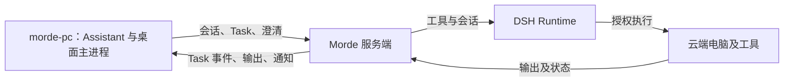

# Muse Desktop PC 交互移植设计方案

## 范围与原则

依据[移植需求文档](<Muse Desktop PC交互移植需求文档.md>)，按用户确认的 **6 项功能**设计：工具活动组、长输出、结构化追问、附件拖放与预览、语音波形、任务完成通知。需求文档验收段残留的审批卡片和排队/引导不作为新增功能；现有审批和消息路由仍纳入回归。

PC 入口使用 `morde-pc` 内打包的 Assistant；服务端继续使用 Morde Task、Broker 和 DSH。新增接口与数据采用可选字段或独立接口，旧客户端和已有任务按原协议运行。除需求中用户已确认的完整输出保存、必答问题可跳过和本机电平采集外，如实施需要改变现有功能、权限或数据处理方式，先说明影响并取得确认。

## 整体结构

- 活动组和追问卡片使用现有 Task 状态，长输出由服务端受控保存和读取；附件与语音交互留在 PC 输入区。
- 桌面主进程负责麦克风授权、前后台状态和系统通知；服务端继续负责账号、任务、授权、审计与恢复。
- 目前规范文件 `docs/design/ice-cream-blue/morde-icecream-blue-ui-spec.html` 在工作区缺失。界面先复用现有 Morde 样式和蓝色 M 标识，取得权威规范后再验收视觉一致性。

## 1. 折叠式工具活动组

在现有 Assistant 任务详情的主/子 Agent 分组内，以 Task、Agent、任务修订为边界，按步骤序号把连续工具步骤折叠成一组；非工具步骤或不同身份中断分组。摘要显示工具数和各状态，失败、等待和运行不能被“已完成”掩盖。

展开后保留每个步骤现有详情入口和授权查询，显示实际记录的输入、输出、耗时及失败原因；只汇总服务端提供的文件增删行数，缺失时显示未记录。按步骤 ID 合并事件更新，重连后以服务端快照恢复，避免重复步骤或跨任务串组。

**落点：**[Assistant 任务活动](../../../web/portal/src/routes/Assistant.tsx)的 `taskAgentActivityGroups`、工作项列表和 `TaskStepDetails`；继续使用现有 Task 事件及步骤详情接口。

## 2. 长工具输出

当前步骤详情是有界、脱敏、加密的记录；云端电脑 Shell 默认在源头对标准输出和错误输出合计截断到 64 KiB。只改 PC 展开控件无法取得截断后的内容。

设计新增独立的完整输出采集支路：在支持的工具源头、截断前按原操作身份采集，原工具返回、模型输入、执行状态及现有有界详情保持原样。采集、传输或保存失败及超过容量时停止该支路，继续排空原输出，不能阻塞、重跑或改变工具结果。源头本身未提供完整内容的工具标明截断或未记录。

服务端按账号、Task、修订、步骤、工具调用及输出流绑定记录；沿用现有敏感命令隐藏和脱敏规则，脱敏后分块加密保存，校验分块和完整性。分块处理须覆盖跨块敏感内容；无法安全处理时不保存该内容。新增只读分页接口在每次读取时复核 Task/Workspace 授权，撤权后停止返回；清理随 Task 数据生命周期执行，并设置可配置容量限制。

步骤详情保留摘要，按需读取输出。分别显示保存中、可读取、源头截断、容量截断、未记录和保存失败；仅在确认源头完整且保存完整时标为完整。历史缺失内容不可恢复，未知或取消的操作继续遵循现有结果展示规则。

**落点：**[Shell 输出](../../../runtime/morde-runtime/runtimeactions/shell.go)、[Task 步骤详情](../../../server/internal/app/task_step_detail.go)、[输出脱敏](../../../server/internal/app/task_step_execution.go)、[Task 详情授权](../../../server/internal/app/task_service.go)。

## 3. 结构化追问

现有 `ask_user` 和 Task 澄清只接收自由文本。优先接入 DSH 上游的 [`dsh-user-questions`](https://github.com/deepseek-ai/deepseek-harness/blob/dsh-v0.2.2-rc.1/packages/interaction/user-questions/README.md) 与 [`dsh-tool-ask-user`](https://github.com/deepseek-ai/deepseek-harness/blob/dsh-v0.2.2-rc.1/packages/interaction/tool-ask-user/README.md)，通过 Morde provider/适配层进入现有 Broker 与持久化流程。两包上游 `0.2.2-rc.1` 为 MIT，版本与当前 Runtime 依赖同版本（[user-questions 清单](https://github.com/deepseek-ai/deepseek-harness/blob/dsh-v0.2.2-rc.1/packages/interaction/user-questions/package.json)、[tool-ask-user 清单](https://github.com/deepseek-ai/deepseek-harness/blob/dsh-v0.2.2-rc.1/packages/interaction/tool-ask-user/package.json)）；实际接入前仍须核验依赖、会话恢复、取消和隔离，不能仅凭版本相同认定兼容。上游限制运行中的子 Agent 直接向用户提问，子 Agent 的问题由主 Agent 汇总，保持现有协作边界。

新澄清记录携带问题 ID、文本、选项 ID、标签和单选/多选规则；新增版本化答复接口，提交每个问题的选项、自由文本或明确的 `skip`。服务端校验当前账号、会话、Task、问题版本和选项，以同一幂等键原子记录答复并恢复对应任务；结果未知时复用原请求身份核对。回传 DSH 时将选项 ID 映射为原标签、自由文本映射为 `custom`；明确跳过映射为空 `selected` 且无 `custom`，服务端保留独立跳过事实，不能用假答案冒充。

用户可主动跳过现有必答问题；Agent 收到跳过事实后继续可安全执行的部分。此规则覆盖 Agent 追问、文件交付和路由澄清；涉及未确定目标、文件交付意图或权限的操作仍经过原门禁，无法安全推进时说明未完成内容。旧客户端继续使用原文本问题和答复接口；多问题依次投影为单题并逐题保存旧答复，全部处理后再恢复任务，答复作为对应问题的自由文本处理。旧会话保留原 `ask_user` 合同，新能力按版本接入，恢复时不改变已冻结的工具集。

Morde 持久记录是待答和恢复的依据，不能仅依赖插件进程内的等待。如果验证表明插件无法满足现有 checkpoint、授权或恢复约束，则记录原因，保留 Morde 的 `ask_user` 并按上游问题与答复格式做最小扩展，仍由 DSH 执行。

**落点：**[Broker 澄清](../../../server/internal/app/cloud_dsh_tool_broker.go)、[澄清持久化](../../../server/internal/store/postgres/task_pending.go)、[PC 澄清卡片](../../../web/portal/src/routes/Assistant.tsx)及 Runtime 插件配置。

## 4. 附件拖放与预览

输入区只拦截文件拖放，显示拖入反馈；文件进入现有 `addComposerFiles` 和附件准备流程，统一执行类型、数量、大小和文件名校验。失败逐项提示，已接受文件继续保留；拖放过程中切换会话时，结果只写入原会话草稿。

图片、文本和现有 Office/PDF 处理结果按已支持的方式预览，复用现有移除、草稿、上传和 PDF 文本提取流程；预览失败不自动发送附件或清空草稿。

**落点：**[Assistant 输入与附件](../../../web/portal/src/routes/Assistant.tsx)、[会话草稿](../../../web/portal/src/routes/assistant-drafts.ts)。

## 5. 语音波形与转写状态

保留 `SpeechRecognition` 转写和已识别文本逐段写入草稿的行为；新增独立取消动作，停止当前识别并保留已写入内容。异步回调绑定录音代次和会话，取消、切换会话或退出后忽略过期结果。

用户启动语音后，PC 仅对可信 Assistant 主框架按需开放音频权限，拒绝摄像头及其他页面或工作台的权限请求，使用本机音频流和 Web Audio 计算实时电平；采样音频不保存、不上传。结束、取消、切换或出错时释放音轨和音频资源；电平采集失败不终止原识别，显示波形不可用。原浏览器识别可能使用在线服务的提示保留。

**落点：**[语音输入](../../../web/portal/src/components/AssistantVoiceInput.tsx)、[PC 权限处理](../../../clients/desktop/harness/desktop/src/morde-main.ts)。

## 6. 任务完成桌面通知

复用服务端已持久化的 `completed` 通知和现有通知权限过滤；为 PC 增加按账号递增游标的只读增量读取，旧通知列表和已读状态不变。游标在通知入库事务中按账号串行分配，防止并发提交漏读。PC 登录期间由桌面主进程持续读取，切换页面或会话不停止监听；首次启用建立基线，断线后从游标恢复。

PC 设置增加本机开关，默认开启；按服务实例、账号、通知 ID 保存本机去重记录。PC 窗口不在前台且开关开启时，先记录投递身份再请求系统通知。通知只使用现有脱敏摘要，账号退出或切换立即停止旧账号监听。系统通知权限不可用时保留站内通知和 Task 状态。进程崩溃恰好发生在系统通知提交前后时，以不重复为先，无法保证该次弹窗一定送达。

**落点：**[通知服务](../../../server/internal/app/notification_service.go)、[通知查询](../../../server/internal/store/postgres/notification.go)、[PC 主进程](../../../clients/desktop/harness/desktop/src/morde-main.ts)。

## 验证与兼容

- 自动化覆盖分组顺序、跨任务隔离、输出脱敏和跨块内容、授权撤销、容量/断线、澄清跳过与重复提交、旧客户端答复、附件草稿隔离、语音释放和通知去重。
- 在实际 `morde-pc` 从入口验证 6 项交互及失败状态；回归普通对话、多会话、审批双入口、消息路由、任务恢复、附件发送、云端电脑和 PC/iOS 同会话。实际客户端未验证的项目不能标为通过。
- 新旧接口和待恢复 Session 并存；任何涉及 Harness 会话、路由或 Task 执行的实现变更，按项目约定同步总流程、实施 TODO 与验证记录。
