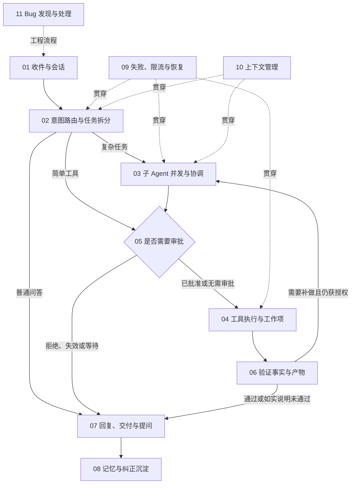

# Morde 复刻 Muse：实施任务总大纲

本清单以本目录上级的 [Muse 逆向工程](../muse-harness-reverse-engineering.md)、[开源映射](../muse-steps-open-source-mapping.md)、[测试用例](../muse-harness-replication-test-cases.md)、[11 步记录](../muse-steps-replication-record.md)和[最终流程图](../Morde%20复刻%20Muse%20最终流程与开发设计.html)为依据，并核对当前 Morde 与 `project/` 源码。目标是复现已观察到、适用于 Morde 的体验；Muse 未知的阈值、内部策略和效果不能当成已证实事实。

## 流程与任务入口

| 步骤 | 文档 | 主要结果 | 当前判断 |
|---|---|---|---|
| 01 | [收件与会话](01-收件与会话.md) | PC/iOS 会话、幂等收件与恢复 | M01-01 已验收；M01-02/03 双端联调待验证 |
| 02 | [意图路由与任务拆分](02-意图路由与任务拆分.md) | 识别追问、修改、停止、新任务并形成任务说明 | M02-01–07 已完成本地实现与回归；M02-02 已通过 PostgreSQL 双任务隔离、实际 PC 本地合成服务验收和 iOS 签名模拟器 UI 用例。M02-06 覆盖隐藏内部 Task → Broker 的只读网页首切片。M02-09 长消息明确意图路由及关联边界的 app/worker 全量回归与 PostgreSQL 定向用例已通过；实际 PC Task 验收仍待可运行当前工作区改动的 Portal/DSH/Guardian。M10-03 预算内检索 PC E2E 与 M02-08 M09/M10 PC/iOS 联调仍待完成。|
| 03 | [并发派发与协调](03-并发派发与协调.md) | 主 Agent、协调员、worker 受控协作 | 服务端/DSH 两层委派、持久化、失败汇总、取消与恢复已通过本地回归；PC 实测已启动但在恢复检查/模型结果确认阶段未派发 worker，端到端仍待复验 |
| 04 | [工具执行与工作项](04-工具执行与工作项.md) | 可查看实际操作、输出与执行状态 | M04-01/02/04 本地实现与回归通过；M04-03 安全长输出回读、Portal/iOS 展示和自动化测试已实现，但实际客户端及大输出 HTTP 组合回读待验；M04-05 原子目录项冲突保护和 Linux 回归通过，实际 PC/云端待验，旧 inode FD 非协作 Host 写入仍无法绝对防止 |
| 05 | [审批](05-审批.md) | 对具体操作授权、等待或拒绝 | M05-01–05 与 M05-03（PC 实际客户端观察、iOS 原生模拟器审批/Task 交互）本地定向回归通过；M05-05 已明确副作用策略并映射账本/门禁；完整 Agent E2E 仍待做，H05 不宣称完成 |
| 06 | [验证](06-验证.md) | 用实际检查判断产物及任务是否符合要求 | 已接入有 claim/来源/版本约束的产物读回、有限文本预览和当前文件失效门禁；App/Worker/Store 本地测试、Portal 定向测试及步骤 06 定向 PostgreSQL 16 集成通过。云端 `/opt/morde-src` HEAD `30dc339` 与本地 HEAD 相同且干净。原 Task `quny0r0t` 的 `file_write` 工作项完成、`Task.validation` 待验证，Workbench 无已核验产物；后续续验路由遇到 `invalid_model_output`。追加独立 PC Task `q9hzwtqd` 于 21:26:45 记录 `task execution stopped`，客户端显示中断且结果未确认；两次尝试均未取得读回或内容比较证据。另一个跨 Task 读取失败不能替代原 Task 验收。PC 正向验收未通过；并发撤权/旧修订回归仍待做；审批覆盖或动作分类未知时必须保留 pending/unknown，详见 [06 TODO](06-验证.md) |
| 07 | [交付与提问](07-交付与提问.md) | 回原会话交付结果、问题和可追溯证据 | 结果回执汇总同修订审批/操作/验证事实；MCP、Host、Workspace 精确绑定成功样例及结果聚合 replay、完成栅栏 race 用例通过。2026-11-24 同 Task steer/旧结果拒收 Worker PostgreSQL E2E 复跑通过；扩展回归在完成门内路由独立请求，验证独立排队、分离 DSH Session、原任务完成后独立执行并单独交付。新增跨 MCP/Host 重复回执冲突的 PostgreSQL 定向用例通过，冲突保持 unknown。Hub/sandbox/media/file-fetch/batch/Task-step 辅助账本未知/待处理状态已覆盖；file.fetch 有专用传输记录时只计一次，缺少记录时回退 Hub 状态。实际 `morde-pc` 本地合成验收已看到成功结果、失败、审批等待、澄清问题、独立快速回复、恢复检查点未决状态和排队 Task 从排队到完成；澄清期间自由对话可继续，执行中关闭客户端、夹具完成后重开，同一会话仅交付一次。九种 Task 状态、未核验成果保护及结构化验证证据映射的 Portal 定向测试 226/226 通过；证据展示限定于当前修订/结果摘要，来源与工作项使用当前会话/授权 Task 数据。2026-11-24 实际 PC 本地合成验收已通过验证片段、来源跳转、工作项详情、缺失成果引用不可用提示及不完整 proof 成果提示；本地 API E2E 与 2026-11-24 实际 PC 澄清回答验收均通过：同一 Task 恢复完成，原会话只交付一次，Task 验证仍为待验证。response-only fixture projection 只验证展示，不代表步骤06后端验证 PASS。AX 树未暴露测试成果名/路径或下载入口。真实工具副作用 unknown、验证 PASS、证据不可用仍待验；S07-17 暴露的路由候选裁剪栅栏冲突已在 S07-18 修复，显式 16,384-token HTTP/API 竞争 E2E 通过；不完整上下文路由规则已压缩，4K 请求边界用例及未知容量回退 4,096-token 的完整 HTTP/API 竞争 E2E（S07-19）通过；实际 PC 竞争验收仍待，需与步骤 09 串行排期。iOS 状态映射原生单测 3/3 通过；M06-03、iOS/跨端交付验收和完整 Agent E2E 仍待验；队列单项通过，但包含 stream 的组合夹具未整体通过；步骤07 TODO 保持未完成 |
| 08 | [记忆与纠正沉淀](08-记忆与纠正沉淀.md) | 经授权检索历史、管理记忆和纠正 | 历史授权复核、个人数据水位/撤权事务栅栏、修订后继关系、显式规则候选和遗忘清理已实现；Go/API/PostgreSQL 及 Portal 定向回归通过。2026-11-24 实际 PC 窗口截图确认第 2/1 版、后继关系和来源可见，AX 采集漏掉滚动区静态文本；PC 候选/遗忘仍待验。iOS 本地原生 success-flow（候选确认、修订/历史、删除候选、遗忘）1/1 通过。完整双端同账号验收和完整 Portal 文件集仍待验证，详见 [08 TODO](08-记忆与纠正沉淀.md) |
| 09 | [失败、限流与恢复](09-失败限流与恢复.md) | 状态真实、有限重试、未知结果先对账 | 已有本地 PostgreSQL 证据覆盖失败保留/安全重试、同账号 Task 事件隔离、模型未知用量及 MCP 持久账本在 Broker 重建后的对账、失败提交恢复、路由等待跨 Worker 重启、超限不重派与不安全重试拒绝；hostless MCP 限流重试经显式重试和重新审批后成功，来源失败步骤、成功关联步骤、事件及账本均持久化。PC/iOS Task/MCP 点击到持久 retry 状态的闭环与 iOS 等待期限 UI 已通过；实际 PC 在 S09-19、iOS 原生客户端在 S09-20 分别从失败工作项点击重试并经本地合成 TaskWorker/Agent 到成功步骤；两端均保留来源失败项并通过 PostgreSQL 核验关联与账本。实际 DSH Node 子进程重启后由新 TaskWorker 从持久队列恢复已通过，并于 S09-18 在独立临时 PostgreSQL 复跑；S09-22 又验证 Go TaskWorker 子进程在被终止后由新进程从同一临时 PostgreSQL 接续并完成同一 Task。该证据覆盖通用 Task 租约/队列恢复，不覆盖生产 server binary 启动装配或 MCP 未知副作用重启后的账本对账；S09-24 已在实际 PC 与原生 iOS 上验证同一合成未知结果 Task 均为 waiting_user/dsh_recovery_unresolved 并保留最后确认工作；S09-25 已验证同一审批等待 Task 的双端读态，但未测试批准后续跑；S09-26/S09-27 已分别通过实际 PC 与 iOS 发起取消、另一端读回同一条 interrupted 助手消息的双向验收；iOS cancelling 展示单测及反向原生 UI 读回通过。S09-29 已验证服务端真实 DSH checkpoint 批准后续跑；S09-30 已在本地合成 fixture 通过 PC→iOS 与 iOS→PC 实际批准及同一 Task 完成态读回（Task `q5rcnqfc`、`qov8v6ql`）；S09-31 服务端真实 DSH 审批等待期间撤销 session token、旧批准拒绝、无追加模型/Host 派发及 TaskStopWorker 取消通过；S09-32 已通过实际 PC/iOS 对同一 Task 的 cancelling 状态读回；S09-33 已通过服务端真实 DSH 共享 Host grant 撤销/权限降级、审批取消、精确 Task fence 与最终取消；S09-34 已补发起人撤权后 cancelling/cancelled 状态只读及服务端回归；S09-35 已通过实际 PC/iOS 对同一共享 Host Task 的 target-grant 撤权读态验收，PC 显示正在停止、iOS 审批动作消失，指定 verify 成功；外层 `TestConversationBrowserAcceptance` 未收到 `STOP_FILE`、601.50 秒超时退出，不计完整 Go browser fixture 通过；session token 401/403/404 原生刷新和生产 server 重启仍待验收，完整双端故障同步及跨账号客户端导航仍待验收；客户端进程重开与服务恢复分开验收；S09-28 两条 PostgreSQL 用例验证 `workspace_host_sync`、`task_hub_workspace_sync` 的具名 wait claim fence；通用 connector/device/browser durable blocker、这些具名 blocker 的非空 checkpoint 自动续跑和 PC/iOS 读态仍待验证。M09-05 的实际 PC/iOS 失败路由关闭/重开与显式复用原消息重试已分别通过本地合成 fixture（S09-17、S09-21）；S09-23 已验证 5 分钟 `available_after` 与 48 小时 failed 路由跨 Go Worker 测试子进程保持；生产 portal 重启装配及重启后 PC/iOS 读态仍待验收 |
| 10 | [上下文管理](10-上下文管理.md) | 长对话压缩、按需查原文、保留来源 | 摘要、DSH 压缩与 1 MiB 检索已通过服务端/Runtime 回归；检索摘录现在带精确 rune 范围和全部覆盖页哈希，checkpoint 恢复及工具数上限回归通过；实际 PC 长会话恢复和最终回复仍待验收 |
| 11 | [Bug 发现与处理](11-Bug发现与处理.md) | 复现、定位、回归和记录 | 工程方法，不能称为已证实的 Muse 产品机制 |

代码存在不代表对应体验已验收。只有实现和该项验收均完成后才能勾选 `[x]`；无法实测的端到端项目保留待验证状态并写明缺项。M01–M11 是各文档的稳定任务编号，TC 编号仅用于追溯资料；渠道、功能和未知探查中不适用于 Morde 的用例不强行纳入。

## 实施顺序和协作边界

1. **打通会话与路由：**先做 01、02 的收件幂等和任务归属；10 的上下文预算及按权限取回历史与其接口一起接入。09 的错误状态与恢复贯穿每一步。
2. **打通执行与授权：**03 在现有 DSH 中支持受控两层委派；04 在 Broker 中记录工具执行；05 接入授权与审批。独立子任务可并行，使用同一电脑、工作区或其他互斥资源的操作要串行或明确隔离。
3. **验证和交付：**06 基于 04 的证据核对任务，07 消费真实执行和验证状态并交付；08 按授权沉淀历史和纠正。11 作为全程缺陷处理方法。

文件和合同归属：01 管消息收件/发件箱；02 管路由决定和任务说明；03 管子会话树及 `engine.mjs` 委派；04 管工具工作项、证据形状和 Broker 调用账本；05 管审批决定；06 管验证证据及判定；07 管交付内容和详情呈现；08 管记忆；09 管错误分类与恢复策略并调用 04 对账；10 管上下文裁剪与检索。多个步骤会改 `engine.mjs`、`Assistant.tsx`、`MordeApp.swift` 等共享文件，实施时先确定合同，再按上述归属顺序集成，避免相互覆盖。

## 共同验收与约束

- 仅以 PC 的 `morde-pc` 和原生 iOS 为普通用户入口，后台 Web 只承担管理职责。涉及 PC 的任务必须启动并操作实际 `morde-pc`；iOS 任务在原生客户端操作。构建、单元测试或独立浏览器不能替代客户端实测；环境不可用时标记未验证。界面遵循项目统一 UI 规范。
- DSH 是唯一 Agent Runtime；优先检查当前已接入的插件及其上游，再决定复用或最小适配。插件接入或移植前核对固定版本、许可证、用户/会话/任务隔离、授权、审批、凭据、预算、操作记录和产物管理，并测试检查点、取消与恢复。项目依赖现状见 [Runtime package.json](../../../../runtime/morde-cloud-runtime/package.json)。
- 在测试环境使用合成数据和受控工具，不向外发送消息或上传文件。具体实施前如无法搭建符合本地限制的环境，相应验收保持待验证。
- 联合验收至少覆盖：PC/iOS 同账号接续同一会话；任务中途断线或关闭客户端后恢复且不重复执行；普通问答无需云电脑；一个复杂任务至少两个独立子任务并行、实际汇总；追问/修改/停止只影响目标任务；授权电脑完成可观察操作与终端命令；搜索结果有来源；失败、审批和验证状态真实可见；超出模型上下文的长对话仍可追溯早期要求；不同账号隔离。
- 第一里程碑的 PC 文件夹同步作为 [M04-05](04-工具执行与工作项.md) 独立验收：由用户在 `morde-pc` 手动触发，目标是固定默认云电脑的 `~/workspace/project/<项目名>/`，仅 PC → 云端；再次点击才同步增删改。冲突、失权、源目录不可访问或目标不可用时保护内容并提示，不切换电脑。本次编写 TODO 不上传文件，真实云端传输若未实测须标记待验证。

## 开源参考的使用方式

每个分文档标出可参考的实际模块与函数，并区分“优先复用插件”“可移植的局部逻辑”和“只参考设计”。跨语言、依赖环境或授权模型不同的代码应在 Morde 现有架构内改写，不能整体引入第二套 Agent 循环。`project/` 多数为源码快照，正式移植前记录实际版本或文件哈希并检查许可证。OpenHands 当前本地目录是 Agent Canvas 前端源码；Claude Agent SDK 仅作为权限接口参考，不替换 DSH。
