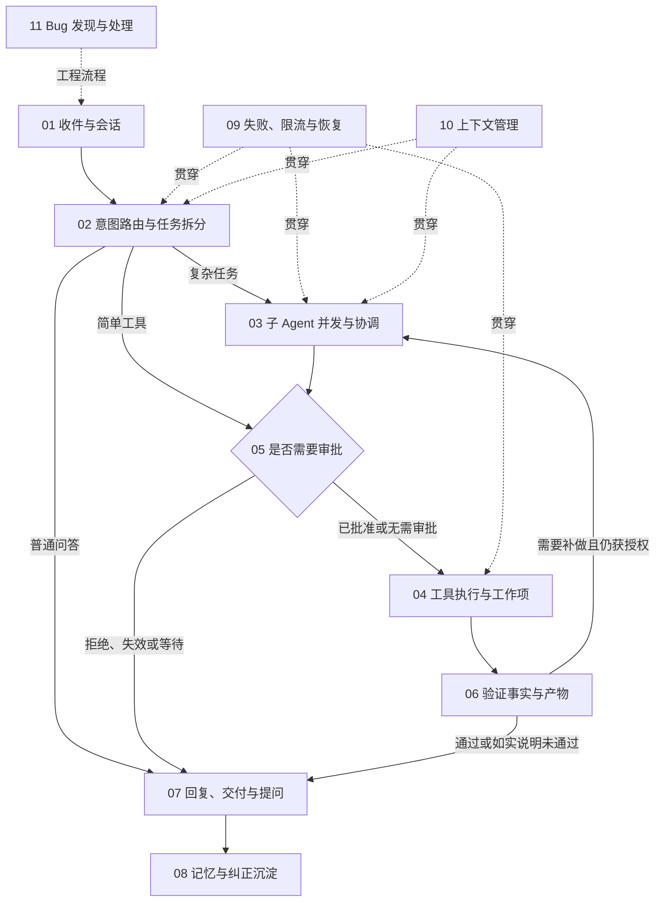

# Morde 复刻 Muse：实施任务总大纲

本清单以本目录上级的 [Muse 逆向工程](../muse-harness-reverse-engineering.md)、[开源映射](../muse-steps-open-source-mapping.md)、[测试用例](../muse-harness-replication-test-cases.md)、[11 步记录](../muse-steps-replication-record.md)和[最终流程图](../Morde%20复刻%20Muse%20最终流程与开发设计.html)为依据，并核对当前 Morde 与 `project/` 源码。目标是复现已观察到、适用于 Morde 的体验；Muse 未知的阈值、内部策略和效果不能当成已证实事实。

## 流程与任务入口

| 步骤 | 文档 | 主要结果 | 当前判断 |
|---|---|---|---|
| 01 | [收件与会话](01-收件与会话.md) | PC/iOS 会话、幂等收件与恢复 | M01-01 已验收；M01-02/03 双端联调待验证 |
| 02 | [意图路由与任务拆分](02-意图路由与任务拆分.md) | 识别追问、修改、停止、新任务并形成任务说明 | M02-01–07 已完成本地实现与回归；M02-02 已通过 PostgreSQL 双任务隔离、实际 PC 本地合成服务验收和 iOS 签名模拟器 UI 用例。M02-06 覆盖隐藏内部 Task → Broker 的只读网页首切片。M02-09 长消息明确意图路由及关联边界的 app/worker 全量回归与 PostgreSQL 定向用例已通过；实际 PC Task 验收仍待可运行当前工作区改动的 Portal/DSH/Guardian。M10-03 预算内检索 PC E2E 与 M02-08 M09/M10 PC/iOS 联调仍待完成。|
| 03 | [并发派发与协调](03-并发派发与协调.md) | 主 Agent、协调员、worker 受控协作 | 服务端/DSH 两层委派、持久化、失败汇总、取消与恢复已通过本地回归；PC 实测已启动但在恢复检查/模型结果确认阶段未派发 worker，端到端仍待复验 |
| 04 | [工具执行与工作项](04-工具执行与工作项.md) | 可查看实际操作、输出与执行状态 | M04-01/02/04 本地实现与回归通过；M04-03 安全长输出回读、Portal/iOS 展示和自动化测试已实现，但实际客户端及大输出 HTTP 组合回读待验；M04-05 原子目录项冲突保护和 Linux 回归通过，实际 PC/云端待验，旧 inode FD 非协作 Host 写入仍无法绝对防止 |
| 05 | [审批](05-审批.md) | 对具体操作授权、等待或拒绝 | M05-01–05 与 M05-03（PC 实际客户端观察、iOS 原生模拟器审批/Task 交互）本地定向回归通过；M05-05 已明确副作用策略并映射账本/门禁；完整 Agent E2E 仍待做，H05 不宣称完成 |
| 06 | [验证](06-验证.md) | 用实际检查判断产物及任务是否符合要求 | 已接入有 claim/来源/版本约束的产物读回、有限文本预览和当前文件失效门禁；App/Worker/Store 本地测试、Portal 定向测试及步骤 06 定向 PostgreSQL 16 集成通过。云端 `/opt/morde-src` HEAD `30dc339` 与本地 HEAD 相同且干净。实际 PC Task `quny0r0t` 的 `file_write` 已完成、`Task.validation` 待验证；Workbench 只读观察显示等待确认且无已核验产物，未取得读回或内容比较证据。后续指定 Task ID 的续验路由遇到 `invalid_model_output` 并安全澄清，未派发工具。另一个独立 Task 的跨 Task 读取失败，不能替代原 Task 验收。PC 验收未通过；并发撤权/旧修订回归仍待做；审批覆盖或动作分类未知时必须保留 pending/unknown，详见 [06 TODO](06-验证.md) |
| 07 | [交付与提问](07-交付与提问.md) | 回原会话交付结果、问题和可追溯证据 | 结果发布已有实现；需消费步骤 05/06 的真实审批与验证状态，批准或拒绝不代表 Task 已完成；交付真实性及双端展示待验证 |
| 08 | [记忆与纠正沉淀](08-记忆与纠正沉淀.md) | 经授权检索历史、管理记忆和纠正 | 已有历史与记忆接口；闭环待核验 |
| 09 | [失败、限流与恢复](09-失败限流与恢复.md) | 状态真实、有限重试、未知结果先对账 | 失败保留/安全重试、同账号 Task 事件隔离、模型未知用量与 Gateway 重建后不重复 Provider 调用、异账号步骤详情及事件流 API 404、失败提交恢复、Worker 重启等待恢复、超限不重派及不安全重试拒绝已有本地 PostgreSQL 证据；现有失败→成功证据只覆盖确认未派发 Host 步骤，MCP 丢回执的 PostgreSQL Broker 对账组合、Task/MCP 重试后的新连接器成功结果仍待补；PC/iOS Task/MCP 与 iOS 原消息路由的本地服务闭环已通过；Task 中断/审批/未知结果双端状态同步和跨账号客户端入口仍待验收 |
| 10 | [上下文管理](10-上下文管理.md) | 长对话压缩、按需查原文、保留来源 | 摘要、DSH 压缩与 1 MiB 检索已通过服务端/Runtime 回归；检索摘录现在带精确 rune 范围和全部覆盖页哈希，checkpoint 恢复及工具数上限回归通过；实际 PC 长会话恢复和最终回复仍待验收 |
| 11 | [Bug 发现与处理](11-Bug发现与处理.md) | 复现、定位、回归和记录 | 工程方法，不能称为已证实的 Muse 产品机制 |

代码存在不代表对应体验已验收。只有实现和该项验收均完成后才能勾选 `[x]`；无法实测的端到端项目保留待验证状态并写明缺项。M01–M11 是各文档的稳定任务编号，TC 编号仅用于追溯资料；渠道、功能和未知探查中不适用于 Morde 的用例不强行纳入。

## 实施顺序和协作边界

1. **打通会话与路由：**先做 01、02 的收件幂等和任务归属；10 的上下文预算及按权限取回历史与其接口一起接入。09 的错误状态与恢复贯穿每一步。
2. **打通执行与授权：**03 在现有 DSH 中支持受控两层委派；04 在 Broker 中记录工具执行；05 接入授权与审批。独立子任务可并行，使用同一电脑、工作区或其他互斥资源的操作要串行或明确隔离。
3. **验证和交付：**06 基于 04 的证据核对任务，07 消费真实执行和验证状态并交付；08 按授权沉淀历史和纠正。11 作为全程缺陷处理方法。

文件和合同归属：01 管消息收件/发件箱；02 管路由决定和任务说明；03 管子会话树及 `engine.mjs` 委派；04 管工具工作项、证据形状和 Broker 调用账本；05 管审批决定；06 管验证证据及判定；07 管交付内容和详情呈现；08 管记忆；09 管错误分类与恢复策略并调用 04 对账；10 管上下文裁剪与检索。多个步骤会改 `engine.mjs`、`Assistant.tsx`、`MordeApp.swift` 等共享文件，实施时先确定合同，再按上述归属顺序集成，避免相互覆盖。

## 共同验收与约束

- 仅以 PC 的 `morde-pc` 和原生 iOS 为普通用户入口，后台 Web 只承担管理职责。涉及 PC 的任务必须启动并操作实际 `morde-pc`；iOS 任务在原生客户端操作。构建、单元测试或独立浏览器不能替代客户端实测；环境不可用时标记未验证。界面遵循项目统一 UI 规范。
- DSH 是唯一 Agent Runtime；优先检查当前已接入的插件及其上游，再决定复用或最小适配。插件接入或移植前核对固定版本、许可证、用户/会话/任务隔离、授权、审批、凭据、预算、操作记录和产物管理，并测试检查点、取消与恢复。项目依赖现状见 [Runtime package.json](../../../../runtime/morde-cloud-runtime/package.json)。
- 在测试环境使用合成数据和受控工具，不向外发送消息或上传文件。具体实施前如无法搭建符合本地限制的环境，相应验收保持待验证。
- 联合验收至少覆盖：PC/iOS 同账号接续同一会话；任务中途断线或关闭客户端后恢复且不重复执行；普通问答无需云电脑；一个复杂任务至少两个独立子任务并行、实际汇总；追问/修改/停止只影响目标任务；授权电脑完成可观察操作与终端命令；搜索结果有来源；失败、审批和验证状态真实可见；超出模型上下文的长对话仍可追溯早期要求；不同账号隔离。
- 第一里程碑的 PC 文件夹同步作为 [M04-05](04-工具执行与工作项.md) 独立验收：由用户在 `morde-pc` 手动触发，目标是固定默认云电脑的 `~/workspace/project/<项目名>/`，仅 PC → 云端；再次点击才同步增删改。冲突、失权、源目录不可访问或目标不可用时保护内容并提示，不切换电脑。本次编写 TODO 不上传文件，真实云端传输若未实测须标记待验证。

## 开源参考的使用方式

每个分文档标出可参考的实际模块与函数，并区分“优先复用插件”“可移植的局部逻辑”和“只参考设计”。跨语言、依赖环境或授权模型不同的代码应在 Morde 现有架构内改写，不能整体引入第二套 Agent 循环。`project/` 多数为源码快照，正式移植前记录实际版本或文件哈希并检查许可证。OpenHands 当前本地目录是 Agent Canvas 前端源码；Claude Agent SDK 仅作为权限接口参考，不替换 DSH。
