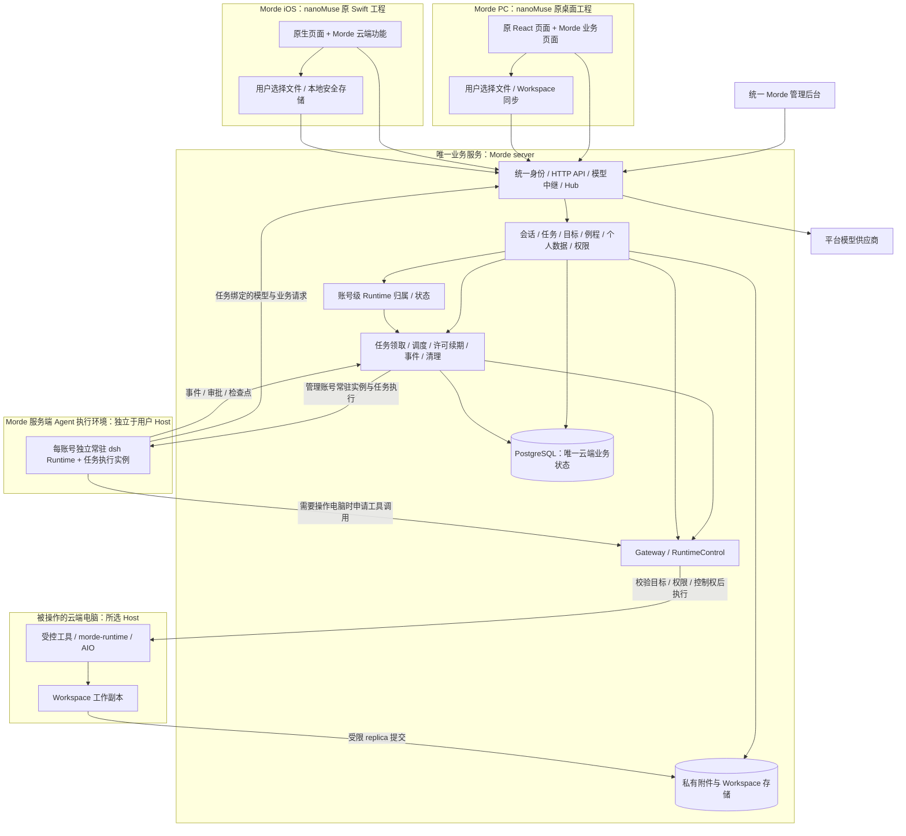
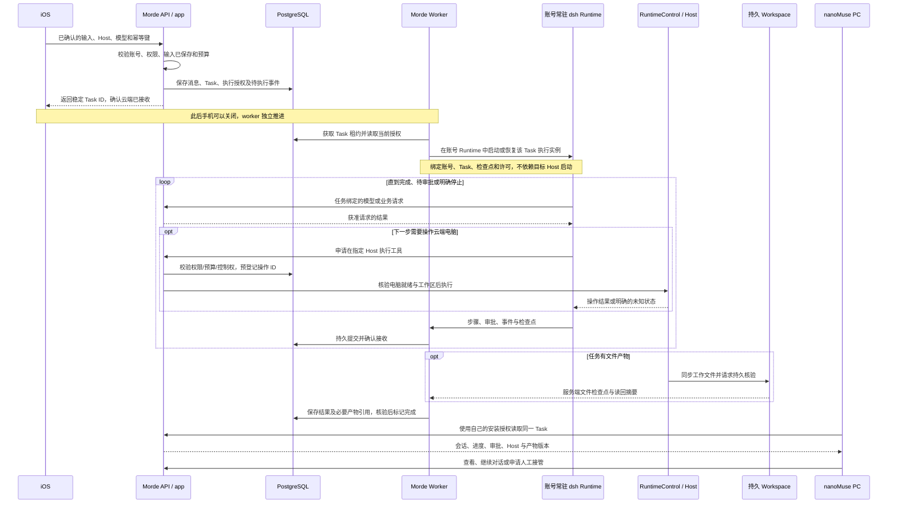

# nanoMuse 客户端与 Morde 服务端融合技术架构设计方案

> 日期：2026-10-28。状态：设计审阅稿，融合尚未实施完成。
>
> 依据：[合并需求文档](nanoMuse客户端与Morde服务端合并需求文档.md)、[云端 Agent 运行时统一化需求](Morde云端Agent运行时统一化需求文档.md)及用户审核。运行时统一化需求覆盖此前保留客户端本机 Agent 和切换 Agent 执行位置的要求。本文说明目标架构、代码归属、数据与接口迁移、页面整合和验收门槛；“目标”“新增”“改造”均不表示当前代码已经实现。
>
> 本次只编写本地文档，不上传文件、不部署服务、不修改现有业务代码或数据。
>
> 本次调整：PC 和 iOS 手机作为云端 Agent 客户端；每个账号在当前服务实例拥有独立常驻的个人 Runtime 进程或容器，dsh 在 Morde 管理的云端执行，需要时操作获准的 Host。不同会话的 Task 可按配额并行；移除用户自带模型密钥能力，并按用户确认的 PC/iOS 范围清理旧密钥，包括可能同步影响其他 Apple 设备的 iOS Keychain 同步项。Android 在本期保持不变，不改源码、配置、构建或验收。
>
> Workspace 调整：在服务端融合与客户端融合之间加入融合 02；目标为完整 Syncthing 节点同步 PC、服务端持久目录和必要时 Host，Morde 负责限额、授权、不可变检查点及任务文件证明。现行 revision/commit 是融合 01 的可回退基线，目标迁移须经融合 02 的限额与围栏门禁。
>
> 2026-11-01 分项设计：[客户端与工作台](实施/融合03-客户端与工作台分项设计.md)、[个人数据同步](实施/融合04-个人数据同步分项设计.md)、[例程设备与记录](实施/融合04-例程设备与记录分项设计.md)、[升级恢复与验收](实施/融合05-升级恢复与验收分项设计.md)。这些设计细化任务，不表示功能已实现。

**产品与技术术语：** 用户只在会话中与 Muse 工作，不创建或管理独立“任务”。本文其余章节的 `Task` 指服务端每轮执行的内部记录，用于恢复、审批、停止、计费和文件核验；它关联会话与消息，不成为客户端页面或公开给用户的编号。

## 1. 设计结论与已审核决策

最终产品为 **Morde PC 端、Morde iOS 手机端**。服务端以 Morde `server/` 为唯一业务基础，将 nanoMuse Cloud/Hub 的必要功能、接口及管理页面迁入；PC 和 iOS 以 `project/nanoMuse/` 原客户端为基础，提供云端会话、资源、文件传输和电脑控制入口。

云端任务的实际 Agent 引擎采用 nanoMuse 桌面所用的 dsh，提取无界面启动和云端适配，运行于 Morde 服务端独立管理的 Agent 执行环境。dsh 负责模型与工具循环，需要操作电脑时，经权限校验调用指定 Host 的工具；Morde 负责账号、任务调度、授权、预算、持久状态及文件完成核验。Agent 的运行位置与被操作的云端电脑是两个概念，不将 dsh 安装在用户选定的 Host 中作为任务的必需条件。

融合的判据是同一账号、同一云端业务对象、同一权限判断和同一写入路径。客户端可保留本地缓存、数据保护和用户选择的文件同步组件；不启动 Agent Runtime、模型与工具循环、本机任务执行器或子 Agent，也不依赖独立 nanoMuse Cloud 账号或服务。

### 1.1 已审核决策

| 编号 | 原有冲突 | 用户已确认的规则 | 必须落实的位置 |
|---|---|---|---|
| D1 | Morde 当前收敛到即时聊天；nanoMuse 有任务、目标、例程 | 用户以会话为唯一 AI 工作入口；服务端仍支持可恢复的内部 Task、目标和例程，统一纳入 Morde | 执行引擎、启动装配、调度、数据模型、API、PC/iOS 会话页面 |
| D2 | nanoMuse 自带模型密钥；Morde 管理服务端模型连接 | 移除用户自带模型密钥的设置和使用能力；云端 Agent 只使用 Morde 管理的模型连接。直接删除 PC/iOS 各设备上本应用保存的自带模型 API key，包含 iOS Keychain 同步项；同步删除可能影响同一 Apple ID 的其他设备 | 模型选择、客户端设置、服务端模型中继与旧密钥清理；Morde 平台模型凭据和 MCP OAuth 不属于移除范围 |
| D3 | nanoMuse Cloud 可完整记录请求、附件并供管理员查看 | 迁移完整留存与管理员查看功能，但默认关闭，用户单独同意后启用；用户于 2026-11-01 确认额外记录默认保留 30 天、每账号 1 GiB，管理员可调整 | 同意记录、采集入口、附件存储、管理权限、查看与导出审计 |
| D4 | Morde 账号审核；nanoMuse 手机/邮箱验证码注册登录 | 统一使用 Morde 账号密码和管理员审核，不迁移验证码登录 | 注册、登录、账号状态、原 nanoMuse 登录页面与接口调用 |
| D5 | 原版退出可清除本机数据，关闭同步可删除云端记录 | 退出只撤销授权并隔离保留数据；关闭同步只停止同步；删除需另行明确确认。用户已单独确认按 D2 删除旧自带模型 API key | 退出、401 处理、切换账号、同步开关、数据删除 |
| D6 | iCloud 依据 Apple ID，同一数据可能被两套同步修改 | 融合版统一停用 iCloud 数据同步，所有跨端数据均走 Morde | CloudKit 两代同步入口、同步设置、后台任务、可同步 Keychain、迁移 |
| D7 | Morde 当前会话固定模型，旧任务会话固定云端电脑；nanoMuse 支持切换 | 同一会话的新 Task 可切换模型和 Host 目标；iOS 在资源库变更常用 Host 与 Workspace，后续新 Task 读取并固定当时的选择。每次重新校验权限，上传本机上下文前明确确认。Agent 执行统一在云端，不提供本机/云端执行切换 | 会话/消息/Task 数据模型、上下文选择、模型与 Host 目标选择、授权 |
| D8 | 本方案原拟以 Morde Go Agent 承担云端循环；用户要求迁入 dsh 并明确其与云端电脑的关系 | dsh 在 Morde 服务端 Agent 执行环境运行，需要时操作获准的云端 Host；两者身份与生命周期分离。PC/iOS 不运行本机 Agent | 无界面运行包、Agent/Host 工具适配、模型/审批门禁、持久恢复、两侧停止及客户端改造 |
| D9 | nanoMuse 第三方连接器支持 OAuth，而 Morde 现有 Connector 仅覆盖服务端凭据存储 | 完整迁移云端 OAuth 授权发现、动态或手工客户端配置、PKCE S256、回调/issuer 校验、密文令牌保存与刷新轮换；令牌只由 Morde 服务端持有 | Connector 授权 API 与一次性流程存储、密文令牌、并发刷新 CAS、审计与 OAuth provider 测试 |
| D10 | 原方案未定义跨设备共用的个人云端 Runtime | 以 `(server_instance_id, user_id)` 确定归属，每账号独立常驻进程或容器；同账号不同会话的 Task 按配额并行，同一 Task 只有一个有效执行者 | 服务端归属/隔离、常驻实例生命周期、任务级停止与恢复、内部协议、状态接口和跨端验收 |

D1、D3–D6 和 D9 沿用前次审核；D2、D7、D8 的本机执行部分按运行时统一化需求调整，D10 为新增目标。账号独立常驻、不同会话并行和移除自带模型密钥能力已确认；旧模型 API key 的删除范围已确认，Android 范围仍见第 13 节。新增核心冲突须记录影响和方案供用户审核。

### 1.2 对旧设计的覆盖范围

[旧多端二开方案](Morde基于nanoMuse的PC与手机端二次开发设计方案.md)、[旧精简决策](Morde基于nanoMuse多端客户端精简设计与重复能力决策.md)中有关客户端入口和 Hub 的旧方向，以本方案为准；独立 Morde iOS 工程不作为最终入口。客户端本机 Agent 按最新运行时统一化需求停用。[旧云端电脑与任务调整清单](实施/Morde云端电脑与任务及APIKey调整实施任务todo清单文档.md)中的任务收敛方向由 D1 覆盖。

旧方案的安装授权、凭证隔离、Gateway ticket、Workspace 同步、资源权限和运行端控制围栏仍可复用。实施时将最终架构登记到[公共约定第 16 节](实施/00-总览与公共约定.md)，同步修改所属实施文档、OpenAPI、代码和测试；本文不直接改写现行接口事实。

### 1.3 首要交付目标与成功标准

> 用户在手机会话中让 Muse 工作，常用云端电脑由资源库选择；手机关闭后处理继续，文件可靠保存，电脑打开后可以接着聊和接管，权限随时能够撤销。

产品主流程围绕这一条完整路径组织。首先打通原 nanoMuse iOS、Morde 服务端与原 nanoMuse PC，之后按既定清单补齐其余功能和页面；这是实施顺序调整，不是删减原功能或取消完整迁移。

| 用户目标 | 必须成立的架构保证 | 主要落点 |
|---|---|---|
| 手机会话中发消息、设置云端电脑 | 明确 Host、Workspace、模型和输入范围，服务端持久接收后关联稳定的内部 Task ID，界面只显示会话状态 | 第 6.2、8.4 节 |
| 手机关闭后继续 | 执行由服务端 worker 驱动，不依赖手机进程、HTTP 请求、SSE 或 Hub 保活 | 第 4.4、6.2、6.5 节 |
| 文件可靠保存 | 输入先就绪，输出提交到持久 Workspace 后才宣称完成，Host 回收不丢工作文件 | 第 5.6 节 |
| 电脑打开后接着工作 | 读取同一会话、Task、Host 和 Workspace；查看、继续对话、人工接管分别处理 | 第 6.4、9.1 节 |
| 权限随时可撤销 | 撤权先阻断新操作，再停止在途执行；断开旧连接，失败时不伪报已停止 | 第 4.4、12.3 节 |

“手机关闭”指锁屏、切后台、结束 App、断网或关机，不等于用户选择退出账号、撤销安装或停止本轮处理。云端已接收的执行在原授权、预算和资源可用范围内继续；需要新的用户批准时持久暂停等待，不能把“继续运行”解释为自动代替用户批准。

## 2. 当前代码事实与融合缺口

以下为 2026-10-27 初始核对快照：Morde HEAD `ca2045d`，nanoMuse HEAD `8d953c81`，两处工作目录均包含未提交改动。提交号只能辅助定位；当前实现与最新工作快照以融合 01 的任务记录为准，不能直接回退覆盖当前成果。

| 已核对的事实 | 对融合的影响 |
|---|---|
| `harness/desktop/package.json` 当前入口为 `out/morde-main.js`，测试入口偏向独立 Morde 模块 | 目录在 nanoMuse 内不等于保留了 nanoMuse 桌面功能，必须恢复并验证原 Electron + dsh 插件启动链 |
| nanoMuse 工作目录中的原 `Minis.xcodeproj` 文件被删除，独立 `Morde.xcodeproj` 存在 | 需恢复原完整工程和扩展目标，在其上合入 Morde；不能把独立精简工程改名后认定融合完成 |
| `server/cmd/portal/main.go` 启动调用 `RetireTaskExecution`；该调用停止任务、停用计划 | 云端任务需要重新接入正常生命周期；只新增页面或恢复路由会被启动逻辑继续关闭 |
| Morde 尚有 `app/agent.go`、`domain/task`、`domain/schedule`、租约、运行端控制与取消代码 | 复用任务治理和运行端机制，Agent 循环按 D8 切到 dsh；存在源码不代表已装配、可运行或功能等价 |
| nanoMuse 桌面依赖 dsh `0.2.0-rc.2`，本机 Host 与 Electron 窗口分进程；`task.ts` 已能启动 dsh 会话并转发工具事件与审批 | 有可复用的真实 Agent 引擎，但旧 Hub 委派仍有内存中的执行记录、15 分钟调用时限及来源端审批，不能直接作为持久云端任务契约 |
| 原 iOS 的 Swift `AIChatViewModel` 负责 Agent 循环，后台处理包含暂停与恢复；Cloud 是其模型 provider 之一 | 使用 Cloud 模型不等于 Agent 在云端。融合客户端改为提交完整任务，由云端 dsh 自主推进；原本机循环不进入正式客户端执行链 |
| Task 已有授权来源和租约；当前 Client 任务鉴权还会读取 token 与安装状态；运行端已有租约过期取消逻辑 | 复用既有执行控制，明确观察连接、执行授权、租约和撤销的关系，不能以手机在线代替服务端执行许可 |
| 现有 Workspace 有 manifest/revision/commit，Host 有释放屏障，Workbench 有控制权切换和终端会话登记 | 需要把这些已有机制连成任务完成与 PC 接续的必经路径，不能只做聊天记录同步 |
| 当前即时聊天 API 为 `/api/instant-chat/*`，是文本问答；过渡 iOS 仍调用 `/api/conversations`、`/api/tasks` | 除登录外还有业务契约漂移，必须按实际客户端调用做完整契约核对 |
| 本地有 `/api/auth/client-login`，此前测试部署返回该接口 404，普通 `/api/auth/login` 路由存在 | 证据指向客户端与部署版本不一致，不能用管理员登录地址代替客户端接口，也不能仅修客户端地址后宣称解决 |
| 部分 API 仅接受 Portal Session，原生 Client 凭证虽能登录，未必能调用全部业务接口 | 需逐接口声明可接受的凭证和资源权限，避免下一步出现“登录成功、业务全部 403” |
| nanoMuse Cloud 是 FastAPI + SQLite，现有 Morde 是 Go + PostgreSQL | 迁移业务语义与页面，不能把 Cloud 原服务作为旁路长期运行 |
| nanoMuse 还包含 Python App Server、自托管 Docker runtime，以及 `demo/showcase/gateway` 中按账号保留的 Web 容器 | 原项目已有服务器端 Agent 执行与基础容器生命周期，不能把云端执行全算作 Morde 新增能力；该部分也必须纳入迁移 |
| 原版 iOS 曾在隔离的旧基线 `22eba3f9` 上完成模拟器构建与启动 | 只证明该版本启动链可修复，不代表当前工作目录、真机或完整功能已经回归 |

这里需要区分三类服务：`cloud/` 负责账号、模型中继、Hub、同步和运营；`nanomuse/server/` 运行 Agent 并向 Web 页面提供业务能力，可部署在自有服务器；`demo/showcase/gateway` 除临时体验会话外，`accounts.py` 还实现了每账号持久容器、独立数据/工作目录/主目录卷、资源限制、空闲停止与再次访问唤醒。不能因为代码目录叫 `demo` 就把其中的正式账号运行能力当成演示数据丢弃。

原项目的“云端主机”更准确地说是服务器上的个人 Agent 容器，已有基础分配和生命周期；Morde 将这一能力扩展为统一管理的 Host/Workspace、云端桌面与终端、资源权限及跨端操作体系。两者都不能仅凭“云端电脑”这个名称被描述成每用户独立的完整虚拟机或公有云 ECS。

### 2.1 nanoMuse Cloud、Agent Runtime 与融合后的关系

`nanoMuse Cloud` 专指原项目的账号/模型中继/Hub/同步/运营服务，不是所有服务端程序的统称，也不等于 dsh Agent Runtime。融合完成后，不再单独部署或登录原 Cloud，必要功能进入 Morde；合并需求已确认不迁移原 Cloud 线上账号及历史云端记录。原 iOS/PC 的模型 provider、登录、同步、Hub 和管理页面都要改接同一 Morde 契约；只删除 Cloud 或只换地址会造成能力丢失、404 或鉴权失败。

迁入的 dsh 是 Morde 的执行组件，不另持有一套云端账号、公开业务 API 或业务数据库。它可以独立运行在受控进程/容器中，这不改变“只有一套 Morde 业务服务”的要求。Cloud 功能迁移和 dsh 云端运行都要完成；仅有模型中继不能实现手机关闭后任务持续工作。

## 3. 总体架构与代码归属

### 3.1 部署与信任边界

- 业务控制面保持 Morde Go + Gin + PostgreSQL；HTTP、Hub、模型中继、任务和调度由 `server/` 统一装配。新增无界面 dsh 执行组件，复用既有运行端管理；不另建独立业务微服务、消息中间件或第二种业务数据库。
- PostgreSQL 承担持久状态、事务、执行租约和待投递事件；Hub 在线连接与临时 presence 可驻内存，断线后从持久状态补齐。首期明确单个 Hub 活跃实例；扩容前再补跨实例路由，不能直接复制实例造成设备互相不可见。
- 每个账号的 dsh Runtime 在 Morde 服务端以独立常驻进程或容器运行；worker 在该归属下管理任务实例、租约、停止和恢复。OpenSandbox、AIO、`morde-runtime` 承担用户云端电脑及其工具执行，Host 通过受控接口被 Agent 操作。Runtime 与 Host 具有独立身份、资源配额和恢复边界，不共用可写 profile、控制凭证或进程命名空间。
- Agent 执行组件、API/数据库和用户 Host 可部署在同一物理测试机的隔离环境中，架构不要求新增物理服务器；但 Agent 工具不能在 API/数据库或 Agent 管理环境中直接执行用户 shell。云端电脑未启动时，Agent 可进行不依赖该电脑且已获准的模型/业务步骤；需要电脑工具时再验证目标可用和执行权限。
- PC/iOS 不启动本机 dsh、Swift Agent、工具循环或子 Agent；用户主动选择的文件传输、目录同步和安全存储可留在客户端。云端 dsh 不依赖 PC 或手机保活；内部通信校验身份、来源及调用能力。
- PC 的远程页面和 iOS 云端电脑视图只获得短期、受限的 Gateway 会话，不能获得本机模型密钥、Node 能力、完整 IPC 或主账号凭证。

### 3.2 迁移模块归属

| 来源 | 最终归属 | 迁移方式 |
|---|---|---|
| nanoMuse Cloud 账号、会话、设备 key | `server/internal/app` 与既有 `domain/identity`、PostgreSQL | 使用 Morde 用户和安装凭证；移除验证码及独立 `nm_` 登录链，不复制账号库 |
| Cloud 个人资料、会话同步 | Morde 会话、个人数据和同步用例 | 转换为统一业务对象及变更日志，不额外保留可写 `sync_conversations` |
| Cloud 模型目录、中继、额度与用量 | 既有模型连接用例、`internal/model`，新增必要账本用例 | 扩展协议和能力映射，共用模型配置与权限 |
| Cloud Hub | `internal/api` 的 WebSocket 入口、`app` 的设备/路由用例 | 迁移帧语义和连接管理，鉴权统一；独立传输包只在体量需要时提取 |
| Cloud 完整记录、附件、数据控制 | `app` 的记录与同意用例、PostgreSQL、受控文件存储 | 按 D3 重新设计采集门禁，不能原样复制默认收集行为 |
| Cloud 管理控制台、统计、规则 | `web/portal` 管理区域及 `/api/admin/*` | 合并导航、用户与模型详情、权限及审计，不保留第二套管理员登录 |
| nanoMuse 自托管 runtime / 按账号持久 Web 容器 | Morde 统一任务与个人数据用例 + Host/Workspace 执行设施 | 保留服务器端 Agent、工作文件及账号运行环境能力；容器身份、生命周期和数据归属迁到 Morde，不再保留独立 Web 账号库和另一套容器管理入口 |
| nanoMuse PC 原界面、Agent、工具 | `harness/dsh-nanomuse` + `harness/desktop` 的界面与客户端适配 | 保留适用页面、数据和文件同步；正式客户端移除 Agent 启动/执行链，操作云端 Host 走 Morde |
| dsh Agent 引擎、nanoMuse preset 与相关 host 插件 | 复用锁定的 dsh 包及 `harness/dsh-nanomuse`；已有 `project/nanoMuse/harness/morde-cloud-runtime/` 服务端 Agent 入口继续适配 | 与用户 Host 独立部署，按账号归属和 Task/实例隔离状态；电脑工具调用目标 Host，不复制引擎 |
| Morde 原 Go Agent 任务执行入口 | `server/internal/app` 的 dsh 执行适配 + 既有 worker/RuntimeControl | 保留任务状态、权限、预算、操作账本及文件核验；模型与工具循环切给 dsh，同一 Task 不同时运行两个 Agent |
| `project/morde-desktop`、现有 `morde-*` 桌面模块 | nanoMuse 原 Electron 主进程及插件业务模块 | 迁移有效的授权、安全存储、目录选择、同步和云端入口，删除重复产品入口须在验收后进行 |
| `project/morde-sync` / Syncthing | 原有客户端同步实现与拟采用的完整同步引擎 | F01 阶段保留 `morde-sync` 旧合同作为可回退基线；融合 02 先验证 Syncthing 限额和任务围栏，再将完整 Syncthing 节点接为文件同步引擎。若门禁失败，才评估增强 `morde-sync`；最终只保留一套可写文件权威 |
| 独立 Morde iOS 模块 | 原 `Minis.xcodeproj` 对应应用及 `NanoMuse/` 模块 | 复用网络、Keychain、Host 访问等代码，合入原页面路由；最终不发行独立 Morde 工程 |
| Portal 普通用户页面、Workbench | nanoMuse 内唯一普通用户功能模块 | 搬入有效组件及交互，Workbench 保留为一个受控渲染模块，被 PC/iOS 云端入口复用 |

后端继续遵循 [server/AGENTS.md](../server/AGENTS.md)：`api/gateway/mcp/worker → app → domain`，存储和运行端实现端口；唯一 `pgxpool`、sqlc、goose、zap 与现有指标体系。不得另建重复 Store、权限模型或状态枚举绕过现有规则。

## 4. 统一身份、权限与账号生命周期

### 4.1 账号和四种资源身份

| 对象 | 含义与权威来源 | 不可混用的对象 |
|---|---|---|
| User | Morde 用户、角色、审核状态，服务端权威 | nanoMuse 旧 Cloud account、Apple ID |
| Installation | 某个 Morde 账号在某次客户端安装上的授权，服务端权威 | 硬件序列号、普通网页 Session |
| Device | nanoMuse Hub 中可接收能力调用的设备记录，绑定 User + Installation | Morde 的 `KindDevice` 同步凭证；云端 Host |
| Host | Morde 云端电脑及其成员、代次、控制状态，服务端权威 | Hub 的用户自有 PC/手机 |

个人云端 Runtime 和本地账号数据空间均以 `(server_instance_id, user_id)` 区分归属，安装授权另含 `installation_id`。不同服务器的同名账号、相同邮箱、相同设备名称不构成同一身份。切换服务器必须重新建立身份，不能复用旧凭证或悄悄合并数据。

### 4.2 登录与凭证

1. 客户端先读取服务端能力与版本，再通过 Morde 账号密码登录。注册沿用 Morde 审核流程；`pending/rejected/disabled` 显示实际原因，不能进入云端功能。
2. 原生客户端使用与 Installation 绑定的 Client 凭证；Workspace worker 使用受限同步凭证；嵌入的用户网页可使用与同一安装关联的受限 Web Session；Host 使用一次性 ticket/短期 Host 会话。各凭证不得互换。
3. Client 必须能够调用已获准的普通用户功能。逐路由补齐 `KindClient` 的能力和对象授权，范围限于该用户可操作的资源；不能为了复用现有 `modelSession` 而把 Client 视为管理员或放开整个 Session 权限。
4. 管理后台保留独立的 Morde 管理员 Session 与角色检查；不得把 nanoMuse 静态 `X-Admin-Token` 迁为第二套登录方式，也不得用 Client 兑换管理员 Session。
5. 本机凭证使用现有 Keychain/系统安全存储。登录 token、同步 token、平台模型密钥均不得进入 URL、前端日志或同步数据；移除用户自带模型密钥的设置和使用入口；按 D2 删除本应用已有自带模型 API key，包含 iOS 同步项；其他凭据不受影响。

### 4.3 退出、撤权与删除

- 退出立即清除可用凭证并停止该账号的 Hub、自动同步和云端请求；保留本地账号数据，在界面隔离隐藏。同一账号重新认证后才能恢复访问；其他账号不能继承记忆、会话、授权或未提交队列。
- 离线退出先在本机完成隔离，记录待撤销安装的非秘密标识；服务端撤销尚未确认时显示此状态，不能声称已完成全局退出。下一次联网完成撤销，或由另一已登录端撤销旧安装。
- 安装撤销、账号停用或资源权限变化，应联动关闭对应 Hub/Gateway 长连接，拒绝新模型请求与同步提交，并取消或暂停失去授权的运行。长连接必须有撤销事件及有界的周期复核，不能只握手时鉴权。
- 客户端不再运行本机 Agent 任务。账号拥有的云端例程与设备会话分离：关闭应用不停止云端例程，但账号停用、例程授权撤销必须停止；不得绑定一个已失效登录 token 长期执行。
- 关闭同步仅停止该类自动上传/下载并保留两端数据。删除本机数据、删除云端副本、删除完整记录、注销账号是不同操作，必须分别展示范围并明确确认。401、同步关闭和普通退出都不得调用删除接口。
- 旧 Hub 常驻授权不得自动变成新 Morde 账号授权。远程授权至少包含账号、目标设备、来源设备/安装、工具范围、到期/撤销信息；云端资源授权与目标设备的本机授权取交集。

### 4.4 连接、执行授权与撤销的生命周期

云端任务复用并扩展既有 `Task.Authorization`，持久记录授权主体、来源安装/凭证标识、获准目标 Host/Workspace、工具范围、有效期和授权版本。它是服务端内部的执行依据，不是发给客户端的新万能 token。Morde worker 续期任务租约，服务端 Agent 执行许可约束 dsh 实例，Host 操作许可约束目标电脑上的工具；两者关联同一 Task，但身份和控制版本分别核验。手机不参与续租，也不保管平台模型或运行端密钥。

提交时验证当前授权；每次领取、续租、模型调用和工具派发再次校验仍有效的任务授权、账号状态及目标资源权限。读取进度使用当前查看者自己的凭证。服务端不保存用户密码或完整 bearer token 来模拟手机在线，也不能因为任务已排队就免除后续权限检查。

| 事件 | 查看/控制连接 | 已接收的云端任务 |
|---|---|---|
| 手机锁屏、App 关闭、断网或关机 | 可以断开，恢复后重新读取 | 原授权仍有效时继续，不调用取消接口 |
| SSE/Gateway 观察凭证到期 | 重新认证或换取观察凭证 | 观察权限到期不代表执行授权到期，两者分别校验 |
| 用户明确停止单个任务 | 其他资源权限保留 | 记录停止请求，阻止后续步骤，确认停止后进入相应终态 |
| 用户退出账号或撤销某次安装 | 撤销该安装的 Client/同步/Web 授权并关闭连接 | 暂停或取消依赖该安装授权的任务；不波及其他安装及另行授权的账号例程 |
| Task 执行授权到期、被撤销，或失去目标资源权限 | 拒绝相关操作 | 停止派发并停止在途动作；不能用系统身份接着跑 |
| 管理员停用账号 | 撤销该用户云端访问 | 该用户的任务和例程均停止获取新执行许可 |

撤销写入同一数据库事务：更新权限/授权版本、记录受影响任务的停止意图及待投递事件。API 返回“授权已撤销”与“执行已停止”两个不同事实；Agent 或目标 Host 的必要停止回执未到时显示“正在停止”或“停止未确认”。已有 Workspace 数据按原保留规则保留，撤销不触发删除。

新操作必须通过当前授权版本与执行围栏检查；旧许可不得无限续期。任务撤权或许可过期时，服务端 Agent 监督组件阻断模型/工具调用并停止 dsh 及其子 Agent，目标 Host 的运行端分别停止相关 job 和工具进程；两侧均需停止证据，不能只关闭 dsh 的输出流，也不能把“云端电脑已停止”等同于“Agent 已停止”。监督能力不由 dsh 自己解除，网络断开也不能继续接受旧许可。无法确认停止的 Agent 实例不得重新派活，相关 Host 保持控制阻断，直到核对完成。外部系统已经接收的发送、支付等动作不能靠撤权追溯撤销。

拟定验收上限：健康网络下，撤权事务提交后新请求不再获准，已建立的受影响观察/控制流在 5 秒内断开；Agent 执行许可和 Host 操作许可的剩余有效期各不超过 30 秒，两侧停止核验预算各不超过 60 秒。网络隔离时按各侧许可与停止核验上界验证进入“停止未确认并阻断”的时间，不能宣称断网下所有外部副作用已消失。这些是待实现和实测的指标，相关参数与唯一配置合同同步登记。

## 5. 统一数据模型与同步

### 5.1 数据、执行与操作目标

| 维度 | 目标含义 | 示例 |
|---|---|---|
| 数据归属 | `account` 或用户尚未选择上传的设备私有数据 | 云端会话由 Morde 统一保存；旧本地历史不会因登录自动上传 |
| Agent 执行位置 | Morde 管理的云端 Agent 执行环境 | PC/iOS 均提交同一云端 Task；不在客户端或所选 Host 运行 Agent 循环 |
| 操作目标 | 获准的云端 Host、业务服务，或无电脑目标 | 纯模型/业务步骤不强制启动 Host；电脑操作必须通过获准 Host |
| 模型来源 | Morde 管理的模型连接 | 移除用户自带模型密钥的设置和使用；缺少云端可用模型时明确提示 |

会话界面显示云端 Agent 状态及同步/保存状态；常用电脑与 Workspace 只在资源库选择，具体操作目标在授权或电脑详情中展示，不占用聊天页面。选择 Host 是选择操作目标，不改变 Runtime 归属或执行位置。用户选定的本机上下文首次上传前须确认范围；本机历史和文件不会自动带出。

### 5.2 云端业务对象的单一来源

| 对象 | 复用/扩展方案 | 一致性要求 |
|---|---|---|
| Conversation、Message | 扩展既有 `domain/conversation`；吸收即时聊天及 nanoMuse 同步会话 | 统一云端 ID、owner、消息排序、附件引用、来源；一个对象只有一个可写服务 |
| Task | 复用 `domain/task` 表达一次可跟踪执行；仅为内部执行记录，不作为独立的用户界面对象 | 不另建平行 Run 状态机；Message 关联 Task，输入摘要与幂等键固定，执行授权按版本核验 |
| Task step/operation/event | 复用持久步骤、操作记录、租约和事件机制 | 区分消息、执行控制事件和完整请求记录；事件有序号，可断线续读 |
| 个人 Agent Runtime | 以 `(server_instance_id, user_id)` 标识的账号归属、受保护状态空间及独立常驻进程或容器；下辖多条会话与 Task | 同账号多端共享归属，不同账号和服务实例隔离；不同会话 Task 可按配额并行。Runtime 不等同安装或 Host |
| dsh session/checkpoint | 既有 Task 的受保护执行状态，记录账号 Runtime 归属、Agent 执行实例、dsh 会话 ID、引擎/profile 版本、事件序号、检查点摘要及操作映射 | Agent 实例不是 Host；所操作的 Host ID/代次记录在目标及操作上。Morde Task 仍为业务权威，检查点不依赖用户 Host 存活，按第 6.6 节持久化和恢复 |
| Goal | 新增目标对象，关联计划、进展、会话及任务 | 目标不是持续运行的 Task；进度变更可追踪来源消息，重复回放不重复更新 |
| Routine/Schedule | 用户看到“例程”，服务端扩展既有 `domain/schedule` | 补齐 nanoMuse 周期语义；一次触发关联一个 Task，不另建第二调度系统 |
| Profile、Memory、个人设置 | 在 Morde 增加有明确类型的个人数据用例 | 可同步数据有 owner、revision、来源；密钥、路径与系统权限不属于可同步字段 |
| Device/Presence | 持久设备身份 + 临时在线状态 | 在线只说明连接可达，不等于任务成功、工具可用或已授权 |
| Usage/Consent/Record/Blob | 最小用量账本、版本化同意、可选完整记录、受权附件 | 分开存储与授权，不能由记录开关连带删除普通会话或账本 |
| Host、Workspace、Binding | 继续使用 Morde 现有实体和存储 | 原有 ID 与数据保留；聊天附件、记忆同步不能伪装为 Workspace 挂载 |

根据 D7，实际模型、可选 Host 目标和授权记录在每次 Task/消息上；同一会话的下一次 Task 可更换模型或 Host，Agent 始终在云端执行。每次提交重新校验所选模型与目标；已运行任务不因界面选择变化而被移动。本机上下文只在用户选定并确认范围后上传，不自动搬运历史和文件；内容或目标变化后重新确认。无 Host 的任务不能获得 Host 工具。

产品界面只以会话表达 AI 工作：发出消息就是继续当前会话，进度、审批、停止与结果均在该会话内呈现。服务端仍为每轮需要执行的请求关联内部 Task，以保存幂等、授权、检查点、文件提交和停止证据；内部 ID 不作为手机端的“新任务”入口或用户可见任务编号。

会话历史不因切换 Host 改变所有者，也不因 Host 成员共享而自动对成员公开。访问历史、读取附件和在指定 Host 执行分别鉴权；旧任务保留原 Host/模型关联，不能把会话的新默认选择回写成历史事实。

现有 `conversations/messages`、`instant_chat_*` 及导入的 nanoMuse 会话最终归入一个会话存储。迁移期间允许只读旧表和一次性回填，兼容入口只能调用新用例；禁止新旧表长期双写。nanoMuse main/side 语义使用同一对象的类型/主会话指针表达，账号最多一个有效主会话；并发设置通过事务解决。

### 5.3 同步对象与本机私有数据

| 数据 | Morde 同步方式 | 保留在本机的部分 |
|---|---|---|
| 会话、用户可见消息、执行结果 | 账号会话增量同步；本机私有会话经用户选择后导入 | 未选择上传的聊天、本地临时上下文 |
| 名称、头像、个人资料 | 版本化资料与受权附件 | 原版明确仅本机的自定义视频等资源 |
| SOUL、记忆、日记、目标及例程 | 新增个人数据同步，按用户选择迁移；类型和修改语义明确 | 未开启同步的个人内容、设备专属例程 |
| Feed、Ideas、Library 等用户内容和配置 | 对原平台已有跨端能力建立映射；新增账号内容通过 Morde 同步 | 设备缓存、无法跨平台执行的本地资源 |
| 模型分组、连接器、技能/MCP 的非秘密配置 | 仅同步安全元数据及兼容的平台配置；用户授权的云端 MCP OAuth 凭据按 D9 由 Morde 加密保管 | 设备原有 API key、OAuth token、Vault、环境密钥、文件绝对路径和系统授权不自动上传 |
| Workspace 文件 | 目标为 PC、服务端持久目录及必要时 Host 的 Syncthing 同步；Morde 管准入、检查点与 Task 文件证明 | 未选目录、未启用同步的文件、超过 300 MiB 的文件及排除项 |

停用 iCloud 不等于自动上传所有本机资料。原来依赖 iCloud 的可迁移数据必须逐类覆盖到 Morde 同步并验收；平台专有或私密数据明确留在本机，不能只关掉 iCloud 然后把原有跨端功能遗漏。

### 5.4 同步协议与冲突规则

- 客户端保存本地 outbox，服务端事务同时写业务变更和账号变更日志。事件采用账号范围递增 cursor；客户端持久化已确认 cursor 后再提交确认，Hub 通知只提示拉取，不承载唯一事实。
- 每条变更有稳定 `mutation_id` 和对象版本；同一 mutation 重试返回原结果。创建消息不重复创建 Task；同步历史消息绝不能触发重新执行。
- 消息追加按消息 ID 去重并保留顺序；标题、资料、目标等可编辑字段采用 `base_revision` 条件更新。发生实质冲突时保留冲突副本并提示处理，不用“最后写入覆盖”静默丢失记忆或目标内容。
- 删除写 tombstone；离线旧客户端不能复活已删对象。cursor 过期返回“需重新拉取快照”，先保存未提交 outbox，再全量对账，不以清空本地作为恢复手段。
- 大附件先完成权限、大小、摘要校验和上传，再原子引用；失败显示“待上传/失败”。仅有摘要、占位符或工作中 presence 不能标记为正文已同步。
- 用户确认普通个人同步数据及其附件默认每账号 5 GiB、单附件 300 MiB，管理员可调整；普通聊天、Workspace 和额外完整记录不计入，超限保留已有内容。计量、并发预留及调低上限后的处理见[个人数据同步分项设计](实施/融合04-个人数据同步分项设计.md)，归融合 04 实施，当前不表示已有功能。
- 关闭同步冻结该类 outbox，不清除记录；重新开启先对账。删除操作撤销相关待上传项并留下本地删除标记，避免旧队列恢复数据。
- Workspace 与个人数据采用不同接口和额度，但共用账号/安装撤销。融合 01 的块回执、文件应用回执和 commit 是当前可回退基线；融合 02 目标改用完整 Syncthing 节点传输，Morde 负责设备授权、目录与路径校验、冲突/撤权、300 MiB/5 GiB 准入和不可变文件检查点。具体门禁与迁移以[Workspace 同步设计方案](Morde%20Workspace%20文件夹同步设计方案.md)和[融合 02 清单](实施/融合02-Morde%20Workspace%20文件夹同步实施任务todo清单文档.md)为准。

### 5.5 iCloud 停用与本地数据保护

实施需检查原 `CloudSyncEngine`、`SyncV2Bootstrap`、CloudKit transport、同步设置、后台唤醒和 extension 入口，全部停止融合版的 iCloud 自动读写；绕过 Morde 的旧跨端复制通道也不得继续写同一业务对象。保留合法本机文件导入功能不代表恢复后台同步。

按用户确认，逐设备删除本应用保存的自带模型 API key，包括 iOS `ProviderKeychainHelper` 的同步与非同步 `api-key` 项；删除同步项可能同步影响同一 Apple ID 的其他设备。其他环境密钥及可同步 Keychain 项迁为 device-only，先验证可读与完整性；不批量清除整个 Keychain 或其他 iCloud 业务数据，不更改用户系统备份设置。仅在旧 iCloud 远端、尚未下载的非密钥数据须有明确导出/迁移安排。

### 5.6 文件可靠保存与任务完成屏障

**目标合同：** 文件权威是 Morde 服务端的持久 Workspace 目录；Syncthing 负责 PC、服务端和必要时 Host 间的文件变化传输，Morde 负责准入、不可变检查点和任务完成判定。PC 应用开启同步时，用户选择的目录可持续双向同步；Workspace 与 Agent 无绑定，用户可用其他工具修改文件。iOS 仍为显式上传/下载。服务端目录以账号/Workspace 隔离，Host 工作副本、手机上传队列和 PC 本地副本都不单独构成“云端已保存”证据。
**MVP 当前切片（2026-10-31）：** 既有显式 `sync-sessions/commit` 路径已加入受限上传/下载：新上传文件超过 314,572,800 字节时在建 session 前拒绝，未变化的历史大文件继续保留和读取；显式 commit 使用 revision、幂等回执和 Workspace 配额事务。T05 源码现包含 Syncthing 接收 reservation/结算账本、Portal UDS、节点只读 socket 挂载和带 UDS socket/Workspace ID 的 folder 配置；接收文件经摘要/分块校验后进入同一不可变 revision，失败恢复到已提交版本。每个新 reservation 会复核账号、folder、设备绑定与安装有效期；其创建与撤权、节点重配共用 owner 锁，撤权前已受理的单文件可完成结算，撤权后新的接收被拒绝。T06 已增加普通当前目录物化、持久 desired/applied 意图和私有 revision marker；当前目录是 revision/块库的可重建投影，数据库/块库恢复后会在 Portal 启动时检查 marker 并重建缺失或 revision 不一致的目录。该 MVP 不代表 PC/iOS 端到端文件同步；空目录 revision 与 Task 摘要源码已接入，备份恢复核对待补；Host applied receipt 与释放 revision 门禁源码已接入，Ubuntu 生命周期验收未完成。T04 网络合同采用每账号普通 Docker bridge，Docker 启动前 nftables 默认拒绝，只放行已授权节点到 Morde relay 主机私网绑定 IPv4/TCP 22067；用户提供的 Ubuntu 原生探针支持该路由方向，公网回环、真实 Syncthing 和策略启动生命周期尚未验收。完整纵向闭环验收前，workspace-sync capability 保持关闭。

**实现补充（2026-10-31）：** quota socket 请求包含 Syncthing folder ID，服务端把该 ID 精确匹配到请求 Workspace 的有效持久 binding，配置漂移时拒绝按其他 Workspace 结算。Relay 容器预检核对它只连接 `cloudhost_workspace_sync_relay` 专用 bridge。Workspace 删除会在标记数据库删除完成前清理当前明文投影、revision marker 和旧 staging；有效或尚待应用的同步 folder/账号配置及未结算 receive 会阻止删除 claim。启动重建只列出 `ready` 且未软删除的 Workspace，避免历史删除行卡住 Portal 启动。对应代码和回归用例只在本地；Ubuntu 原生构建及完整同步仍未验收。

旧 Workspace volume 导入器现从只读来源保留实际存在的空目录，并在提交 revision 前重扫目录集合；文件及空目录共用一笔 revision 事务。正式升级来源盘点、隔离副本、回滚和 Syncthing 索引验收仍属于融合 02 F02-T09，未完成前同步能力保持关闭。

1. **先准入再同步。** 单文件上限 300 MiB（314,572,800 字节），每 Workspace 已参与同步的文件逻辑总量上限 5 GiB（5,368,709,120 字节）；边界值允许。超过单文件上限的本机原件保留且不上传。总量超额时保留已有已接纳文件，暂停新增/扩容，允许删除/缩小后恢复；冲突副本计入额度。额度拒绝须持久终结原幂等 key，额度后来变化也不能让迟到的同 key 请求创建会话或提交；客户端只有收到明确拒绝后才能为新尝试持久保存新 key，超时或结果未知继续用原 key 恢复。服务端所有写入口共用准入，Syncthing 的“100%”不能覆盖策略错误。

   按用户 2026-10-29 首次确认、2026-10-30 再确认，同步覆盖或删除本机已有文件前保留可恢复的本机安全副本；该副本不自动上传、不计入 5 GiB，但占用本机磁盘，原路径可能显示新版本。删除副本须另行明确确认。保全失败或无法保证打开句柄后续写入可恢复时，暂停覆盖/删除。F02-T01 的独立 Syncthing 原型已验证副本隔离、旧打开句柄晚写、跨卷和 ENOSPC 失败关闭；该原型尚未集成到 Morde 发布构建，副本查看和恢复界面归 F03-T06。
2. **输入稳定后才执行。** PC 同步或 iOS 显式上传完成后，Morde 在服务端核对文件清单、摘要、权限与 Host 就绪状态，再建立不可变输入检查点。Task 固定该检查点；未稳定、被策略暂停或仍在传输的文件不得作为已就绪输入。Task 需要固定输入时从已核对文件建立只读快照，外部变化不得使在途操作继续使用失效输入。

   PC 断网或停止同步时，本机尚未上报的修改无法被云端获知；按用户确认，云端 Task 继续使用已确认的输入版本。PC 重连且服务端确认外部变更后，相关 Task 安全暂停并要求按新版本重新提交；离线设备最新内容未知，不伪称云端和本机已经一致。

   Task 提交时的输入检查点保留为原始证据；任务执行中由其自身获准文件操作产生的变更，只有在受认证的执行来源、Task/操作、授权及 Host 代次、Workspace 绑定、路径和持久读回摘要均能可靠关联后，才可推进该 Task 的当前执行检查点。后续操作与 Host 已应用版本须使用该检查点；不能只因外部文件恰好具有相同路径和摘要就认定为任务自己的写入。Host 文件处理器的进程内写锁不会约束普通桌面程序、shell 或其他进程，来源证明还须有隔离或受控发布边界。其他用户/任务变更、混合来源或来源未知时保持阻断并暂停对账。该合同的 Runtime 私有视图、发布回执/CAS 和操作准入已在本地实现；真实三节点 Syncthing + Runtime 纵切片已验证离线重连围栏、认证 Host applied-revision receipt 和 TaskStopWorker 暂停 stale Task 时 Store.BeginHostRelease 返回未变更；真实三节点额度联测也验证超额暂存内容未进入 Workspace、缩小后重新提交，并保留服务端/Host 被覆盖旧副本。Worker/Portal/Host Runtime 的操作先行竞态另验证了在途 `file.write` 同时阻止 Workspace commit 与 Host `/release`，写入结算后外部 revision 提交并触发旧 Task 安全暂停；与三节点版本先行场景合起来覆盖两种顺序。F02-T03 已按融合 02 清单定义的范围通过门禁，可以进入 F02-T04；生产 Host/Guardian 容器销毁证明和全量故障组合仍须在后续目标环境验收，不能据此提前切换正式文件权威。
T08 已知待裁决边界：绑定 Workspace 的 Task 可通过 `desktop.input` 操作共享 Host 桌面，间接改写共享文件并绕过 Task 私有文件视图。该能力没有可验证的 Task 文件发布回执；是否在隔离 GUI 会话实现前临时拒绝此类 Task 的 AI 桌面输入，已请用户确认。逐操作审批不能替代文件隔离，用户决定前不改动能力。

3. **输出持久核验后才完成。** Host 用自身受限身份修改工作目录并同步回服务端；Morde 以 operation 台账、文件路径/大小/摘要、服务端持久读回和必要的 Host 停止/授权证据判断产物。服务端根据 Task 原文、批次输入及追加要求自动把文件交付意图分类为 `required`、`none` 或 `unclear` 并持久化；客户端不提交开关或预期路径，普通追加消息只能提高谨慎等级。若新 Task 的意图为 `unclear`，任务在提交事务中连同待回答澄清、步骤与 `waiting_user` 状态一起落库，Agent 执行尚未启动；运行中到达相同边界时复用 Task 澄清 API。用户回答后，服务端依据回答将意图确定为 `required` 或 `none`，并原子保存回答、更新后的 Task 目标和重新排队状态；含糊或互相冲突的回答不消费请求，要求文件交付但未绑定 Workspace 时须带 Workspace 重新提交。此路径使用 Portal 现有澄清表单，不新增客户端标记、路径或模型调用。明确文件交付不能凭模型文本、缺少写入尝试或 Syncthing 完成百分比标记完成。保存失败/冲突保留工作副本，只重试保存或对账，不重跑已产生副作用的步骤。
4. **回收与跨端读取。** Host 有在途工具、未确认文件写入或停止未知时不得释放唯一工作副本；撤权后已确认文件保留，未确认写入显示待恢复。PC 读任务产物时从服务端检查点取得清单，下载后核对摘要；本机旧文件不能静默覆盖新云端版本。

**迁移边界：** 当前融合 01 已实现的 manifest/revision/chunk/commit、input_revision、Host binding 和 Task 文件证据是旧协议基线。Task 的 input_revision 固定提交时输入；workspace_checkpoint_revision 是可由可信 Task 发布推进的独立检查点。只有 Task 私有 Runtime 视图中的变化，经持久发布回执和 revision CAS 后才能推进 checkpoint；相同路径/大小/摘要不能作为来源证明。迁移 00077 已加入服务端 checkpoint 字段和读写围栏；Runtime 私有视图、发布回执/CAS 和 checkpoint 推进已在本地实现。融合 02 的 F02-T01～T03 已按清单范围通过 Syncthing 限额与任务围栏门禁：真实 PC/服务端/Host 三节点、Morde LiveSync/API/PostgreSQL 与独立 Runtime 的离线重连纵切片已三轮 race 通过；认证 Host replica controller 的 applied-revision receipt、TaskStopWorker 暂停 stale Task、暂停期间 Store.BeginHostRelease 未能开始释放已在同一流程验证。生产 Host/Guardian 活动操作销毁证明和全量故障组合仍须后续目标环境验收；F02-T03 已解锁 F02-T04。F02-T04 当前源码已接入每账号节点、普通 bridge、启动前 fail-closed nftables relay gate、账号撤权锁及启动恢复重试；目标 Ubuntu 尚未安装该版本，真实规则生命周期、PC/服务端传输和撤权竞态仍未验收。正式文件权威切换、旧文件迁移与回滚仍待后续实施，并须重新验收 Task/Host 文件保证。具体字段与回退路径以[融合 02 清单](实施/融合02-Morde%20Workspace%20文件夹同步实施任务todo清单文档.md)和 OpenAPI 的实施更新为准；本地实现及隔离联测不表示已上线。F02-T04 当前源码按用户确认采用每账号普通 bridge 与启动前 nftables 默认拒绝：动态 allow-set 仅开放已应用并提交当前授权快照的账号 bridge 到 Morde relay host-bind IPv4/TCP 22067，节点发起的主机入站仅允许 Portal REST TCP 8384 的已建立响应。授权恢复失败会由周期对账重试；账号撤权与 gate 切换受同一 owner 锁保护。目标 Ubuntu 尚未安装此版本，规则生命周期和真实 PC/服务端传输未验收，workspace-sync capability 仍关闭。单机磁盘损坏仍依赖备份与恢复演练。

## 6. Agent、任务、目标与例程的融合

### 6.1 统一云端执行与账号级 Runtime

每个账号在一个 Morde 服务实例中有独立常驻的个人 Runtime 进程或容器，归属由 `(server_instance_id, user_id)` 确定；PC 与手机访问相同归属、会话和历史。不同账号的资料、会话、记忆、检查点、连接器凭据和授权隔离。归属不按设备、Host 或 Task 切分，不要求每用户常驻云端电脑。不同会话的 Task 可在配额内并行；Task 的执行实例、代次、授权、检查点与操作账本各自独立，同一 Task 同时只有一个有效执行者。

并行任务若操作同一 Host 或 Workspace，仍须遵守该资源的控制权、输入版本与冲突规则；资源冲突时等待或明确提示，不能静默覆盖，也不把单台电脑的限制变成整个账号禁止并行。

复用已有无界面 dsh 入口，由 Morde 管理账号常驻容器及各 Task 的执行、租约和恢复。`CloudDSHExecutor` 已可取得账号 Runtime 并在其中启动/恢复 Task；Portal 使用持久 Runtime 租约，按 Task fence 复用 IPC。每个 Node Task 子进程先报告进程身份，Guardian 将其纳入独立 Task cgroup 并确认后，服务端才放行 prompt；停止 Task 需核验其 cgroup 销毁，账号级停止另需 Runtime 容器销毁证明。该接线已有本地定向用例，仍须通过原生 Linux/cgroup v2 与多 Task 环境验收，才能证明停止一个 Task 不误停同账号其他 Task。若账号 Runtime 故障必须整体停止，受影响任务均真实显示中断或待恢复，并先对账未知副作用；不能重跑或伪报成功。

**停止证明边界：** Node `AccountRuntime` 为每个 Task spawn 独立 `bin.mjs` 子进程，并可按单 Task 的进程组发信号、等待 child `close`；Node 测试验证停止 Task A 后 Task B 继续，最新 `npm test` 47/47 通过。但 child `close` 只确认直接子进程退出，不证明全部后代已销毁。服务端接线另由 Guardian 管理 Task cgroup：进程身份未 Arm/Started 前不会下发 prompt，Task 停止后必须取得 Task cgroup 销毁证明；账号级停止需 Runtime 容器销毁证明。Go 定向测试使用替身 Guardian，验证 Portal/worker 顺序和回收分支。本机最新源码已打入 `linux/amd64` 模拟镜像并通过隔离 smoke（digest `sha256:0933979aa13fcc33728fda38cd888fce61c9d330cf8b43d9882d09149f7de267`，Node v24.22.0）；smoke 核验 `bin-account.mjs` 身份围栏的 `runtime_ready/runtime_stopped` 和既有 `bin.mjs` fail-closed 行为，但没有运行多 Task 容器。原生 Ubuntu/systemd/cgroup v2、真实容器中的单 Task/账号级销毁和 Guardian 重启恢复仍待验收；macOS 假 Guardian 测试与模拟镜像不能替代这些检查。

**当前服务端实现进展：** 迁移 00073 持久化 `(service_instance_id, owner_id)` Runtime lease 和单调 Task start sequence；Store 可登记 Runtime、确认 ready、续租，并在 Task Agent 创建事务内写入 Runtime 代次与序号绑定。CloudDSHExecutor 与 Portal 已接入该账号 Runtime，Node 顶层 Task start 经账号 Runtime 路由；服务端等待 Guardian 确认 Task 子进程已纳入 cgroup 后才放行。TaskWorker 生命周期运行 bounded stop-candidate 回收：处理显式 stopping 与过期 lease，活动 Task 存在时等待其安全停止；回收失败会停止 Worker 接单。`GET /api/execution` 已返回 owner execution gate、账号 Runtime 状态/ID/代次/配额和活动 Task 数；stop-all/enable 继续共用账号级 execution control。相关 Go/Node 定向测试通过，但 PostgreSQL 新增集成用例在当前未配置 `CH_TEST_DATABASE_URL` 时未实际运行，也不代表真实 Linux/Guardian/容器验收。

本机 `linux/amd64` 模拟镜像已用包含 Task 独立 child 原型的源码重建并 smoke：digest `sha256:0933979aa13fcc33728fda38cd888fce61c9d330cf8b43d9882d09149f7de267`，smoke 运行 Node v24.22.0。Smoke 核验 `bin-account.mjs` identity-fenced `runtime_ready/runtime_stopped`，并运行既有 `bin.mjs` fail-closed 检查；不运行多 Task 容器。Go/Node 定向测试另核对服务端接线；该镜像仍不能证明原生 Ubuntu Guardian/cgroup 生命周期或真实容器中的并行任务行为。

Hermes-agent 暂不作为必需依赖；以后若考虑替换或补充，必须先证明隔离、任务恢复、Host 工具、审批/撤权、用量与配额可完整接入 Morde，并保持唯一业务权威。

| 场景 | 负责执行的组件 | 必须保留的保护和行为 |
|---|---|---|
| 纯模型/获准业务步骤 | Morde 管理的云端 dsh 与模型/业务服务 | 无 Host 也可运行并完成；按账号、Task、模型能力及授权隔离 |
| 需要电脑操作 | 云端 dsh 决策，经 RuntimeControl 调用获准 Host | Host 只执行受控电脑工具；分别校验 Agent 许可和 Host 权限、代次、控制权及工作区 |

PC 和 iOS 提交、查看和处理用户决定；目标 PC 还可在用户授权和各项门禁通过后响应云端 Task 的单次截图、文件查看、命令或已选 Workspace 写入请求，按第 7.2 节处理。客户端不启动本机 dsh、Swift Agent、模型与工具循环、本机 Agent 任务执行器或子 Agent；单次设备动作不成为云端 Host 的自动回退。客户端断开不停止已受理任务，审批持久等待有权用户；Hub 连接不是云端 Task 的执行或保活前提。旧本机历史和文件保留在设备，只有经用户选择和确认的内容才上传。

云端复用 dsh 的循环、上下文压缩、技能、计划及子 Agent 能力，记忆、目标和审批经适配接入 Morde；Go 侧复用权限、预算、恢复与结果核验，不对同一 Task 再运行一套 Agent 循环。原 nanoMuse Web 的 shell、浏览器和工作文件操作映射到获准 Host，个人记忆与会话归 Morde，工作文件归 Workspace；旧持久容器数据按 R2 盘点，不保留第二套业务权威。

### 6.2 云端任务链路

- 提交先落库再执行；幂等键绑定 owner、目标会话、正文、模型、执行目标、输入文件版本和必要参数摘要。同键不同参数明确拒绝，同键重试不再次调用模型或工具。只有数据库事务提交后才能显示“云端已接收”；响应丢失时用原幂等键查回同一 Task，手机本地“已发送”不能代替服务端回执。
- worker 与云端 dsh 使用独立于客户端的服务生命周期，不能继承提交请求或 SSE 的取消上下文。观察连接断开只结束订阅；停止必须来自明确控制请求、授权失效、预算/资源错误或服务端安全控制。进程崩溃后由持久队列、检查点和租约恢复，不能只启动一个随请求结束的后台协程。
- 沿用 `queued/running/waiting_user/pausing/paused/cancelling/completed/failed/cancelled` 等现有任务状态。网络超时是“结果未确认”，不得直接标记 completed；具体未知操作使用现有 operation 状态及恢复路径，不随意新建平行状态枚举。
- 长任务使用有界的执行片段和可持久化的暂停点；长期目标由多个 Task 推进。不能单纯取消现有时间、token 和工具次数上限来获得“长期执行”。需要调整预算时同步修改唯一规则和管理设置。
- 用户确认绑定 `task_id + approval_id + operation_digest + revision`，只能由获准主体回答，过期/重复/参数变化不能生效。模型输出、工具返回、远端网页或另一个 Agent 的消息不是用户授权。
- 任务每次领取、恢复、续租及派发操作前复核账号、Task 授权及 Agent 执行实例。操作电脑前额外核验指定 Host 就绪、generation、控制围栏及 Workspace binding，并取得相应占用许可；未指定或未获准的电脑不能由 Agent 擅自选择。电脑操作的输入版本就绪后才执行；版本冲突先对账，不能默默换成别的输入。重启后先恢复操作账本；对于结果未知且无幂等保证的外部操作，暂停核对，不盲目重发。
- 取消先记录意图并通知执行端，收到停止证据后才进入已取消；租约丢失的旧执行者不能再提交结果。Host release/delete、成员撤权和账号停用必须联动执行控制。
- 启动不再无条件调用 `RetireTaskExecution`。实施时把旧版本任务退役视为一次性迁移事实，处理完遗留停止请求后按新规则装配 Task/Schedule worker；历史已停用任务和例程不因升级自动复活。

### 6.3 目标和例程

Goal 保存目标、进展、步骤、关联内容及状态；Routine 复用 Morde Schedule，保存模型、可选 Host、授权、时间规则和关联 Goal。原 nanoMuse 的目标/进展文本块转换为经对象权限与版本校验的业务变更，不能让模型文本跨账号改写目标。

现有 once/daily/weekly 与迁入的 weekdays、每 N 小时等规则使用同一计划定义，记录 IANA 时区、下一触发槽、版本、夏令时和错过处理。按现有数据库及 00 合同，每次触发由 `(schedule_id, occurrence_key)` 去重并记录 `schedule_version` 快照，同一时点至多关联一个 Task；执行始终在云端，待审批时持久等待。扩展规则的来源与验收见[例程设备与记录分项设计](实施/融合04-例程设备与记录分项设计.md)。

迁移设备上的旧 Agent 例程前先停用旧执行调度并保留数据；是否导入、启用及授权由用户明确选择，不能因登录自动启动。手机离线不影响已获准的云端计划，旧停用计划不自动复活。

### 6.4 PC 接续、补充要求与人工接管

“电脑打开后接着工作”的默认含义是换一个客户端访问同一份云端工作，不是把正在运行的进程搬到 PC。客户端恢复以 `conversation_id + task_id` 及版本为基础；服务端关联独立 Agent 执行实例，需要操作电脑时再关联目标 `host_id + workspace_id` 及版本。任务不绑定某个屏幕或某条 WebSocket，打开 PC 也不把服务端 dsh 搬回本机。

| 用户动作 | 处理规则 |
|---|---|
| PC 打开会话 | 先取得当前快照与最后事件序号，再续读后续事件；在会话内展示执行位置、保存状态、待审批和失败原因，不新建或重跑内部 Task |
| PC 回答云端任务的问题/审批 | 同账号的有效授权端可处理可见的待办；使用审批版本条件提交，两个端同时回答只有一个生效。其他设备本机信任授权仍遵守 Hub 原边界 |
| 给进行中的任务补充要求 | 持久记录为同一 Task 的待处理输入，Agent 在安全边界读取；涉及改变目标、权限或预算时重新确认，不直接改动已派发操作 |
| PC 人工操作同一云端电脑 | 复用 Host 控制权切换：阻止该 Host 上的新 AI 操作、暂停相关任务并保留服务端 Agent 会话，核验在途动作已停止后再授予人工控制；未确认停止时保持阻断 |
| 人工完成后交还 Agent | 核对 Host generation、控制版本及 Workspace 新 revision，重新建立必要执行许可；同一可恢复 Task 从检查点继续，不能沿用旧租约操作 |
| 在同一会话继续提问 | 服务端创建下一次内部 Task，引用已保存文件和上下文；不修改上一轮执行的完成事实 |
| 把云端文件下载到 PC 本地工作 | 用户选择本地目录并同步；这是文件接续，不承诺迁移云端程序进程或把后续执行位置自动改成本机 |

打开会话或其进度不会自动获得桌面/终端控制权。沿用现有 AIO 终端会话登记和顺序接入限制；Host 未重建且会话仍有效时可复用，已中断时明确建立新会话。Host 释放/重建后保证可恢复的是已保存的会话、内部执行检查点与文件，不承诺内存、窗口和未保存终端状态原样存在。

手机断开后遇到新审批，Task 保持 `waiting_user`，审批与通知持久化，PC 登录后可继续处理；推送只是提示手段，推送失败不丢待办，也不自动批准。执行授权被撤销后，只有用户在有权客户端重新明确授权、且旧执行者已停止，才能恢复可继续的 Task，并保留授权版本历史。

### 6.5 Host 保活、休眠与异常恢复

Agent 与 Host 生命周期分别管理。服务端任务存在或 dsh 正在调用模型，本身不构成 Host 占用；需要电脑工具时，Morde 校验/准备获准的 Host 并取得占用许可。尚未结束的电脑操作、依赖该环境继续的任务片段、未提交文件、未确认停止和人工控制均阻止 Host 回收。是否空闲由这些服务端状态判断，不能只看手机、浏览器或 Hub 心跳。当前目标不要求新增自动休眠功能；若迁入原休眠策略，仍须遵守上述边界。

等待审批的任务只有在工具已停、检查点和文件已提交、环境可恢复时才可释放所占用的 Host 计算资源；否则保留 Host 并按预算提示。Agent 会话/检查点不随 Host 释放而删除，任务仍可在 PC 查看和处理待办。下一次需要电脑工具时按原 Host 身份恢复或执行明确的恢复流程，失败不能自动换一台电脑重跑。未来例程由服务端调度决定是否需要恢复 Host，与手机是否在线无关。

API/worker 重启后先对账 Task、dsh 检查点、Runtime 操作及 Workspace 版本，再领取任务；同一 Task 只有一个有效执行者。dsh 重启使旧 Agent 实例失效；Host/runtime 重启使该电脑的旧操作许可与代次失效，不直接销毁服务端 Agent 会话。受影响任务暂停依赖该 Host 的推进，先核验在途结果、文件和新代次，再获准继续。不可恢复的中断显示原因和已保存产物，不能通过无限重试掩盖失败。

### 6.6 dsh 迁入 Morde 执行体系的边界

“迁移到 Morde Server”指 dsh 部署在 Morde 服务端的 Agent 执行环境，每账号有独立常驻进程或容器，由 worker 管理其任务实例，使用锁定版本的 Node/dsh 包及 nanoMuse 插件，无 Electron 窗口。用户选择的云端电脑是可调用的工具资源，不负责启动或维持 Agent；dsh 根据任务需要通过受控接口操作它。客户端断开不会终止服务端任务，Host 休眠/重建也不删除 Agent 的持久状态。新增入口复用 dsh 包，不复制或重写引擎；原桌面安装包需适配 Linux 无界面运行，不能直接照搬。

本文中的 Morde `Host` 专指用户云端电脑；dsh 框架自身称为 Host 的宿主进程属于 Agent Runtime，不能据此把两者视为同一实例。

| 层次 | 职责与唯一来源 | 明确不承担的职责 |
|---|---|---|
| Morde Go 控制服务及 worker | 接收/领取 Task，管理服务端 Agent 实例与许可；身份、模型目录、预算、计划、审批、操作账本、状态/事件、完成核验 | 不再与 dsh 同时进行同一个任务的模型决策循环 |
| 服务端 dsh 及 nanoMuse 适配 | 在独立 Agent 执行环境组装获准上下文、调用模型、选择工具、消费结果、等待用户，组织技能及子 Agent | 不驻留在用户选定的 Host；不另建账号/调度/云端业务主库，不自行扩大权限 |
| RuntimeControl / morde-runtime / AIO | 将获准工具请求送往目标 Host，管理该电脑的操作许可、工具进程树与控制权 | 不负责维持服务端 dsh 会话，不接受脱离 Task/操作 ID 的越权调用 |
| 持久状态及 Workspace | 业务状态、受保护的恢复检查点、工具执行证据、输入/产物提交 | 不把进程内存或单条 SSE 当成恢复与保存证据 |

迁移必须同时完成以下适配，不能只新增一个 dsh 启动命令：

1. **无界面启动与隔离。** 只装载执行必需的 dsh/nanoMuse 插件，建立账号级 Runtime 归属，并按账号、Task 与 Agent 实例隔离状态及会话缓存；用户工作文件仍归指定 Workspace。运行时只拿任务限定的短期能力，不拿数据库、管理员、容器宿主机或其他账号权限。控制凭证不得进入用户工具可读目录或 shell 环境。Agent 进程/子 Agent 的资源计入服务端执行配额，电脑工具计入目标 Host 配额，整体受同一 Task 预算约束。
2. **业务能力改接。** 云端 profile 不装载原 Cloud 登录/同步、独立 Hub 注册、原账号调度和本机界面启动逻辑；对应的模型、记忆、目标、连接器和设备能力改接 Morde；客户端不加载本机 Agent profile 执行任务。不得把原 `rooms.json`、dsh 会话库或 schedule 插件变成第二套可写的云端业务权威；云端 persona 明确所选 Host 和范围。
3. **模型与工具统一门禁。** dsh 模型适配只经 Morde 平台模型服务，供应商密钥留在控制服务。工具管线统一检查 Task、授权版本、预算及审批，覆盖 MCP、Hands、子 Agent 和后台 jobs。模型/获准业务 API 可由服务端处理；电脑 shell、用户文件、浏览器及桌面操作必须经 RuntimeControl 路由到指定 Host，结果返回 dsh 后继续决策。不能把 dsh 原生本地 shell/fs 直接开放到 Agent 管理环境，也不能把管理环境路径冒充用户电脑路径。尚未选定或无权使用电脑时等待用户选择/授权，未适配能力如实报错，不自动换目标。
4. **审批不依赖发起手机。** dsh 的 ask/approval 事件转换为 Morde 持久待办，`waiting_user` 时可由有权 PC 处理；决定按操作摘要与版本回填 dsh。拒绝、过期和撤权均不能触发默认允许。原 `task.ts` 的调用超时、内存 Promise 和来源端审批只作为行为参考，不复制为云端可靠性机制；dsh 的本机“始终允许”也不能越过 Morde 云端授权。
5. **检查点和事件有持久确认。** 记录 `task_id、dsh_session_id、engine/profile_version、event_seq、checkpoint_digest` 及工具 call 到 Morde operation 的映射。复用 dsh session 事件与 flush 扩展，把恢复必需内容保存到 Morde 受保护存储；仅监听 `session/event` 后异步上传不是持久保证。在派发副作用前持久登记意图，在结果进入下一步、暂停和完成前完成对应检查点提交。投递按序去重，失败暂停推进；恢复先对账未知操作，不重放整轮。检查点按第 7.3 节限制权限和留存，不开放为管理员全文旁路。
6. **停止覆盖两侧执行树。** 服务端子 Agent、目标 Host 上的 job 和工具进程均绑定父 Task，继承或收窄授权并汇总预算；任务结束前必须停止，若确需独立继续则显式创建另一个获准 Task。取消/撤权先阻断新操作，再停止服务端 dsh/子 Agent 和各目标 Host 的相关工具，按实例和操作分别收集证据，无法核验则保持阻断。新 worker 不能仅凭旧 dsh 进程还在就把它当成获准执行者。
7. **能力与版本先验证。** Linux 下验证锁定版本的 Node/dsh、文件/shell/浏览器/MCP、压缩、审批和恢复；复用原工具语义与测试样例。dsh、云端 profile、协议及检查点版本进入构建清单，运行实例固定版本至安全边界，升级不直接修改正在执行的 profile。若某项核心能力无法在统一门禁下保留，记录冲突请用户审核；不能静默换回 Go Agent 或宣称已完整迁移。

已有 Go Agent 的历史运行记录保持可读。切换前先停止或排空旧执行者、核验未知操作，再接入 dsh；旧检查点不能未经转换直接交给新引擎重跑。Go 中与权限、预算、RuntimeControl、产物和恢复相关的逻辑按职责复用，不因替换 Agent 循环而一并删除。

## 7. 模型、Hub 与完整记录

### 7.1 云端模型服务与设备密钥

- 模型连接、可用模型 ID、能力、用量、预算和访问策略由 Morde 管理；云端 Task 的模型调用由服务端 dsh 经统一网关完成，不嵌套另一套 Go Agent 循环，客户端不逐步调用模型代跑任务。
- 移除用户自带模型 key 的设置和使用能力；云端任务使用 Morde 已配置的模型连接，缺失时明确提示。按用户确认在各 PC/iOS 设备清理本应用保存的旧模型 API key，iOS 可同步项也删除且可能影响同 Apple ID 的其他设备。只删除可识别的模型密钥条目，无法确定用途的共享变量先记录处理；平台管理员模型凭据、登录/同步凭据和 MCP OAuth 保留。
- 模型适配覆盖实际使用的流式文本、tool calls、图片、usage、取消和错误；目录提供能力及可用状态。每次运行记录实际模型，fallback 受授权、预算和能力约束，不能静默更换计费来源。
- 文件、技能和连接器须在云端可用且获准才可使用；未上传文件、设备私有 MCP 或设备 key 不能被当成可离线执行的云端依赖。模型调用 ID 幂等记账，已产生输出或副作用的步骤不整轮自动重放。
- Host 资源配额与模型 token/金额账本分开；新注册账号首次经管理员批准时，服务端在审核事务内按管理员配置发放正数默认 token 限额及并发上限；缺少配置时审核保持待审，已有人工预算、重复审核和 disabled 恢复不重发。邀请奖励和贡献奖励仍不自动发放。此规则覆盖 2026-11-01“新用户不自动获得模型额度”的决定，旧验收记录仅保留为历史基线。原托管图像/视频能力的适用范围单独按实际基线核对，不把它当作已实现的云端 Agent 能力。

### 7.2 Hub 迁移

保留设备目录、在线状态、重命名/移除和 profile/sync 变更提示等适用语义；需要 `call/event/result` 的非 Agent 设备能力按现有权限、双方授权、超时、取消和有界队列处理。所有连接绑定 Morde 账号及安装，不信任客户端自报 owner。

用户于 2026-11-01 确认本期保留云端 Agent 对目标 PC 的受控截图、文件查看和命令请求；目标设备授权，各类能力分别实施并验收，未通过前不可用。来源为受权云端 Task 时按服务端真实身份鉴权，不伪装为客户端安装。文件写入仅限目标 PC 已选择的 Workspace，沿用同步限额及覆盖前安全副本，F02-T10 通过后开放；本机写入不等于云端已确认。命令不得绕过既有 Agent 和文件保护边界。具体拆分见[例程设备与记录分项设计](实施/融合04-例程设备与记录分项设计.md)。

Hub 不得委派 PC/手机启动本机 Agent、工具循环或本机任务执行器，也不承担云端 Task 的保活或唯一状态。断线重连后从 Morde 持久状态查询，不能盲目重发有副作用的调用；撤销设备联动其连接和授权。

### 7.3 完整记录、同意与管理员查看

| 数据层 | 默认行为 | 管理员能否查看正文 |
|---|---|---|
| 用户主动保存的账号会话、目标、文件 | 为所选云端业务持久化，按用户/资源权限访问 | 不因管理员身份或已开启同步而自动获得完整正文访问 |
| 云端 dsh 的必要执行日志/恢复检查点 | 保存恢复所需最小内容及版本，按 Task 隔离并限定生命周期 | 不开放完整 dsh profile 下载或原始会话查看，不绕过内容权限与同意 |
| 最小运行/安全/用量信息 | 保存状态、操作 ID、时间、模型及必要用量，不带密码、token 或原始请求正文 | 按管理权限查看必要元数据 |
| 完整模型请求、响应、工具输出、截图、附件的额外记录副本 | **默认不采集、不留存**；该用户对明确范围单独同意后启用 | 只有同意范围内的记录，且操作者有相应内容权限 |
| 训练贡献样本 | 独立目的、独立同意；不随完整记录开关自动开启 | 单独规则，不把“可查看记录”解释成“可用于训练” |

同意记录包含用户、用途、数据类别、版本、生效时间、撤销时间及适用范围。采集前、排队后实际写入前和导出时均校验当前同意；不同意时记录专用附件上传及异步任务也不得留下完整记录副本。模型中继为完成当前请求而处理内容，不等于获准持久留存。用户主动保存的聊天正文、上传的业务附件仍按第一层规则工作，不受“完整记录关闭”连带删除或禁用。

执行中的必要恢复 checkpoint 与完整记录分开：仅保留恢复所需的最少内容和受权临时附件，限定生命周期，不作为管理员查询全文的旁路；结束后按规则清理临时内容，保留用户可见结果和必要操作证据。若恢复所需内容已不可用，明确暂停恢复，不能凭空补写完成状态。

完整记录仍需屏蔽凭证和 Vault 明文，不允许把 Authorization、Cookie、provider key 写入正文。附件使用不可枚举 ID 与 owner/record 关联，摘要只用于完整性和受控去重；不能知道 SHA256 就跨账号下载。用户于 2026-11-01 确认额外记录默认保留 30 天、每账号 1 GiB，管理员可调整；普通会话与业务文件不计入该额度。计量、到期和调整后的处理见[例程设备与记录分项设计](实施/融合04-例程设备与记录分项设计.md)，纳入文件大小校验、垃圾回收与备份恢复。

管理后台将“用量查看”“正文查看”“附件下载”“批量导出”“数据删除”拆成受控操作，并记录操作者、目的、范围、时间和结果。撤回同意立即停止新采集及后续管理员内容访问；历史记录的保留/删除选项需明确展示，删除后同步清理附件引用和可检索索引，未完成清理显示待处理状态。备份恢复后先重放删除与撤销记录，避免旧备份恢复访问权限。普通业务日志、metrics、异常追踪不接收完整内容。

## 8. 接口契约与版本兼容

本节是**拟定接口归属**。现有接口以 [portal.yaml](../server/openapi/portal.yaml) 为准；新增字段、路径、错误码及协议版本必须在实现同一变更内正式登记。不得根据本文假设线上已提供这些接口。

### 8.1 HTTP 与长连接接口分组

| 能力 | 现有/目标入口 | 融合要求 |
|---|---|---|
| 能力握手 | 新增 `GET /api/capabilities` | 返回稳定服务实例 ID、API/Hub/事件版本、最低客户端版本、功能状态和公开限制，不暴露密钥 |
| 账号、审核、安装 | 复用 `/api/auth/register`、`client-login`、`client-web-session`、`client-logout`、`/api/me`、`/api/clients` | 普通用户与管理员身份分离；不迁移 `/v1/auth/code`、`verify` |
| Host、Workspace、成员、控制、通知、API Key | 复用现有 `/api/hosts`、`workspaces`、`notifications`、`apikeys` 等契约 | 原 ID、权限、生命周期与同步语义保留；补齐原生 Client 调用权限 |
| 统一会话 | 改造并统一到 `/api/conversations` 与 `/{id}/messages` | 接收消息与创建云端 Task 的事务一致；本地历史导入使用显式导入/同步语义，不执行历史请求 |
| 统一任务 | 恢复并扩展 `/api/tasks`、`/{id}`、`/{id}/events`、actions、审批相关入口 | 使用已有 Task 域，SSE 序号、查询、取消和重试语义一致 |
| 账号 Runtime 状态与控制 | 拟调整已有 `/api/execution`、`/api/execution/stop-all`、`/api/execution/enable` | 按认证账号返回 Runtime 归属、可用/控制状态及必要的 Task 汇总；按权限供 PC/iOS 使用，控制 Runtime 不等于操作 Host。字段和授权随 F01-T17 落实 |
| 目标、例程 | 新增 `/api/goals`；恢复并扩展 `/api/schedules` | Routine 只是一种界面名称，云端不再另设重复 `/routines` 存储与状态机 |
| 资料、个人数据、同步 | 新增或扩展 `/api/me/profile`、`/api/personal-data/*`、`/api/sync/*` | 有类型的对象、版本、cursor、tombstone、快照和上传授权；不接受任意本地文件路径 |
| 平台模型 | 保留 `/api/available-models`、`/api/model-connections`；拟增 `/api/model/v1/chat/completions` | OpenAI-compatible 协议适配进入同一模型用例；若 SDK 需要 `/models`，只提供同一目录的只读映射 |
| MCP 连接器与 OAuth | `/api/mcp/connectors`、`/{id}/oauth/authorize`、`/api/mcp/oauth/callback` | 服务端发现 OAuth 元数据，使用 PKCE S256 和一次性 state；issuer 与 Connector revision 校验后换取授权令牌；令牌密文仅存于 Morde，刷新轮换以 CAS 保存，不进入客户端或 dsh |
| Hub 与设备 | 拟增 `/api/hub` WebSocket、`/api/devices` | 与 Installation 绑定；不是 `/api/clients` 的同义复制，设备移除和安装撤销建立联动 |
| 同意、完整记录及附件 | 拟增 `/api/me/data-consents`、`/api/records`、受控附件入口 | 前置同意检查、所有者授权、明确删除范围，不与普通会话接口混写 |
| 运营与管理 | 扩展 `/api/admin/*` | nanoMuse 管理 API 接到同一用户、模型、用量、记录和权限用例 |

`/api/instant-chat/*` 是当前接口，不能原样继续保有独立会话写库。切换期可作为薄兼容入口映射到统一用例和存储，定义退役版本，至少满足已发行受支持客户端的升级窗口。上游 `/v1/sync/*`、`/v1/me/*` 等原则上由客户端适配层改接；确需临时兼容时也只能在同一 Morde 服务调用相同用例，不转发到第二套 Cloud。

### 8.2 共同请求与事件规则

- 普通 REST 继续使用 Morde 统一错误体和错误码，集合不返回不必要的 `null`。模型兼容入口可映射成 SDK 能识别的协议错误，但 request ID 和根因不丢失；不能把 403/429 统一显示为网络故障。
- 创建任务、消息、计划触发、额度结算和同步提交明确幂等键及冲突行为。事件包括对象 ID、序号、版本及关联 request ID，重连从 cursor/Last-Event-ID 续读，缺口回查快照。
- 协议中必须区分审核未通过、凭证撤销、资源无权访问、设备离线、能力不支持、版本不兼容、额度不足及需要重同步。不可用功能给出真实原因，不以成功空列表掩盖后端缺失。
- HTTP 定义在 OpenAPI；Hub 帧、SSE 事件及本机 IPC 的版本、错误和限额由对应契约文件描述并用于测试。客户端 TS/Swift DTO 应从契约生成或通过共享 fixture 校验，避免手写模型长期漂移。

### 8.3 登录 404 的发布门槛

能力握手发生在密码提交前。若能力接口缺失且没有声明支持该旧版本，显示“服务端版本不支持此客户端”，保留本地数据并明确云端功能不可用，不回退到独立 nanoMuse Cloud。服务端宣称支持的登录、模型、会话、任务、同步及 Hub 必须在实际装配的路由上可用。

发布验收使用正式客户端配置的同一 base URL，验证“注册/审核 → 客户端登录 → 读取资源 → 执行/同步 → 退出撤销”，并核对服务端构建标识、迁移版本和反向代理路由。后台 `/admin/login` 页面可打开不能代替 API 验收；本地单测通过也不能证明远端部署已更新。

### 8.4 首要场景的最小契约

优先补齐下列内容，扩展第 8.1 节既有入口，不另外建立一套“手机任务 API”或“PC 接续 API”。这里列出字段语义，具体名称和状态以实施时的唯一契约为准。

以下 Task 字段和接口是服务端执行契约；客户端仍从会话入口发送消息、读取进度和处理审批，不提供“发送新任务”流程。

| 契约 | 必须携带或返回的信息 | 关键保证 |
|---|---|---|
| 提交云端任务 | 会话、服务端确定的账号 Runtime 归属、按需选择的 Host/Workspace、平台模型、输入版本、上下文确认、预算、幂等键 | 用户消息、Task、受限执行授权和待执行事件同事务；同键重试返回原 Task，目标 Host 不充当 Agent 实例 ID |
| Task 快照与列表 | Task/会话 ID、账号 Runtime 归属、电脑操作目标及状态、实际模型、任务版本、事件序号、等待原因、保存状态、产物引用和可用动作 | PC 使用自己的凭证读取；Agent 运行中、电脑工具执行中及等待电脑分别表达，快照与事件游标对应同一可恢复边界 |
| 事件续读 | 有序事件 ID、Task 版本和关联对象，支持从快照游标续读 | 快照后产生的事件不能丢，重复事件去重；过期游标回到明确的快照重取流程 |
| 用户补充、审批与任务控制 | 请求幂等键、预期 Task/审批版本及动作范围 | 打开页面不发执行命令；多端同时操作条件提交，冲突返回最新状态 |
| 文件保存证明 | 服务端根据 Task 原文自动推导并持久化 `required`、`none` 或 `unclear`；客户端不提交标记或预期路径；有文件产物时提供 Workspace revision、路径、大小/摘要及提交状态 | 明确要求的文件只有持久提交并校验后才允许完成；普通问答不强制产生文件；交付意图含糊时先不执行并展示可回答的 Task 澄清，回答后原子确定意图并恢复；要求文件但没有 Workspace 时提示带 Workspace 重新提交；未知写入不能绕过核验 |
| 人工接管与交还 | 复用 Host control API，包含预期控制版本及转换状态 | AI 与人工写控制互斥，返回停止核验和转换进度，不伪造立即接管成功 |
| 撤销授权与停止结果 | 撤销范围、提交时间、授权版本、受影响 Task/连接及停止确认状态 | 支持从 PC 或其他有权端撤销；不要求被撤销手机在线配合 |

运行端操作的预约与撤权按授权版本串行判定，拒绝使用旧版本派发新操作；撤权前已获准的在途操作进入取消/核验流程。执行授权更新、任务版本更新、输出提交与完成事件必须有明确事务和恢复边界，避免出现“权限已失效仍派发”或“任务完成但文件未保存”的组合。

### 8.5 Morde 与云端 dsh 的内部执行契约

扩展既有 worker 的服务端 Agent 执行端口，电脑工具复用 RuntimeControl；具体内部传输与字段登记后再实现，不向 PC/iOS 暴露一套独立 dsh 任务 API。Agent 启停/恢复与 Host 工具控制分开，各自关联同一 Morde Task，不能以启动云端电脑隐式启动另一份 Agent。

| 内容 | 必须保持的边界 |
|---|---|
| Agent 启动/恢复上下文 | 服务实例和认证账号确定的 Runtime 归属、Task/owner、Agent 执行实例及代次、授权/租约、模型/预算、输入、dsh/profile 版本及检查点引用由 Morde 下发；不以 Host 已启动作为 Agent 启动前提 |
| 电脑工具上下文 | 目标 Host/Workspace、Host generation、控制版本、操作许可、operation ID 及参数摘要在每次调用时校验；与 Agent 实例/代次分别记录，不由模型自行授予 |
| 执行身份 | 仅访问该 Task 获准的模型、业务数据和工具，短期有效、可撤销；绑定接收方和运行实例，不复用用户登录 token 或宽泛服务账号 |
| 事件与恢复确认 | 引擎事件序号映射为 Morde 事件，持久后才确认；重复投递可去重，断线补发不新建 Task，内存接收不等于保存成功 |
| 模型/工具/审批 | 使用稳定调用 ID、参数摘要、预期版本和结果证据；统一限额、暂停及操作未知处理，审批不能通过伪造 dsh UI 事件绕过 |
| 停止与完成 | 分别报告服务端 dsh/子 Agent 与目标 Host 的 jobs/工具进程停止情况；任一必要回执缺失都不宣称整体已停止，最终完成仍由 Morde 核验 |

服务端关闭 dsh 框架宿主进程面向用户的独立控制入口，仅允许受认证的内部控制和执行适配，网络上不可绕过 Morde 直连。插件加载与动态安装权限由发布配置控制；任务不能安装一个绕过门禁的插件来获取额外执行能力。

## 9. PC、iOS 与管理页面迁移

### 9.1 PC 和 iOS 的单一产品入口

iOS 本期以 [Morde-nanoMuse 融合后 iOS 手机端目标态设计稿](设计图/Morde-nanoMuse融合后iOS手机端目标态设计稿.html)为页面布局、视觉与交互参照。该 HTML 为本地演示，示例账号、内容及控制状态不构成真实功能或验收证据。

| 用户功能 | PC 目标 | iOS 目标 |
|---|---|---|
| 主页、主/侧会话、搜索、模型选择 | 保留原 MuseChats、侧栏和模型面板，接入云端状态与可选 Host | 以聊天为首屏，按设计稿重整 NanoMuseRoot、会话侧栏和模型管理，接入相同云端会话 |
| Agent、工具、技能、连接器、审批 | 保留适用页面和授权交互，改接云端 Task/工具；不启动本机 Agent | 保留适用页面、分享和文件入口，改接云端 Task；不启动原 Swift Agent/iSH 执行链 |
| 记忆、目标、例程、Feed、Ideas、Library、头像 | 保留原面板，标明本机/账号范围，接统一同步与云端执行 | 保留能力与数据；底部导航只放聊天、动态、点子、资源库，目标与例程从点子二级页进入，按同一数据规则接入 |
| 云端电脑、Workspace、文件同步 | 将 Morde 用户资源页迁入原应用导航；主进程选择本机目录，用户开启后持续同步并展示限额/冲突/就绪状态 | 原生资源列表、详情和权限状态；按平台能力显式上传、下载云端文件 |
| 云端电脑中的远程桌面、终端、文件、VS Code | 从云端电脑详情复用单个 Workbench 模块，进入前获取受权会话；首页进入云端电脑，不新增“工作台”顶级菜单 | 从资源库或会话进度进入电脑详情/远程画面，复用同一 Workbench 模块；不新增“工作台”顶级菜单 |
| 自有设备互连 | 原 Devices/Hub 页面接 Morde 设备域 | 原设备页面接相同 Hub 与设备授权 |
| 通知、模型连接、安装管理、API Key、设置 | 合并 Morde 原用户页面与 nanoMuse 对应设置，保留一个入口 | 按普通用户角色提供对应能力，敏感管理操作重新验证 |
| 账号与数据控制 | Morde 密码登录、审核状态、同步/记录分离设置 | 同样规则；删除验证码及 iCloud 同步入口，保留本机数据管理 |

融合版 PC/iOS 以会话作为 AI 工作入口。用户在会话中发消息，Muse 在该会话中处理；界面不提供“发送新任务”、独立任务列表或任务详情。进度、审批、结果和停止当前处理的入口归入会话，内部 Task 只承担服务端执行与恢复，不展示编号。

设计稿的四栏、会话、附件、进度、审批、资源库、文件和云端电脑主流程由融合 03 实现；动态、点子、个人数据、目标例程及相应设置的真实功能由融合 04 接入同一套页面；融合 05 对照设计稿与真实数据逐页验收。03 中尚未接入的能力须明确显示状态，不能以示例数据或演示操作冒充完成。

首要场景的页面要求：iOS 资源库选择常用云端电脑与 Workspace，账号与设置页不重复提供该功能，聊天页不展示所选名称；发送消息直接继续当前会话，“＋”只负责添加附件。服务端为本轮内部执行固定当时的目标快照，资源选择变更不回写进行中的操作，且每轮重新校验权限与可用性。收到持久回执后在会话内展示“云端已接收，可暂时离开”。PC/iOS 从同一会话读取“处理中 / 等待你处理 / 文件保存中 / 已完成 / 失败或停止”的进度；Agent 状态与电脑状态分别表达。处理时提供进度、查看或接管电脑及停止入口，完成结果直接回到会话；安装管理提供撤销入口，不把聊天输出结束等同于文件已保存。

离开会话、切换标签或 App 进入后台只结束当前页面订阅，不能触发停止内部执行、退出账号或撤销执行授权。

PC/iOS 的每次需执行的用户消息均提交同一 Morde 会话并关联内部 Task，只渲染服务端 dsh 的状态和事件；界面选择模型及可选 Host，不提供本机 Agent 执行选项。查看已有会话只读取状态，不启动或重跑内部执行。

关闭普通聊天同步不会删除或取消已经在云端运行的执行。用户主动进入会话时仍按账号权限查询其服务端状态；该查询不能借机把其他本机私有会话上传。

PC 恢复原工程的界面与必要启动链，吸收 `morde-main` 的授权和同步能力，移除本机 Agent 启动编排。iOS 恢复原 `MinisApp`、`Minis.xcodeproj`、extension 与资源依赖，接入 Morde 会话和任务并停用本机 Agent 执行链；仍保留用户主动选择文件等非 Agent 功能。

普通用户业务界面最终只保留一份功能归属。现有 Portal 用户路由逐项搬入后退出正式构建；Morde 管理后台可继续独立构建。Workbench 从现目录迁为 nanoMuse 下的单一共享渲染模块，并通过适配器供 PC/iOS 使用；云端内容不获得本机桥接权限。如果继续提供浏览器用户入口，它只能复用同一用户功能模块及契约，不能另维护一份 Portal 产品。

构建和发行同步处理启动入口、主进程、preload/IPC、资源复制、dsh 插件注册、Python/Go 二进制、Xcode target membership、AppGroup、extension、更新渠道、测试与打包脚本。正式构建清单应明确每个平台唯一产物，旧独立入口只在迁移完成前作为对照，不能继续进入 release。

### 9.2 nanoMuse Cloud 管理页面逐类收敛

以下页面均来自当前 Cloud Console 清单，迁移功能及数据查询，界面可合并同类项。不能只保留 Morde 原用户/Host 管理页就算管理端融合完成。

| nanoMuse 原页面/能力 | Morde 管理后台落点与规则 |
|---|---|
| overview、live、health | 运营总览、在线设备/执行、服务健康；与现有容量、Host/Workspace 状态合并展示 |
| people、AccountDrawer、会话/事件/账本 | Morde 用户详情，统一审核、状态、安装、使用情况与授权撤销；不建立第二账号表 |
| models、目录、provider pool、额度调整 | 统一模型管理、连接健康、限流、预算及操作审计；管理页面不回显密钥 |
| usage、stats、platforms、cohorts | 模型和平台用量、版本/留存统计；指标口径及数据来源明确，账本不重复计费 |
| hands、quality、abuse | 工具成功/失败及风险统计；默认仅必要元数据，内容抽查遵守 D3 |
| activity、places、AddressDrawer | 账号活动与现有聚合维度；限制原始标识可见范围，不为迁移新增设备定位权限 |
| data、turns、record、blobs、samples、导出 | 单一数据管理区域；分别管理会话、可选完整记录、附件、训练样本；全文及导出受同意与内容权限限制 |
| controls、rules、evaluate、audit、notify-test | 统一运营控制规则与管理审计；不会绕过账号审核、设备同意或 Host 权限 |
| settings、allowance 等管理设置 | 统一服务配置与预算设置；不能由管理员开关替用户同意记录采集 |
| invites | 邀请关系/历史及反滥用管理可迁移；邀请码不能代替密码登录或绕过审核，本期默认不自动发放奖励 |
| site、demo、GitHub/展示统计、nudges | 原有运营统计/提示能力纳入管理区清单；保留可迁移展示，依赖外部数据的集成需单独配置；不用真实完整记录自动生成公开展示 |

Cloud Console 原组件可逐页搬入现有管理前端，统一 API client、身份、导航、错误和空态；不把旧 console iframe 原样嵌入并继续调用独立 Cloud。默认关闭记录时，相关页面解释状态且不发出内容采集请求，不能展示伪造样例冒充真实数据。

## 10. 数据、安装身份与版本迁移

### 10.1 先建立可恢复基线

冻结一份可运行的 PC/iOS 功能基线和当前 Morde 数据模型，保存源码版本、未提交差异、构建方式、数据目录及必要的本地备份。为每项功能记录平台、入口、操作、预期结果、数据位置和实际验证结果。未验证的功能标为待验证，不能把目录中有文件当作基线通过。

迁移清单区分 Morde 现有 PostgreSQL 数据、nanoMuse 本机数据、旧 Web 持久容器的数据卷和旧 iCloud 数据；保留用户已有 Morde ID、Workspace 内容和权限。旧 Cloud 线上账号及历史云端记录按已确认需求不迁移。旧 Web 容器的 `/data`、`/workspace`、`/home/muse` 若本地实际存在且涉及应保护数据，分别核对归属、范围与恢复方式，不当作临时缓存清除；不明确时不导入、不删除。所有转换先给出预览、数量、冲突及恢复办法，再在副本演练；不可通过重建空数据库或清空客户端目录规避兼容问题。

### 10.2 数据 ID、所有者与转换

- 为跨来源导入建立唯一映射 `(source_system, source_account/device, entity_kind, source_id) → morde_id`，记录迁移批次和校验摘要。已有 Morde ID 原样保留，外部 ID 不直接塞入不兼容的 ID 校验器。
- 只对明确选择纳入的来源建立归属映射，再导入适用的会话、消息、目标、例程和附件引用；外键、消息顺序和跨对象引用逐项核对。重复执行迁移不重复造对象、不重复增加额度、不重新执行历史任务。
- 本机未登录时产生的数据保持原本机归属。用户登录新 Morde 账号不自动认领全部历史；需要上传时预览范围并确认。旧账号数据在身份未核实前隔离保留。
- 原任务/计划历史保持可读；旧 pending/running、未确认操作、旧授权和退役状态不直接恢复执行。是否恢复某个计划是显式操作，必须使用新权限和新调度版本。
- 旧 Cloud 线上账号及历史云端记录不导入；不复用旧密码散列、`nm_` token 或管理员 token 作为新授权。
- 不从旧 Cloud 导入完整记录；其他确需处理的数据不能把原有默认采集解释成新同意，未满足新规则的内容不进入可被管理员查看的新记录库。

### 10.3 iOS/PC 安装升级

显示名称已确定为 Morde，**Bundle ID、AppGroup、Keychain access group、extension ID 与显示名称分开决策**。当前原 iOS 身份为 `io.github.nanomuse.app` 系列，独立 Morde 为 `io.morde.app`；更换标识不能假设可直接读取旧应用沙箱、Keychain 或 AppGroup。

若保留原安装身份，前提是具备相应签名与分发条件，再做原位升级和本地 schema 迁移。若使用新身份，则需设计用户可见的导出/导入或受控迁移桥，验证附件、密钥处理和扩展数据；未经核实不得承诺无感覆盖安装。旧独立 Morde 客户端的凭证不得直接当作 nanoMuse 旧账号身份，必要时重新认证并关联已有资源。

PC 同样核对 appId、系统安全存储 service 名、userData 路径、安装器升级识别及自动更新渠道。原目录保留到新版本读取及校验成功；迁移标记写入与新数据提交保持原子，失败回到原读取路径，不做半迁移后删除源目录。

### 10.4 服务端切换与回退

1. **扩展**：新增字段、表及协议能力，执行显式 goose 迁移；已发布迁移只增不改。先支持转换和校验，不删除旧数据。
2. **回填**：在可恢复副本演练并核对；正式切换按账号/批次设单写入入口。变更并发通过迁移标记、版本和事务处理，不用无约束双写。
3. **切换**：新旧入口都进入同一新用例；先验证指定客户端组合，再切换默认入口。关闭旧 Cloud 依赖前检查所有客户端、后台任务和隐蔽同步调用。
4. **收敛**：升级窗口结束且数据核对通过后，移除旧入口、重复用户页面、旧写库代码及独立发行产物。历史只读数据按明确保留规则处理。

回退优先切回兼容新 schema 的上一应用版本，保留切换后新写入。不能直接恢复旧数据库快照覆盖已发生的新消息和文件；确需恢复时先停写，导出并重放新增变更，再核对完整性。应用回滚、新 schema 兼容和恢复演练属于同一发布门槛。

02 已发现新旧 Workspace 提交回执没有共享的原子幂等键空间：当前升级须停写并排空旧实例后切换，回退也不得由不识别新版回执的旧实例继续接收写入；混跑另需实现合同并联测。详见[升级恢复与验收分项设计](实施/融合05-升级恢复与验收分项设计.md)。

dsh 切换单独核对执行实例与检查点版本：新任务走已验证的 dsh 入口，旧运行先排空或安全暂停，不能同时派给 Go 与 dsh。运行包回退必须能读取已保存检查点；不兼容时保留文件和历史、显示待恢复，不把回退解释为重新执行用户请求。本文只规定该方案，未实际切换运行端。

## 11. 部署、容量与可观测性

沿用 Morde 的反向代理、Portal/Gateway、PostgreSQL 和执行设施，将 Hub、模型中继、任务、调度及 dsh 执行配置加入同一配置体系。服务端 Agent 运行包包含锁定的 Node/dsh、nanoMuse 云端 profile 和工具适配，由 Morde worker 管理其隔离实例；用户 Host 单独运行电脑工具端并由 RuntimeControl 管理。Agent 与 Host 分别健康检查、限额和恢复，不需要 Electron 窗口或用户登录云端桌面来维持任务。正式客户端只使用 Morde 业务契约发起 Agent 任务，不提供用户自带模型密钥入口，也不后台登录或同步到独立 nanoMuse Cloud。

现有 4 vCPU / 8 GiB 测试机只作为集成测试环境，不预先承诺可容纳的常驻账号数或并发量。模型推理默认使用已配置供应商；运行 dsh 不等于在这台服务器部署模型权重。账号常驻 Runtime、浏览器、子 Agent、云端电脑、API/Hub、PostgreSQL 和同步 I/O 共享资源，测试前按现有配额留足系统余量，优先从受限并发建立基线；资源不足时明确排队或不可用，不能虚报 Runtime 已就绪。

必须有按账号/模型/设备设置的请求大小、并发、排队、附件、同步及任务预算限制；任务执行槽与模型调用槽分别控制，审批等待不占用持续模型调用。长连接配置独立的心跳、背压、关闭与恢复，不能为支持 SSE 而取消整个服务的超时。

观测复用 Morde request ID、结构化日志和指标。覆盖登录失败/版本不兼容、模型首次输出与排队、活跃 Hub 设备、同步延迟/冲突、任务租约/取消/未知操作、计划漏跑/重复阻止、记录同意拒绝及存储余量。标签必须有界，日志中不保存消息正文、密钥或带 ticket 的 URL。

首要场景额外观测提交回执延迟、dsh 启动/恢复与检查点落后、断开客户端后的模型/工具推进、子执行数、产物保存延迟、PC 快照/事件接续缺口、撤权生效与执行树停止确认耗时、因未保存数据阻止回收的次数。服务端执行保活和用户连接活跃度分开计数；无人在线不等于没有任务。

健康检查区分进程存活、数据库/schema 就绪、关键 worker 就绪、dsh/profile/工具可用及检查点持久化能力。数据库或权限检查失败时不继续高风险执行；服务重启恢复 Task/调度及 outbox，Hub 重连后回查状态。备份范围纳入新增业务表、dsh 恢复状态、附件、Workspace 和必要的受保护配置，验证恢复后的引用、额度与删除标记一致。

## 12. 实施阶段与验收门槛

这是架构阶段划分，不替代后续逐文件实施 TODO。以第 1.3 节主流程优先，服务端、iOS 和 PC 按同一条链路配套完成，再补齐其余迁移；不再等待全部管理页面和全部 Cloud 功能完成后才验证跨端任务。每阶段保留证据，首条流程通过仍不代表完整融合完成。

逐项开发按五份实施清单顺序推进：[01 服务端融合与云端任务执行](实施/融合01-服务端融合与云端任务执行实施任务todo清单文档.md) → [02 Morde Workspace 文件夹同步](实施/融合02-Morde%20Workspace%20文件夹同步实施任务todo清单文档.md) → [03 PC 与 iOS 客户端融合](实施/融合03-PC与iOS客户端融合实施任务todo清单文档.md) → [04 nanoMuse 功能及管理后台迁移](实施/融合04-nanoMuse功能及管理后台迁移实施任务todo清单文档.md) → [05 联调、数据升级与整体验收](实施/融合05-联调数据升级与整体验收实施任务todo清单文档.md)。用户已确认 01 阶段结项，现从 02 继续；01 的目标环境和数据等未验证项明确留给 05，不表示其已通过。02 的限额、围栏及文件回退门禁仍须满足；03 再接 PC/iOS 客户端。02～04 完成自身检查再交接；总规则放在 01，不再另设总览文档。下面 P0～P5 是架构里程碑，不额外拆成实施文件。

| 阶段 | 主要产出 | 进入下一阶段的门槛 |
|---|---|---|
| P0：基线与冲突冻结 | 原 PC/iOS 可运行基线、当前差异清单、页面/API/数据盘点、身份和数据迁移决策 | 未覆盖功能逐项标明；破坏性或核心冲突有审核结果；不得覆盖当前未提交改动 |
| P1：主流程契约与 dsh 最小验证 | 统一身份/Task/执行授权，服务端 Linux 无界面 dsh 与 Host 工具分离，模型/工具门禁及持久检查点，补齐 00/OpenAPI 和内部协议 | dsh 独立启动并完成模型/工具循环，按需调用目标电脑；同一对象一套写路径，幂等、账号隔离与权限边界可测试 |
| P2：首条跨端完整流程 | 原 iOS 发起 → Morde 派发 → 服务端 dsh 决策 → 按需操作指定 Host → Workspace 保存 → 原 PC 接续 | 手机断开后服务端 dsh 继续，PC 读取同一 Task 和文件；Agent 不依赖用户 Host 内的进程、独立 Cloud、Electron 或原 Hub delegate 生命周期 |
| P3：中断、接管与撤权 | dsh/API/worker 重启恢复、审批跨端处理、人工接管、执行树停止与撤权、保存失败及回收屏障 | 第 12.3 节所有主流程验收通过；不得以断线自动取消或靠重跑掩盖丢失 |
| P4：其余能力完整迁移 | Hub、个人数据、目标例程、模型能力、完整记录同意、管理页面和适用原功能回归；完成 iCloud 停用及旧依赖清理 | D1–D10 按最新需求落地，功能/页面清单逐项通过，客户端不运行本机 Agent |
| P5：升级与整体验收 | 真实客户端/服务端组合、数据升级/回退、唯一发行清单、旧依赖收敛 | 通用验收与主流程验收全部通过；真机未测项目明确留项，未通过不能标为融合完成 |

### 12.1 需求到验证的映射

| 编号 | 必须验证的场景 | 通过证据 |
|---|---|---|
| A01 | PC/iOS 各一个原 nanoMuse 工程的正式入口 | 构建清单、入口依赖、安装后原功能导航；独立 Morde 包不在正式产物中 |
| A02 | 原聊天界面、记忆、目标、例程及授权等适用能力迁移 | 按新需求逐项回归；PC/iOS 不启动本机 Agent、工具/模型循环或本机任务执行器，旧本地数据受保护 |
| A03 | 同账号 PC/iOS 使用同一 Host、Workspace、会话和目标 | 一端修改，另一端收到相同 ID/版本；数据库只有一份业务记录 |
| A04 | 仅部署 Morde 业务服务完成所有融合功能 | 客户端和 worker 请求记录不依赖独立 Cloud/Hub；管理页面同样无旧服务依赖 |
| A05 | 登录与全部业务契约一致 | 正式 base URL 的登录、资源、模型、会话、任务、同步、Hub 合约测试；无缺失接口 404/凭证类型误配 |
| A06 | 账号审核、停用、安装撤销与跨账号隔离 | 待审无法云端操作，撤销后 HTTP/WS/同步/Gateway 拒绝，另一账号看不到缓存及 outbox |
| A07 | 云端模型连接与旧设备密钥清理 | 客户端无自带模型密钥入口；云端只用 Morde 管理的连接；按范围删除 PC/iOS 应用内旧 key 及 iOS 同步项，失败可见且不影响其他凭据 |
| A08 | 云端纯模型及按需操作 Host 的任务 | 服务端执行一次；没有 Host 时获准非电脑能力可完成，需要电脑时按权限与可用性处理 |
| A09 | 长任务、审批、重启、超时及取消 | 租约丢失不继续提交，重试不重复副作用，审批不能重放，未知操作进入核对流程 |
| A10 | 目标、例程及时区/离线补跑 | 同一 occurrence 最多创建一个 Task；旧客户端 Agent 调度停用，旧停用计划不自动恢复 |
| A11 | 个人数据同步及冲突 | 消息去重、编辑冲突保留、cursor 过期重同步、附件完整、tombstone 不被旧设备复活；普通个人数据默认每账号 5 GiB、单附件 300 MiB，管理员可调整，与其他额度分开 |
| A12 | Workspace 选择目录和同步 | 未选目录不上传；块/文件回执、commit、冲突、断线和撤权均沿用原协议验证 |
| A13 | 完整记录默认关闭与独立同意 | 无同意时无完整记录副本及管理员全文访问；正常业务附件仍可用；同意后按范围可用，撤回立即阻断。额外记录默认 30 天/每账号 1 GiB，管理员可调整 |
| A14 | 退出、关闭同步、明确删除 | 退出后保留隔离数据；关闭同步两端数据仍在；不同删除范围不互相连带，重连不复活已删除数据 |
| A15 | iCloud 全面停用 | 设置、后台、extension、CloudKit 与可同步 Keychain 无继续同步；迁入 Morde 的跨端资料可用，历史不被清空 |
| A16 | Hub 适用设备能力的双端授权 | 无目标端许可不执行；PC 截图、文件查看、命令和已选 Workspace 文件写入分别验收；写入须通过 F02-T10，覆盖前保全；不能跨账号路由或委派客户端 Agent；设备撤销、断线重连与请求限额正确 |
| A17 | 管理后台功能迁移 | 第 9.2 节逐项验收；同一用户/模型/账本/审计来源，管理员无默认全文旁路；新账号首次批准时一次性发放已配置的默认模型预算，邀请和贡献奖励不自动发放，计量与管理员预算配置可用 |
| A18 | 现有数据升级及回退 | 行数/摘要/引用核对，重复迁移幂等；其他本机数据和凭据仍可用，旧自带模型 API key 按 D2 清理；回退保留切换后新增数据 |
| A19 | 实际资源与发布组合 | 在目标测试环境验证容量限制、长连接及重启恢复；不同支持版本组合有明确兼容结果 |
| A20 | 同一会话切换模型与 Host 目标 | 新 Task 使用已确认模型/目标并重新授权；Agent 始终在云端；历史关联不变，本机上下文未确认不上传 |
| A21 | 原服务器端 Agent 与持久 Web 环境 | shell/浏览器/文件及个人状态能力有明确迁移映射；历史卷不丢失；休眠/恢复不重复执行或遗漏计划；无第二套云端账号、容器管理和业务写库 |
| A22 | 服务端 dsh 为真实执行引擎，与被操作的 Host 分离 | 独立 Agent 实例无界面运行；模型→按需调用 Host 工具→结果→下一步确由 dsh 驱动；Go 不重复运行，Host 启停不删除 Agent 状态，业务数据与调度唯一 |
| A23 | 账号级 Runtime 归属与隔离 | 同账号 PC/iOS 看到同一 `(server_instance_id, user_id)` 归属；两账号及不同服务实例的状态、会话、记忆、检查点、凭据和授权隔离 |
| A24 | 每账号独立常驻及同账号多任务并行 | 不同会话按资源配额并行；停止单任务不误停其他任务，实例故障后状态真实并按检查点恢复 |

### 12.2 测试与完成口径

实施代码时运行对应工程已有检查：后端按 `server/AGENTS.md` 完成 lint、单测、race、生成一致性及涉及存储的 PostgreSQL 集成；nanoMuse 按实际改动覆盖服务端 dsh/工具适配、桌面、同步组件和 iOS 测试。云端运行入口增加 Linux 无界面启动与停止、工具门禁、持久检查点、引擎升级兼容测试。跨语言契约使用固定正常/错误 fixture，关键幂等、撤权及并发路径增加行为测试。

端到端必须经过真实界面、接口和持久数据验证，包含至少两端同账号及另一隔离账号。模拟器启动只算启动验证；系统权限、硬件工具、iOS 后台行为、分享/文件扩展和安装升级需按可用设备验证，未做真机测试要明确留项。新功能、原功能和数据升级三类验收任一缺失，都不宣称融合完成。

### 12.3 首要场景的端到端验收

用同一个已审核账号的 iOS、PC，以及另一个无权账号验证。选择一台 Host 和一个持久 Workspace，使用可核验产物的任务；至少包含多步骤执行和跨过客户端断开的持续运行。故障测试使用可控工具/模型与隔离测试数据，不把真实外部副作用作为反复重试的验证手段。

| 编号 | 操作与故障条件 | 必须看到的结果 |
|---|---|---|
| G01 | 手机选择 Host/Workspace/模型，上传输入并提交；在回执返回前制造断线，再用同一幂等键重试 | 未完成上传不启动；已提交返回原 Task；只有一个执行和一个用户请求，不因“未收到响应”重跑 |
| G02 | 收到云端接收回执后结束 iOS App、断开手机网络，随后关闭 PC 客户端 | 无客户端在线时云端 dsh 仍调用模型/工具并回写进度；文件提交后任务完成；有新审批则可靠等待，不能自动批准 |
| G03 | 任务执行期间分别重启 API/worker、服务端 dsh 和目标 Host；在工具完成但检查点确认前制造中断 | 按各自实例/代次使旧许可失效；Host 重启保留 Agent 会话，相关操作先对账再恢复；dsh 重启读取检查点和操作账本，不重复副作用，未知结果暂停核对 |
| G04 | 手机离线后 PC 登录，查看运行进度、处理待审批、继续同一会话 | 同一 Task/Host/Workspace 和有序事件可见；查看不重跑；重复审批只有一次生效 |
| G05 | 云端写出文件后模拟服务端落盘失败、同步未稳定或并发文件冲突，再恢复 | 不提前显示已完成或已保存；保留工作副本；只重试保存/冲突处理，最终服务端、Host 与 PC 读回摘要一致 |
| G06 | 全部客户端断开并触发空闲检查；完成后释放/恢复 Host | 有该 Host 的占用任务/工具或未提交文件时不回收；受控释放保留 Agent 状态、Workspace 文件及引用，文件可靠性不依赖手机缓存 |
| G07 | PC 在 AI 执行时申请人工接管，编辑已授权文件，再交还 | 新 AI 操作先被阻断，在途停止确认后才可人工操作；交还读取新版本，不沿用旧控制围栏或旧文件内容 |
| G08 | 手机关闭后，由 PC 停止任务、撤销手机安装，再分别测试账号停用和资源撤权 | 区分停止范围；依赖已撤销授权的任务停止，旧 HTTP/WS/ticket/同步许可失效；数据保留，有权端可查看真实停止结果 |
| G09 | 撤权时分别隔离控制服务与 Agent 实例、Agent 与 Host，另测工具无法确认停止；任务带有子 Agent 和后台 job | 两侧短期许可各自失效；分别核验服务端 Agent 树与 Host 工具树，按第 4.4 节时限停止或标为停止未确认并阻断，不显示虚假的“已停止” |
| G10 | 上传所选本机内容、切换模型/Host，关闭同步或使用无权账号访问；再测 300 MiB/5 GiB 边界 | 未选和超限内容不上传；设备私有 key/工具不是云端隐含依赖；超额暂停新增同步并显示原因，缩小/删除后恢复；关闭同步不取消云端任务；无权账号不能读取结果或接管 |
| G11 | Linux 云端环境使用可控模型触发至少两轮模型与真实测试工具交互，并检查 PC/iOS 进程与请求 | 服务端 dsh 消费工具结果后继续；客户端不启动本机 Agent 或模型/工具循环；无旧 Cloud 依赖或 Go Agent 重复调用 |
| G12 | 分别测试 dsh shell/文件/MCP/子 Agent/后台 job 的权限不足、撤权、预算耗尽、审批跨端与两个账号并发 | 每条执行路径都经过统一门禁，执行树无孤儿；审批落库后可从 PC 处理，重复决定只生效一次；profile/检查点/文件不串账号，不能直连原 dsh 控制入口绕过授权 |
| G13 | 用明确文件交付、明确指定“在/写入/保存到 Workspace”、Workspace 代码修改、普通问答及“写报告”或“写一段关于 Workspace 的说明”等含糊 Task 文本，覆盖无 Host、已选 Host 但无 `file_write`、有效提交及未知写入；为含糊任务分别回答“需要文件”“只需聊天答复”“含糊/矛盾”，并测试无 Workspace 时要求文件 | 服务端自动判定明确交付目标并强制文件提交/读回；普通问答无文件可完成；含糊意图在执行前显示可回答澄清，明确回答后按新意图恢复，矛盾回答不推进；无 Workspace 时不接受文件交付回答并提示重新提交；未知写入不能放行；电脑操作只在目标明确、就绪且获准后执行 |
| G14 | 同账号的 PC/iOS 查看 Runtime 和同一任务，再用不同账号及不同服务实例尝试读取 | 相同账号看到同一归属及状态；其他账号/实例无法读取会话、记忆、检查点、凭据或 Host 授权；查看不重跑任务 |
| G15 | 一个账号在不同会话并行运行两个 Task，停止其中一个；再注入账号 Runtime 重启和配额不足 | 单任务停止不误停另一项；常驻实例故障时各任务显示真实状态、按检查点和操作账本恢复，不重放未知副作用；超配额排队或明确拒绝 |
| G16 | 用本地合成凭据演练 PC/iOS 旧模型 key 清理，包括 iOS 同步/非同步项、失败重试、共享变量和备份恢复 | 仅删除已确认的模型 API key；其他凭据与数据保留，失败不报成功。同步删除可能影响同 Apple ID 的其他设备；未实测的真实 iCloud 行为须如实记录 |

以上验证同时记录任务状态/事件、操作执行次数、Workspace revision/文件摘要、控制版本及撤权时间线。仅截图显示成功不足以通过。主流程验收覆盖手机关闭时的连续性；整机磁盘损坏恢复、真实硬件及完整升级仍按通用验收单独验证。

## 13. 剩余审核项与实施边界

D1–D10 按第 1.1 节执行。R1、R2 中旧 Cloud 线上账号及历史不迁移、R4 的本期不自动发放、R5、R6 和 R7 已确认；R2 中实际存在的旧 Web 卷、R3 和日后如需自动发放的具体规则仍按各自范围处理。

| 编号 | 待确认事项 | 推荐处理及未确认前的边界 |
|---|---|---|
| R1 | Android 是否本次一起交付与验收 | 用户已确认 PC 仍在范围、手机端只修改 iOS；Android 源码、配置、构建和验收保持不变，不作为本期交付依赖 |
| R2 | 既有 nanoMuse Cloud 线上账号及历史；旧 Web 持久容器数据 | 线上账号和历史已确认不迁移；旧 Web 卷若本地实际存在且涉及应保护数据，单独核对范围、身份和恢复方式；不影响本机数据保留与新 Morde 账号体系 |
| R3 | 正式 Bundle ID/签名团队、AppGroup、PC appId/更新渠道和旧安装升级路线 | 用户于 2026-11-01 选择先做本地可行性核对，再决定正式身份；分别核对原签名、导出及旧 Keychain 清理，保护原数据；显示名称已确定 |
| R4 | 邀请奖励、贡献奖励及新用户模型额度 | 2026-11-01“新用户无自动额度”的决定于 2026-11-03 被覆盖：管理员首次批准新注册账号时按当前管理员配置发放 token 限额和并发上限；未配置则保持待审。已有预算和账本不删除，重复审核及禁用后恢复不重发。邀请奖励、贡献奖励仍不自动发放。 |
| R5 | 账号 Runtime 隔离 | 已确认每账号独立常驻进程或容器；具体选型需满足跨账号隔离、任务级停止、恢复和资源配额 |
| R6 | 同账号多个 Task 并行 | 已确认不同会话的 Task 可按配额并行，同一 Task 始终只有一个有效执行者；同一会话仍遵守一个活动 Task 的现有规则 |
| R7 | 用户自带模型密钥及旧数据 | 已确认移除设置与使用，并删除 PC/iOS 本应用保存的模型 API key，包括 iOS Keychain 同步项；同步删除可能影响同 Apple ID 的其他设备。平台模型、登录/同步、MCP OAuth 和其他应用凭据不在范围；用途不明的共享变量需先核对 |

若基线核对发现某项原核心功能只能通过停用另一功能、改变付费/权限规则、丢弃历史或改变用户预期实现，需要新增冲突记录并请用户审核。一般适配、复用和修复按本方案推进，不把普通实现选择反复升级为产品审批。

## 14. 主要核对来源

以下为本次架构核对的本地来源，实施时以冻结后的实际版本复核；源码会继续变化，路径存在不表示该能力已完成融合。

| 来源 | 本文使用的事实 |
|---|---|
| [合并需求文档](nanoMuse客户端与Morde服务端合并需求文档.md) | 唯一客户端/服务端归属、功能保留、同步与数据保护、验收边界 |
| [后端规范](../server/AGENTS.md)、[公共约定](实施/00-总览与公共约定.md)、[OpenAPI](../server/openapi/portal.yaml) | 后端分层、契约、权限、状态、迁移和架构登记规则 |
| [启动装配](../server/cmd/portal/main.go)、[任务退役逻辑](../server/internal/store/postgres/retire_tasks.go)、[Agent](../server/internal/app/agent.go) | 当前任务启动冲突及可复用执行引擎 |
| [即时聊天接口](../server/internal/api/instant_chat.go)、[模型接口](../server/internal/api/model_connections.go)、[账号接口](../server/internal/api/auth.go) | 实际路由与凭证类型差异 |
| [身份](../server/internal/domain/identity/types.go)、[会话](../server/internal/domain/conversation/types.go)、[任务](../server/internal/domain/task/types.go)、[计划](../server/internal/domain/schedule/types.go) | 已有单一业务域与状态，避免复制平行模型 |
| [任务鉴权](../server/internal/app/credentials.go)、[Host 控制权](../server/internal/app/control.go)、[终端会话](../server/internal/app/terminal_session.go)、[运行端租约与停止](../project/morde-runtime/runtimecore/core.go) | 手机断开不等于撤权；复用执行授权、控制围栏、接管及停止证据 |
| [Workspace 同步服务](../server/internal/app/workspace_sync.go)、[Host 生命周期](../server/internal/app/host.go) | 输入/输出 revision、持久提交及回收屏障必须进入任务完成路径 |
| [nanoMuse 架构](../project/nanoMuse/docs/architecture.md)、[桌面](../project/nanoMuse/docs/desktop.md)、[iOS](../project/nanoMuse/docs/ios.md) | 原客户端构成、各平台实际功能及限制 |
| [Cloud](../project/nanoMuse/docs/cloud.md)、[Hub](../project/nanoMuse/docs/hub.md)、[同步与账号](../project/nanoMuse/docs/sync.md) | 模型中继、跨端协议、记录、账号数据行为 |
| [Cloud API 实现](../project/nanoMuse/cloud/nanomuse_cloud/api.py)、[Console 页面](../project/nanoMuse/cloud/console/src/App.tsx) | 服务端接口、托管媒体退役、管理功能清单 |
| [自托管说明](../project/nanoMuse/docs/self-hosting.md)、[运行端部署](../project/nanoMuse/docs/deployment.md)、[Web 账号容器](../project/nanoMuse/demo/showcase/gateway/showcase_gateway/accounts.py)、[容器运行器](../project/nanoMuse/demo/showcase/gateway/showcase_gateway/runner.py) | 原项目已有服务器端执行、持久工作目录、资源限制及停止/唤醒；Cloud 中继不等于全部服务端 |
| [桌面构建入口](../project/nanoMuse/harness/desktop/package.json)、[桌面 Cloud 适配](../project/nanoMuse/harness/dsh-nanomuse/src/cloud.ts)、[桌面 Hub](../project/nanoMuse/harness/dsh-nanomuse/src/hub.ts) | 当前精简入口与原功能接回位置 |
| [dsh 依赖版本](../project/nanoMuse/harness/dsh-nanomuse/package.json)、[原桌面 Host 启动](../project/nanoMuse/harness/desktop/src/main.ts)、[nanoMuse preset](../project/nanoMuse/harness/dsh-nanomuse/presets/nanomuse.patch.yml)、[Hub 任务执行适配](../project/nanoMuse/harness/dsh-nanomuse/src/task.ts) | dsh 与界面可分离、模型/工具与子 Agent 能力、原委派的超时/内存状态/审批边界；无界面云端仍须适配验证 |
| 本地已安装的 dsh `0.2.0-rc.2`：`@deepseek-ai/dsh-tools/lib/types/index.d.ts`、`@deepseek-ai/dsh-session/lib/types/index.d.ts` | 工具前置/执行管线与 session 事件/flush 扩展可作为接入点；异步事件监听本身不构成持久确认，实施时按锁定包复核 |
| [iOS 原入口](../project/nanoMuse/android/src/ios/MinisApp.swift)、[账号数据](../project/nanoMuse/android/src/ios/NanoMuse/NanoMuseAccountData.swift)、[同步](../project/nanoMuse/android/src/ios/NanoMuse/NanoMuseSync.swift)、[旧过渡应用](../project/nanoMuse/android/src/ios/Morde/MordeApp.swift) | 原生入口、退出数据规则及过渡 API 漂移 |
| [iOS Agent](../project/nanoMuse/android/src/ios/Agent/Chat/AIChatViewModel.swift)、[iOS 后台暂停与恢复](../project/nanoMuse/android/src/ios/Agent/Chat/AIChatViewModel+BackgroundTask.swift) | 本机 Agent 运行在手机；使用 Cloud 模型不等于云端执行，也不能靠手机后台保活实现关机后继续 |
| [iOS CloudKit 入口](../project/nanoMuse/android/src/ios/Agent/Sync/V2/SyncV2Bootstrap.swift)、[环境密钥存储](../project/nanoMuse/android/src/ios/Shared/EnvVarStore.swift) | 停用 iCloud 不能只隐藏设置，需处理同步引擎与 Keychain |
| [旧 Workspace 同步组件](../project/morde-sync/README.md)、[Workspace 同步设计](Morde%20Workspace%20文件夹同步设计方案.md)、[Workbench](../web/workbench/src/app/Workbench.tsx) | 旧协议基线、Syncthing 迁移目标与云端电脑交互能力 |
