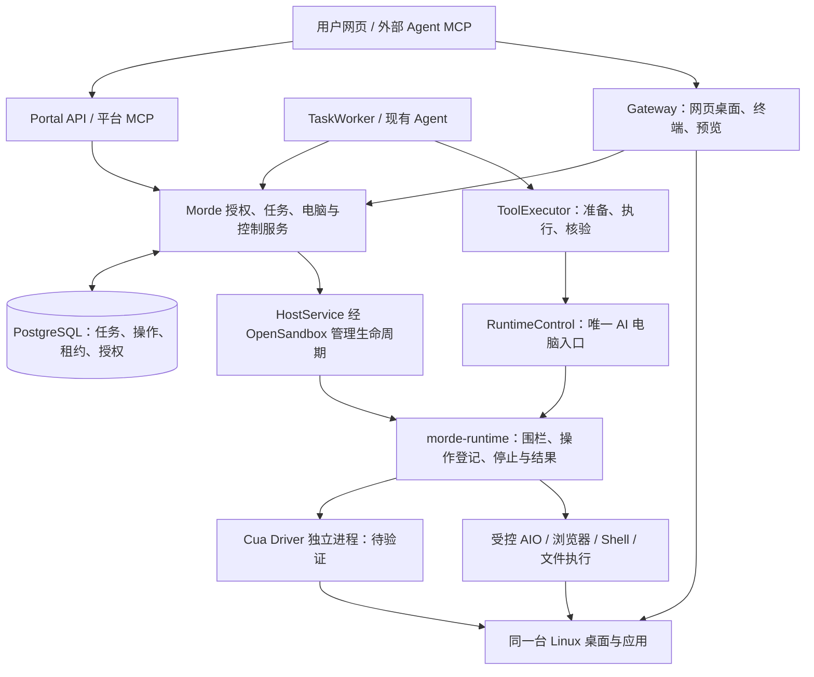

# 基于 Cua 优化 Morde 的设计方案

> 2026-10-21。目标：让 Agent 直接使用用户的长期云端电脑，可靠完成工作；用户可以快速开始、随时接管，并在下次回来时继续。
>
> 本文是已有 [云端电脑设计][base-design] 的增量设计，详细来源与复用决定见 [Cua 可复用模块与借鉴清单][catalog]。**设计建议不等于已实现或已验证。** 当前另一个会话正在开发 Morde，本次仅修改研究/设计文档；不改运行代码、公共合同、实施状态或共享环境，不外发文件。

> 后续执行见 [20 Cua 借鉴优化实施 TODO](/Users/zhongxuan_li/Desktop/morde/docs/实施/20-Cua借鉴优化实施任务todo清单文档.md)。按用户安排，先完成现有实施清单；本文的阶段描述用于说明能力依赖，后续增量范围与执行顺序以 T20 清单为准。

## 1. 设计决定与适用范围

### 1.1 总体决定

**保留 Morde 的产品、任务、权限和电脑生命周期；优先验证 Cua Driver 作为受控桌面组件；将 Cua 的动作证据、身份约束和快速开始方法融入同一条执行链。**

Morde 与 Cua 都能服务 Agent 云端电脑。Morde 要形成的价值是：用户容易把工作交出去，过程可理解，结果能核对，中断后可继续，接管时边界可靠，成果和环境可长期保存。是否超越由这些具体结果证明，不能由功能列表或代码规模证明。

| 决定 | 处理方式 |
|---|---|
| 保留 | Go 分层、PostgreSQL、HostService、TaskService、已有 Responses Agent/ToolExecutor、Portal/Workbench、Gateway、OpenSandbox 和已验证 AIO 能力。 |
| 优先增强 | 操作结果证据、观察新鲜度、运行端控制、恢复对账、首次真实体验、固定版本验证。 |
| 条件复用 | MIT Driver 经协议接入；JSON fixture 用于适配器测试；纯 TS 动画与 Python fixture 仅在相应场景需要时采用。 |
| 维持当前范围 | 首个环境是受支持的 Linux 电脑；多平台、多云调度、另一套 Agent 引擎、全套 Spaces/媒体栈不进入本阶段。 |

源码研究已确认 Morde 有任务持久化、模型连接和 Agent 核心，当前设计从现有实现继续。生产接线、可靠停止、恢复和完整用户流程仍以 T11–T13 的实际验收为准；本文不重新判定它们的完成状态。[Agent 工具边界][M12b]

### 1.2 合同归属

| 内容 | 唯一维护位置 |
|---|---|
| HTTP API | [server/openapi/portal.yaml][openapi] |
| 公共类型、状态、错误码、数据表和依赖 | [00 公共约定][common] |
| 运行端请求、围栏、operation 和 quiesce | [独立项目方案 §4.4.1][runtime-contract] 及 T12.02 产出的 schema |
| 实现顺序及文件负责人 | [08 实施总览][implementation] 及 T10–T19 |
| 对照验证 | [V01–V32][validation]，新证据进入对应记录，不重新编号 |

下文涉及结构化动作证据、观察引用或能力字段的内容，属于**待纳入上述合同的设计增量**，没有在本文直接生效。实施时在同一交付中更新权威合同、实现、调用方、生成物和相关测试；不得暗中把新字段塞进任意字符串，形成第二套协议。

## 2. 接入架构与信任边界

下图是目标调用关系，Driver 分支待验证后接入：

1. 平台管理用户、预算、任务和批准；运行端在真正观察/操作的位置执行围栏检查。两端检查各自负责的边界。
2. AI 的截图、DOM、GUI、Shell、文件全部经 RuntimeControl。管理探测仍可用现有 AIO typed client；不能把它作为 AI 的备用直连路径。
3. Driver 只负责被准许的电脑能力，不获得模型凭据、平台控制密钥或任务调度权。平台不开放它的独立公网端口。
4. Gateway 的人工输入服从同一个 ControlService；只读、撤权、旧连接和长连接持续校验在服务端落实。
5. 保持现有“平台仓库 + 独立运行项目”边界。Driver 的适配与进程管理在独立运行项目，不在 Portal Go 服务内加载 Rust/Node FFI。

## 3. 操作、证据与任务完成

### 3.1 分清三个不同问题（B01/B04/B17）

| 层次 | 回答的问题 | 设计规则 |
|---|---|---|
| operation | 这个有身份的调用是否被接收、执行并得到可对账的结果？ | 沿用冻结 operation 状态和幂等语义；响应丢失时查询原 operation_id。 |
| 动作证据 | 指定输入实际造成了什么变化？ | 保留 Driver 的 effect、目标、观察来源与拒绝原因；其他工具使用自己的明确证据。 |
| 任务核验 | 用户要求的成果是否已达成？ | 沿用 ToolExecutor.Verify，由受控观察或独立结果检查验证；模型的完成声明仅作为待核对主张。 |

Driver 的 `verify_state` 可以核对窗口/进程等有限谓词，不理解所有业务目标。某次点击 `confirmed`、浏览器进入页面、命令退出为零，都不足以证明一份报告正确或一次表单提交成功。

| Driver/运行结果 | Morde 应怎样处理 |
|---|---|
| `confirmed` | 保存该动作证据，继续检查任务所需结果；不直接结束任务。 |
| `partial` | 记录已确认的部分并重新观察；只在能识别剩余部分且授权允许时继续，不能整段重放。 |
| `unverifiable` | 表示效果无法核验。若调用本身已完成，保留已知执行结果和未知效果，不一律改成 operation unknown。对外副作用是否发生仍需业务对账。 |
| `suspected_noop` | 重新观察、核对目标或采用被支持的替代方式；不可无限点击。 |
| `refused` | 保留拒绝原因；按原因修复授权/前台状态/目标引用。不得自动扩大权限或绕过拒绝。 |
| 断线、超时、运行端重启后无可信结果 | operation 保持不确定并按原 ID 查询/对账；不以新 ID 重发，更不自动换 Driver/AIO 重做。 |

**拟增加的证据内容**限于调用方真正需要的部分：效果分类、稳定原因码、实际执行路线、目标引用、观察引用、受限 readback/产物引用。控制密钥、密码、整页敏感正文和无限截图序列不进入普通任务日志。现有 `AgentToolResult.Output` 是有界字符串；增加机器可读证据须同步 Go 类型、运行 schema、存储与 API，并明确大小、留存和兼容规则。

### 3.2 观察与动作必须针对同一对象（B02/B03/B18）

观察引用的语义至少包含当前 Host、runtime generation/instance、control version、会话身份、窗口/页面身份及观察序号；图像操作还需知道画面范围、坐标空间、缩放和 Driver 原生 capture/token。具体编码由冻结合同的增量定义，不另造一个未经签发验证的客户端 JSON 凭证。

- 页面导航、窗口重建、运行端重启、控制权变化或坐标映射失效后，旧引用必须拒绝；短 TTL 只是补充，不能代替版本/对象检查。
- Driver 有自己的 token/capture 生命周期，运行端只能在原生约束上增加限制，不能取消原生 stale 校验。
- 屏幕与浏览器内容属于不可信任务数据。页面提示“调用某工具”或 Driver 的 next_call 建议不授予权限；由 Agent 经正常准备、授权与预算检查决定下一步。
- GUI、DOM、可访问性及视觉区域各有适用范围，实际能力不足时明确说明；禁止把不支持自动转换成未经校准的裸坐标输入。

### 3.3 能力发现（B03/B17）

可向 Agent 提供的工具是：**运行端实际能力 ∩ Morde 已实现适配 ∩ 当前调用者权限 ∩ 当前控制状态**。能力发现本身不构成后续执行授权，每次操作仍重新校验。

固定记录运行协议版本、镜像 digest、Driver 版本及采用的上游合同版本；不要把本地 `0.38.0` Driver 和 `0.8.0` portable contract 混作同一版本。未实现能力不注册给 Agent；权限或环境暂时变化则返回现有合同中的稳定错误。`capability_unavailable` 到公共 `unsupported` 的映射沿用冻结规则。

## 4. Cua Driver 最小接入设计

### 4.1 选择与范围

优先验证 **固定版本 Driver + MCP 协议 + 运行端内部单个适配器**。先接观察、列窗口/激活、必要输入和有限效果核验，使用当前真实场景需要的工具；Shell/文件仍由既定受管执行器承担。增加工具时逐个补授权、停止和证据，不把上游 tools/list 全量转发。

| Morde 现有能力/职责 | 首批上游候选 | 接入约束 |
|---|---|---|
| `window.list` | `list_windows`，按需要辅助 `list_apps` | 保留原生窗口身份并绑定 Morde 观察上下文；不能只传易复用的数字窗口 ID。 |
| `desktop.observe` | `get_window_state` / `get_desktop_state` | 按任务实际范围选择窗口或桌面，限制图像大小，保留原生 token/capture 关系。 |
| `desktop.input` | `click`、`type_text`、`press_key`、`hotkey`；需要时再增加 `drag/scroll` | 逐工具校验 target、前台/后台 delivery 支持及坐标；输入不共用一个无约束的 JSON 透传口。 |
| `window.activate` | 以固定产物的实际工具 schema 和平台支持确认 | portable manifest 不是完整平台能力表；没有验证到匹配行为时不宣称 Driver 已实现该能力。 |
| Task 的独立 Verify | 必要时将 `verify_state` 作为受控观察的一个步骤 | 不新增一个可绕过运行围栏的验证入口；业务成果仍由独立检查决定。 |
| `browser.observe/actions`、`shell.exec`、`file.*` | 先沿用运行端已验证的对应执行器 | Browser 将来采用 Driver 语义工具时单独验证页面身份和权限；本次不推定它们已是直接替换关系。 |

这些是适配选择，Morde 对外工具名和 scope 继续按原合同。候选名称来源于 [Driver 合同][driver-contract]；正式实现还需保存固定运行产物的实际 `tools/list` 并逐项核验参数与结果。

优先研究 stdio 以减少对外监听，但在选定版本实测前不把它当作已确认的隔离方案。必须确认 CLI 到 daemon 的实际链路、进程归属、桌面身份和会话作用域；如果多个调用会落入不可隔离的共享 daemon，该方案不能进入正式接管链路。仅关闭管道或杀死 CLI 不代表桌面动作已停止。

| 运行端职责 | 必须做到 |
|---|---|
| 启动与恢复 | 固定产物，受管身份启动，运行端先 blocked；握手与真实能力检查通过后才接任务。 |
| 会话 | 保持观察/动作所需的长连接与 session；重连后丢弃旧 native token，并对原 operation 先对账。 |
| 授权 | 可信平台签发的 Host/task/lease/control/instance/operation 信息在执行端校验；不给普通任务访问控制凭据或本地管理 socket 的能力。 |
| 输出 | 结构校验、大小限制和脱敏；发送给 Agent 前再次检查当前控制权，拒绝晚到的私密画面或文件结果。 |
| 停止 | 覆盖已派发输入、排队动作、Driver 关联子进程和全部受管后台活动；无法证明已排空时不给 human 授权。 |
| 故障 | operation registry 持续可用且跨运行代次保留；Driver 崩溃不抹掉已接收/已启动的操作记录。 |

### 4.2 防止同机旁路

Agent 若能任意执行 Shell，同时能访问同一用户的 X11、CDP、Driver socket 或控制服务，就可能绕开网关围栏。单个应用层 `if` 无法解决这个问题。T12 必须落实执行身份、目录/socket 权限和受管进程域，使普通任务不能停止/修改管理服务、读取密钥或启动不可追踪的输入进程。

采用 cgroup、独立进程域或其他隔离机制前，验证它们在固定 runsc 环境中的实际支持。一次 kill/process-group 结束、操作超时、stdio EOF 都不能单独充当 `drained` 证据。该限制同样适用于当前 AIO 路线。

沿用原合同对 AI 自动化进程和可安全保留的应用/预览服务的区分：人工接管应能继续使用电脑。保留的服务须已明确用途、隔离权限且不会继续执行 Agent 指令；无法确认归属时不能先报接管完成。

### 4.3 接入与回退门槛

1. **产物**：V01/V02，能确认源码、构建产物、依赖、架构、许可和摘要。
2. **行为**：V03/V04，普通用户身份下窗口、中文输入、浏览器、缩放、stale 与拒绝码符合约定。
3. **控制**：V08/V10，私密接管、撤权、全部读写和晚到输出可控。
4. **收益**：V32，同一工作负载的正确率、人工干预、总耗时和每成功任务成本有可重复改善，或补齐了必需能力。

任一关键门槛未过，记录结果并继续当前已验证路径的开发。**回退是经对账后的部署选择，不是在未知动作中偷偷换通道重试。** 切换前停止新任务、排空/对账在途操作、处理未决副作用、重建能力缓存并使旧观察失效。无需预先建设通用插件市场或多 provider 调度框架。

## 5. 长任务、重试与恢复（B05/B06/B07/B16）

### 5.1 继续现有任务执行链

TaskWorker 使用现有持久任务、租约和预算；Agent 经 ToolExecutor 执行并独立核验。浏览器只是提交与观察入口，关闭后任务继续依赖实际服务端装配和持续在线运行环境。

以下沿用冻结协议：操作先持久 accepted，再持久 running，然后产生副作用；相同 operation_id 与参数哈希返回原结果，内容变化则冲突。重启后 running 不自动再执行，能证明尚未开始副作用的 accepted 才可继续。registry 不健康/连续性不明时阻断，不能把查询失败解释为不存在。

### 5.2 检查点保存能对账的事实

对批量工作，在 T11 的既有检查点设计里记录：输入版本/摘要、稳定项目标识、已核验结果、关联 operation/外部回执、未决项及下一步。不要只保存一段“已完成 80%”的自然语言。检查点也不应保存未受控的进程/数据库/模型对象。

以 100 个合成条目为例：已核验条目跳过；未开始条目继续；在途或未知条目先查对应结果。输入变了先提示差异并按现有任务规则处理，不将旧检查点直接套到新文件。

| 发生位置 | 恢复行为 |
|---|---|
| 接收之前 | 健康且连续的 registry 证明未接收，才按冻结规则使用相同 ID 重试。 |
| 接收后、尚未产生副作用 | 只有持久阶段可证明未执行，才继续。 |
| 已执行但响应丢失 | 查原操作和外部结果，不能新建 ID 重发。 |
| 外部服务无幂等键且无法查询 | 标为待核对，保留证据与人工处理入口；不承诺任意 GUI 动作 exactly-once。 |
| 任务失租、预算停止或控制权变化 | 禁止继续派发，按现有停止/排空流程推进；重新授权并观察后才恢复。 |

Shell 输出使用游标、上限、截断提示与退出记录；进程句柄不替代 operation_id。旧 Worker 即使还活着也不能通过新租约/实例围栏继续操作。

### 5.3 计划和通知复用同一任务链

T14 使用用户可见的 IANA 时区、计划+预定触发点去重，以及明确的错过/不重叠策略；按已有 T14 决策实现一种可解释的默认行为。通知持久化，网页断线后可继续查看；无变化轮询不产生重复通知。全部停止需同时覆盖任务、计划和后台动作。Cua routines 可借鉴注入时钟和分开测试触发计算的方法，不复制它的本地 JSON 存储和隐式时区。

## 6. 用户接管、批准与隐私（B08/B09/B14）

### 6.1 人工接管按服务端事实展示

1. 用户请求接管，ControlService 原子推进控制版本并阻止新的 AI 读写；界面显示“正在接管”。
2. 运行端拒绝旧围栏，停止/排空队列、输入、受管进程、观察和后台活动；Gateway 撤销旧连接，释放遗留按键和鼠标状态。
3. 按冻结合同取得绑定 Host/generation/instance/blocked version/目标 human version/taskset 的排空回执，原子消费并再次确认排空后，才展示“由你控制”。
4. 无法排空时保持未完成状态，显示具体原因和已定义的处理动作；不能把前端开关或超时当作接管成功。
5. 用户明确交回，按 returning/ai 的既有协议切换；新控制版本下重新观察。Cua 的窗口级短租约不用于自动回收 Morde 的人工控制。

接管期间 AI 的截图、DOM、Shell、文件读写均受阻；晚到结果也须门禁。已经发生的外部提交、Agent 已经读过的信息不能被接管撤销，UI 对未决结果需要单独说明。

### 6.2 批准和登录

首版优先让用户在私密接管期间完成登录，再交回电脑。批准必须由可信界面提交，绑定请求身份、对象、内容摘要、影响、控制版本和有效期；不能用页面内文本或模型生成的批准作为依据。

后续确需 Keyvault 类功能时再定义凭据请求、用户批准、最小注入和掩码回执。模型无需获得明文密码；登录态属于电脑的受保护用户资料，不进入共享模板、普通任务日志或公开预览。

### 6.3 证据与历史保存

复用现有任务事件、产物和审计，按数据类型明确保留及删除范围。普通列表显示步骤、原因与受限结果；完整截图/内容仅在任务需要、权限允许时保存。历史读取不等于当前电脑控制权，权限撤销后重新校验；不照搬 Cua 的实验 History 库或其固定容量/天数作为 Morde 的默认产品合同。

## 7. 稳定电脑、软件与交付（B06/B10/B12/B19）

| 对象 | 设计要求 | 用户应看见什么 |
|---|---|---|
| 长期电脑 | Host 身份稳定，计算容器可停止/重建；沿用 HostService，不另建 provider 生命周期。 | “准备中、可用、已停止、恢复失败”等实际状态及下一步。 |
| 用户数据 | 工作目录、一个浏览器 profile 和已声明应用资料进入独立持久范围；单写、权限和一致性先验收。 | 明确保留了什么、保存点时间、哪些应用需重新登录。 |
| 软件 | 固定镜像和受支持安装方式，记录架构、来源与摘要；普通 Agent 不取得永久 root。 | 可用软件和可恢复范围，不承诺任意软件无损迁移。 |
| 预览 | 绑定实际代码/改动标识、启动进程、端口和状态，经 Gateway 鉴权。 | 当前修改是否真正运行；旧服务不能冒充新结果。 |
| 模板/副本 | 从干净内容构建，固定镜像和输入版本；副本有独立卷与权限，计划默认停用，凭据不自动复制。 | 任务成果、复现条件和可独立继续工作的入口。 |
| 备份/迁移 | 数据库、持久卷和必要配置范围一致；密钥按同等级保护；暂停恢复与单端写入。 | 恢复报告、失败范围和明确回退条件。 |

Driver 升级按具体镜像/版本发布，不自动跟随 latest。升级期间先对账和停止在途任务；旧二进制可回退不代表新数据格式可安全降级，需要对应的数据恢复验证。跨节点连接方式未来按 T18 决定；当前不引入 Cua 全套 mesh、relay 或媒体栈。

## 8. 第一次使用：先完成真实工作（B13/B15）

### 8.1 普通用户路径

默认入口仍是“助理、任务、电脑、连接”四项。模型已由管理员配置且对该用户授权时，用户不必理解容器、镜像、MCP、租约或 Driver。

**进入网页 → 选一个示例/输入目标 → 后台准备电脑 → 查看真实进度 → 打开成果 → 按需接管或继续。**

建议三个示例都使用内置合成资料，不要求额外网站账号：

| 示例 | 真实执行 | 独立验收 |
|---|---|---|
| 整理资料并生成报告 | 读取示例目录、分类、保存文件与索引。 | 输入清单与输出目录匹配；报告能下载/打开且可追溯。 |
| 在浏览器完成一个流程 | 操作本地测试网页、填写并提交合成数据。 | 测试服务记录值和提交次数；不只看成功提示。 |
| 修改一个小页面并预览 | 修改示例项目、启动当前代码、检查页面效果。 | 预览版本/进程与当前改动一致，旧页面不得通过。 |

首次使用只要求选择一个示例，不让用户先填一张环境参数表。示例数据有独立命名和清理范围，不触碰用户已有文件；成果仍保存在该电脑的工作区。

### 8.2 等待和失败要能继续

- 准备过程按真实阶段展示：排队、创建、启动检查、模型/工具准备、执行；没有可计算进度时不显示虚假百分比。
- 模型未就绪时说明缺的是管理员授权、连接配置、图片/工具能力还是额度，不要求用户反复复制 Key。连接变更后重新探测，不假设所有模型都可看图操作。
- 失败保留用户目标、已有电脑和可复用结果；“重试”先对账，避免重复创建电脑或外部提交。说明影响范围，让用户知道任务能否继续。
- “停止”与“正在停止”、“接管”与“正在接管”对应服务端真实状态；高频控制放在桌面和任务页固定位置。
- 首个结果能直接查看文件、报告或实际预览；不要要求用户读工具 JSON 才知道任务结果。
- 键盘操作、缩放、中文输入、断线重连和无鼠标场景纳入桌面验收。Agent 动画仅在 B20 有实际帮助时增加。

### 8.3 管理员与外部 Agent

管理员快速开始沿 T16 提供一条受支持部署路径，集中检查 Linux/架构、runsc、卷权限、运行密钥、服务连通和授权模型能力。错误指向具体修复步骤；配置成功后普通用户直接复用授权连接。

Codex Desktop 是首个外部 MCP 联调客户端：提供一份实际可用配置、连接检查、限权 Key 和可复制示例；明确“直接工具调用依赖外部 Agent 循环”与“委派完整任务由 Morde 后台执行”的区别。网页和 MCP 共用 TaskService，不造另一个任务入口。

### 8.4 易用性验收口径

沿用 V26–V31：管理员干净环境部署与普通用户首次体验分别计时。普通用户指标包括到达第一个可核验结果的时间、必要选择/输入次数、失败续接成功率、需要人工解释次数；冷启动和准备好电脑两组分开。先采集基线，再设有依据的目标，不把“几秒/几分钟上手”写成未经验证的承诺。V31 的 5 名真人试用者不能用 AI 浏览器操作替代。

## 9. 实施影响范围与衔接

本表是改动归属建议，路径未存在的模块由所属 T 任务按现有结构创建；不替代其文件锁定/唯一负责人规则。本轮没有修改这些代码。

| 优化 | 实际调用方与代码范围 | 同步内容与验证 |
|---|---|---|
| 动作证据/观察引用 | `server/internal/app/agent_tools.go`、Agent、生产 ToolExecutor、运行端适配器 | 若改变合同，同步运行 schema、00、任务操作存储/迁移、OpenAPI、两端生成类型和展示；V04/V12/V16。 |
| Driver 接入 | 独立运行项目的镜像、适配器、进程管理与测试；平台只经 RuntimeControl | 固定依赖/许可/摘要、支持能力与实例握手、停止和拒绝样例；V01–V04/V08/V10。 |
| 恢复与进程输出 | 既有 `app/agent*`、`worker/task*`、任务事务/事件和运行 operation registry | 持久操作、检查点、幂等参数与游标、断点前后崩溃测试；V12–V17。 |
| 接管与权限 | T12 的 ControlService、HostService/HostRuntime、Gateway、运行身份/输入控制 | 原 API/WS/终端/noVNC/MCP 调用路径统一改造；撤权、旧连接、晚到输出与整机排空；V08–V10/V18。 |
| 最短体验 | `web/portal`、`web/workbench` 已有页面/组件，T13 的 MCP/模型设置 | OpenAPI 生成类型、默认模型授权、真实示例、引导文案和用户指南同步；V26–V31。 |
| 计划、存储与交付 | T14–T18 各自已有任务边界 | 触发点去重、恢复范围、预览版本、备份/副本/迁移；V19–V24。 |

现有 `app/runtime.go` 负责 Host 上游地址解析等职责，名称相近不意味着它已经实现本设计的 RuntimeControl。实现时按当前端口与分层找到真实入口，禁止凭文件名追加一套平行控制服务。

共享合同、生成类型、迁移编号和 `cmd/portal` 装配由现有集成人统一更新；新适配不先于可用依赖把 TaskWorker 接到生产并开始认领任务。文档中的候选不能改变已冻结的 required scope 或暂停/接管语义。

## 10. 分阶段采用与结束条件

| 顺序 | 采用项 | 依赖与结束条件 |
|---|---|---|
| 1，当前主线 | B01/B02/B03/B08/B17，加 B13 的首个示例 | 接到现有 T11–T13；统一证据、围栏与最短体验。运行层未通过时页面可实现，但不得记为完整交付。 |
| 2，Driver 小范围判定 | R01/R02，必要时 R04 | 隔离运行产物可用后走 §4 的四个门槛。结论可以是采用、限制采用或不采用；不阻塞不依赖 Driver 的 Morde 工作。 |
| 3，M1 可靠工作 | B04/B05/B06/B15/B19 | 完成既有 T11/T12 生产接线和恢复，T13.07 全链路；V08/V10/V13–V17 有真实证据。 |
| 4，P0 连续使用 | B09 的私密登录、B10/B14/B16、B13 完整体验 | T14–T16；任务定时、持续资料、预览、备份、部署和真人试用通过。 |
| 5，团队与扩展 | T17/T18；按需 B07/B12/B18/B20 | 先证明固定成果可交付及副本隔离，再根据真实应用/节点需求扩展；手机仍按 T19 最后处理。 |

测试规模围绕实际承诺：固定一套 Linux/runsc/镜像和普通用户身份，先把少量应用证明充分。仅在影响对应行为时扩展矩阵，不为测试数量复制整个上游体系。

## 11. 用什么证明优化有效

| 要证明的价值 | 本地验收场景 | 不能替代它的证据 |
|---|---|---|
| Agent 能可靠持续工作 | 合成 100 项任务在不同检查点中断 Worker/运行端后恢复，核对无遗漏与重复；未知外部提交转待核对。 | 只有数据库单测、模型说完成、一次正常演示。 |
| 用户能放心接管 | 输入/读取/后台进程/旧连接并发存在时接管，服务端确认后 AI 无新读写，交回后重新观察。 | UI 显示只读、一个请求被取消、单 PID 被杀。 |
| 第一个结果来得容易 | 新用户在已部署环境选一个真实示例，无额外账号，看到可核验成果；配置/冷启动时间单独计。 | mock 成果、帮助文档齐全、开发者自己很快点完。 |
| 电脑和成果可长期保留 | 停止/重建后文件与声明 profile 恢复；修改后预览绑定当前版本；备份恢复可核对。 | 卷存在、页面返回 200、运行着旧服务。 |
| Driver 值得增加依赖 | 相同输入、模型/预算和基础环境对照当前执行路线，记录正确率、拒绝率、人工介入、延迟、全部重试及成本。 | 跨模型/镜像混比、只统计成功尝试、免费额度。 |

产品端到端比较与执行层比较分别记录；与 Cua 比较时固定双方版本/能力范围，无法做到同环境的部分明确标注，结论限定在受测场景。所有产物留在本地。

当前仍待证明：Driver 在目标 Linux/runsc 上的兼容与受管停止、完整接管、真实模型流程、独立云端连续性和真人易用性。V25 需要用户在独立目标环境准备本地副本；本机 VM 上关闭页面不能证明本机关机后云端仍执行。本方案不改变这些验证状态。

[M12b]: /Users/zhongxuan_li/Desktop/morde/server/internal/app/agent_tools.go:101
[base-design]: /Users/zhongxuan_li/Desktop/morde/docs/AI与用户共用云端主机设计方案.md
[catalog]: /Users/zhongxuan_li/Desktop/morde/docs/Cua可复用模块与借鉴清单.md
[common]: /Users/zhongxuan_li/Desktop/morde/docs/实施/00-总览与公共约定.md
[driver-contract]: /Users/zhongxuan_li/Desktop/morde/server/project/cua/libs/cua-driver/contract/README.md
[implementation]: /Users/zhongxuan_li/Desktop/morde/docs/实施/08-云端电脑实施总览.md
[openapi]: /Users/zhongxuan_li/Desktop/morde/server/openapi/portal.yaml
[runtime-contract]: /Users/zhongxuan_li/Desktop/morde/docs/开源依赖二开与独立项目方案.md
[validation]: /Users/zhongxuan_li/Desktop/morde/docs/实施/Morde与Cua对照验证任务清单.md
